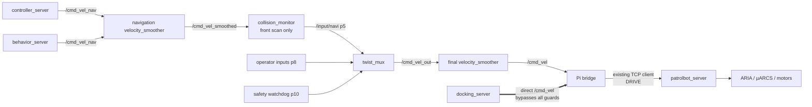
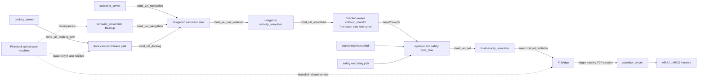
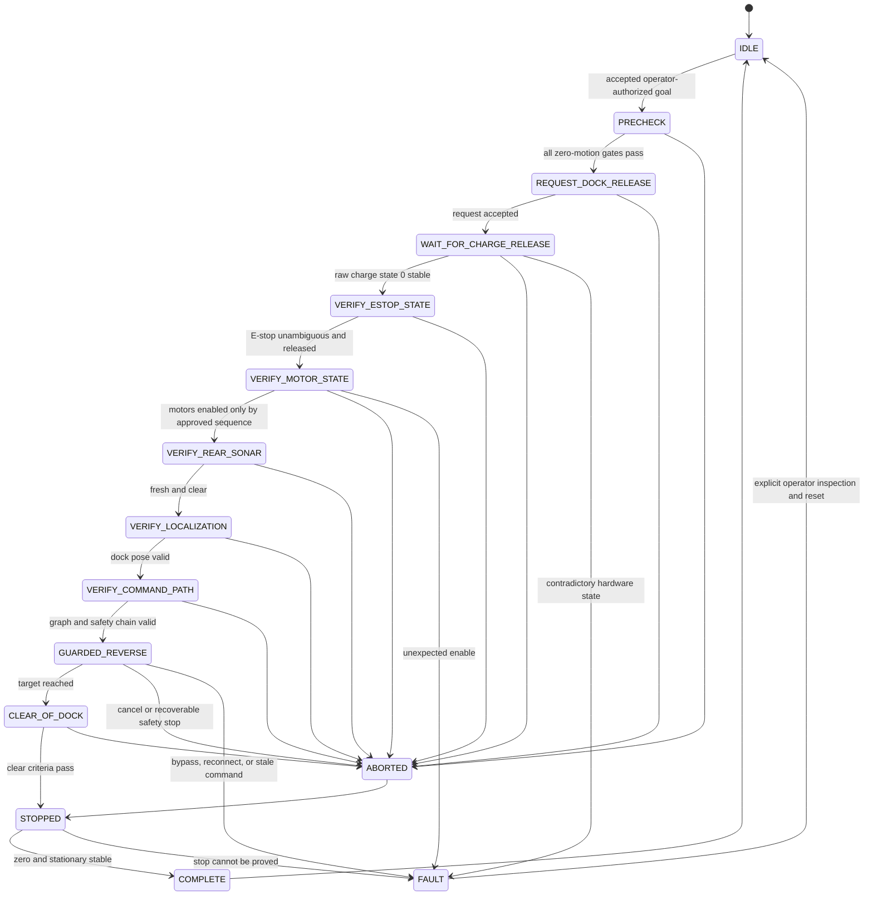
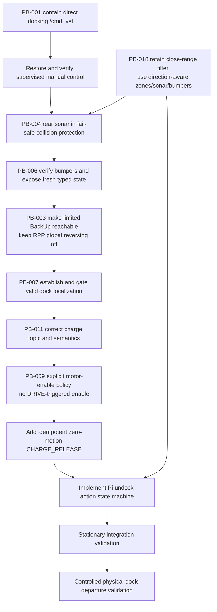

# PB-AUDIT-001 and PB-AUDIT-002 Remediation Plan

**Plan status:** Implementation-ready design and verified backups only. No production source, configuration, ROS parameter, process, service, container, lifecycle state, µARCS setting, network state, or robot state was changed. No command was sent to TCP port 7272, µARCS, a velocity topic, or a motion action. The robot was not moved.

**Baseline:** 2026-07-16, backup ID `20260716T161104Z-pb001-pb002`.

## 1. Executive summary

PB-AUDIT-001 is confirmed at runtime. The lifecycle-active Jazzy `docking_server` and the legitimate final velocity smoother both publish `geometry_msgs/Twist` directly to `/cmd_vel`; the bridge subscribes there. The docking publisher bypasses the navigation velocity smoother, Nav2 Collision Monitor, `twist_mux`, safety-watchdog priority, and final velocity smoother. Although the docking controller's own costmap projection is enabled, that is not the PatrolBot safety chain and has neither the rear-sonar source nor the independent watchdog/mux override. The immediate containment recommendation is therefore to remove the docking server from both composed and non-composed launch paths and from the lifecycle list. It is unused, has no dock database, has an invalid charging-state interface, and must remain disabled until the complete guarded dock workflow is ready.

PB-AUDIT-002 is not a parameter defect. It is an interlock, sensing, localization, protocol, command-path, recovery, and physical-validation problem. Closure requires, in order: contain PB-AUDIT-001; restore a supervised manual-control path; integrate rear sonar and verify bumpers; make a deliberately limited BackUp path reachable without enabling global RPP reversing; establish and validate the dock pose; correct both the topic and semantics of docking charge state; add a zero-motion, idempotent µARCS `CHARGE 0` operation; remove implicit motor enable; implement a cancelable Raspberry Pi undock state machine; then perform staged stationary and physical tests.

The eventual safe velocity path will be:

`controller_server`/`behavior_server` or a gated docking producer → upstream navigation-command arbitration → navigation velocity smoother → direction-aware collision monitor using front scan and rear sonar → existing operator/safety twist mux → final velocity smoother → the sole `/cmd_vel` publisher → bridge → the already-established single TCP client → `patrolbot_server` → ARIA → µARCS → motors.

The SBC will only execute hardware-level release. `patrolbot_server` will receive an idempotent `CHARGE_RELEASE` request and call `ArRobot::comInt(ArCommands::CHARGE, 0)` without commanding motion or enabling motors. It will acknowledge only after raw µARCS charge state is stably zero, or return a bounded structured error. A Raspberry Pi action server will own the complete state machine and invoke Nav2's BackUp behavior for guarded reverse. Missing or stale sonar, invalid bumper state, ambiguous E-stop state, invalid localization, a stale bridge, or unexpected motor enable will prevent or abort movement.

Both host-local backup sets and off-robot workstation copies were created and checksum-verified. They include deployed source, installed copies, configuration, binaries, units, logs, container provenance, endpoint/parameter snapshots, metadata, and checksums. No secret value is reproduced in this plan.

## 2. Sources reviewed

The following local sources were read in full or inspected at the relevant implementation points:

- `PATROLBOT_RPI5_AUDIT.md`, the canonical audit and authority for finding IDs, severity, evidence, dependencies, safety constraints, and deferred tests.
- `AUDIT-2026-07-16.md`, used only as superseded context and an evidence cross-check.
- `misc/manual_docs/Copy of Research_PatrolBot_3rd_gen_User_Guide_RevA (2).pdf`, especially pp. 26–29, 32, 60–66, 74–75, and Appendix B.
- `misc/manual_docs/Copy of PatrolBot-PTLB-RevA.pdf`.
- `AGENTS.md`, `SKILLS/SSH.md`, `SKILLS/rpi-architecture.md`, and `SKILLS/sbc-architecture.md`.
- The deployed and repository copies of navigation launch/configuration, command mux, both smoothers, Collision Monitor, localization, custom behavior trees, bridge, watchdog, joystick teleop, Docker Compose, entrypoints, and health checks.
- The live and backed-up SBC source `/home/ros/patrolbot_hw_server/patrolbot_server.cpp`, binary, Makefile, unit/drop-in, socat/static-Ethernet units/scripts, and `/usr/local/Aria/params/patrolbot-sh.p`.
- Official ROS 2 and Nav2 Jazzy documentation listed in section 24. Installed Jazzy interfaces, parameters, examples, and headers were also inspected to resolve version-sensitive behavior.

Manual facts controlling this design are:

- Charging permits operation other than driving. `CHARGE 1` halts motion, disables motors, and deploys the dock electromagnet; `CHARGE 0` gracefully cancels charging.
- Raw charge states are 0 not charging, 1 bulk, 2 overcharge, and 3 float.
- A physical red E-stop removes motor power. After both red buttons are released, physical PWR ON is required to restore motor power.
- A fresh OPEN session has motors disabled and expects an explicit enable.
- The rear sonar is intended for obstacle sensing while backing.
- Original docking was a slow forward approach, front-bumper contact, stop, then `CHARGE 1`.
- Firmware BumpStall is direction-aware, but actual PatrolBot bumper mapping/configuration remains physically unverified.

## 3. Canonical-audit findings extracted

| Finding | Severity / confidence | Confirmed condition | Effect on PB-AUDIT-002 | Required disposition |
|---|---|---|---|---|
| PB-AUDIT-001 | Critical / High | `docking_server` directly publishes `/cmd_vel` and is lifecycle-active | Any use of docking/undocking can bypass arbitration and safety | Contain first; safely re-plumb only with the complete workflow |
| PB-AUDIT-002 | High / High, with E-stop attribution Medium | Dock release and safe departure do not exist; several independent blockers are present | Primary issue | Close only after all dependencies and physical tests pass |
| PB-AUDIT-003 | High / High | RPP reversing is disabled; custom BackUp BT files are not loaded | No controlled autonomous reverse is reachable | Keep RPP reversing off; make a tested BackUp path reachable after rear protection |
| PB-AUDIT-004 | High / High | `/sonar` is fresh at about 5 Hz but has zero subscribers | Reverse would be blind | Add fail-safe rear collision source and optional marking-only costmap source |
| PB-AUDIT-007 | High / High | AMCL always initializes at map `(0,0,0)`; live pose is wrong and stale | Dock-relative departure cannot be trusted | Add conditional dock-pose initialization and a localization health gate |
| PB-AUDIT-009 | Medium / High | Server enables motors at startup and when any nonzero DRIVE arrives | A stray/stale command can implicitly re-enable after an inhibit | Remove command-triggered enable; require a separate controlled enable policy |
| PB-AUDIT-011 | Medium / High | Docking subscribes `/battery_state`; bridge publishes `/battery` | Charging/undocking confirmation cannot work | Correct topic and semantics; remapping alone is not sufficient |
| PB-AUDIT-018 | Medium / High | Bridge maps scan returns below 0.25 m to infinity | The near dock face disappears; flank points can still trigger the current box | Retain for now; do not depend on near-field laser for reverse; use sonar/bumpers |

PB-AUDIT-006 (bumper behavior) and PB-AUDIT-015 (missing joystick receiver) are included only where they materially gate the required physical tests. Autonomous reverse cannot be accepted until front/rear bumper mapping and stop behavior are verified, and no physical test may start without a supervised manual-control path.

The canonical order is corrected in two respects by current revalidation:

1. PB-AUDIT-011 cannot be solved by topic remapping alone because Jazzy `SimpleChargingDock` tests `BatteryState.current`, which is `0.0` on PatrolBot; a PatrolBot-specific charge-state implementation is required.
2. The dormant custom recovery trees must not simply be enabled as written. They attempt `Spin` before `BackUp`, use 0.30 m at 0.15 m/s, and do not by themselves create rear protection. Rear sensing must land first, and dock exit must use its own reverse-before-spin sequence and stricter limits.

## 4. Current live-state revalidation

All observations were read-only. A short-lived DDS discovery query initially under-counted one publisher; repeated verbose inspection after discovery stabilized and matched the canonical audit. The verified baseline is:

| Check | Revalidated result |
|---|---|
| Pi identity | `patrolbot-rpi5`, Ethernet `10.0.0.2/24`, management alias `robot-pi2` |
| SBC identity | `patrolbot1`, Ethernet `10.0.0.1/24`, management alias `robot-sbc` |
| Hardware server | `patrolbot_server`, PID 1289 at snapshot, listening on TCP 7272 |
| Existing single client | Established `10.0.0.2:49444 → 10.0.0.1:7272`; owned by the existing bridge/server processes |
| Pi containers | `patrolbot-bridge`, `patrolbot-navigation`, and `patrolbot-bringup` healthy |
| SBC services | `patrolbot-server.service`, `socat-boot.service`, and `patrolbot-wired-ip.service` active |
| Sensor freshness | `/scan`, `/odom`, and `/sonar` stamps advanced during observation |
| Motion | `/odom.twist` linear and angular values were zero; no nonzero `/cmd_vel` sample observed; robot stationary |
| Dock state | `/battery` approximately 29.7 V, status CHARGING; raw charge state above zero in AUX telemetry |
| E-stop/motors | Diagnostics reported `estop_pressed=True`, `motors_enabled=False`; physical-button versus dock-inhibit attribution remains unknown |
| Localization | `/amcl_pose` at `(0,0,0)` with an old stamp and effectively zero covariance, inconsistent with the physical dock location |
| Lifecycle | All 12 listed Nav2 lifecycle nodes active, including `docking_server` |

The availability gate was repeated after both backups and again after writing this plan. At final handoff, both hosts and all named services/containers remained up, the same `10.0.0.2:49444 ↔ 10.0.0.1:7272` session remained established and owned by server PID 1289, `/scan` and `/sonar` produced fresh stamps, and `/odom.twist` remained exactly zero in every linear/angular component. No second connection to port 7272 was opened.

### Live endpoint contract

| Topic | Type | Publisher(s) | Subscriber(s) | Assessment |
|---|---|---|---|---|
| `/cmd_vel` | `geometry_msgs/Twist` | `teleop_velocity_smoother`, `docking_server` | `patrolbot_bridge` | Unsafe duplicate; PB-AUDIT-001 |
| `/cmd_vel_nav` | `geometry_msgs/Twist` | `controller_server`; four behavior-server publisher endpoints | navigation `velocity_smoother` | Normal Nav2 producer group |
| `/cmd_vel_smoothed` | `geometry_msgs/Twist` | navigation `velocity_smoother` | `collision_monitor` | Normal |
| `/input/navi` | `geometry_msgs/Twist` | `collision_monitor` | `cmd_vel_mux` | Normal |
| `/input/safety_controller` | `geometry_msgs/Twist` | `patrolbot_safety_watchdog` | `cmd_vel_mux` | Priority 10, 0.2 s timeout |
| `/input/joy` | `geometry_msgs/Twist` | joystick teleop node | `cmd_vel_mux` | Priority 8; receiver/data absent |
| `/input/teleop` | `geometry_msgs/Twist` | none | `cmd_vel_mux` | Reserved, priority 8 |
| `/input/switch` | `geometry_msgs/Twist` | none | `cmd_vel_mux` | Reserved, priority 6 |
| `/cmd_vel_out` | `geometry_msgs/Twist` | `cmd_vel_mux` | `teleop_velocity_smoother` | Normal |
| `/battery` | `sensor_msgs/BatteryState` | `patrolbot_bridge` | none | Charging encoded in status; `current=0.0` |
| `/battery_state` | `sensor_msgs/BatteryState` | none | `docking_server` | Topic and semantic mismatch |
| `/sonar` | `sensor_msgs/PointCloud2` | `patrolbot_bridge`, BEST_EFFORT sensor QoS | none | Safety-relevant orphan |

Runtime mux order is safety 10, joy/teleop 8, switch 6, navigation 5. Both velocity smoothers, Collision Monitor, mux, bridge, controller, behaviors, and docking server currently use unstamped `Twist`, consistent with Jazzy's `enable_stamped_cmd_vel=false` setting. The controller and behavior server are remapped to `/cmd_vel_nav`; the docking server is not remapped in either the composed or non-composed launch branch.

The active Collision Monitor consumes `/cmd_vel_smoothed`, publishes `/input/navi`, uses `/scan` only, has a direction-independent ±0.3 m stop box with `min_points=8`, and a 2 s source timeout. The docking controller's `use_collision_detection=true` projects the footprint against the local costmap, but this does not provide PatrolBot's Collision Monitor, rear-sonar freshness, safety-watchdog priority, or final smoothing.

The current BT navigator loads stock Nav2 XML under `/opt/ros/jazzy`, not either repository custom tree. RPP has `use_rotate_to_heading=true` and `allow_reversing=false`, which is the correct global combination for this design.

Alternate-path review found:

- Both composition variants in `patrolbot_navigation_launch.py` can recreate the docking bypass.
- Dormant `rosaria2.xml` and `rosaria2-lidar.xml` launch files contain direct hardware/velocity paths. They are not in the active image path but must be explicitly deprecated or guarded so they cannot silently reintroduce a second bridge.
- Keyboard and joystick teleop enter muxed operator inputs; they intentionally bypass Nav2 Collision Monitor and remain operator-responsibility paths.
- `smoother_lifecycle.xml`, `patrolbot_navigation/scripts/twist_mux.yaml`, and commented launch includes are dormant/alternate configuration that must be included in static path checks.
- No other active node directly commands the bridge.

## 5. Existing command and docking architecture

### Current unsafe path



### Proposed safe path



The outer mux retains safety 10 > manual 8 > switch 6 > navigation 5. The new upstream navigation mux uses docking 7 > controller/behavior 5, 0.2 s input timeouts, and an explicit dock-manager lease gate. A docking command can never outrank the independent safety or manual path because it enters the outer mux only as navigation. The lease gate defaults closed, publishes no stale command, expires at 0.25 s, and opens only for one state-machine goal. Controller/navigation actions must be canceled and confirmed inactive before a dock lease is issued. The initial PatrolBot undock implementation will use the existing behavior-server BackUp output, not the docking producer; the docking path is retained in the design for later supervised docking.

### Proposed undock state machine



## 6. Backup locations and verification

### Locations

| Set | Host-local location | Off-robot workstation copy | Contents |
|---|---|---|---|
| Raspberry Pi 5 | `/home/ubuntu/patrolbot-backups/20260716T161104Z-pb001-pb002/` | `backups/20260716T161104Z-pb001-pb002/pi5/` | Deployed source/config, installed container copies, Docker files including protected `.env`, provenance, ROS snapshots, logs, status, metadata |
| Legacy SBC | `/home/ros/patrolbot-backups/20260716T161104Z-pb001-pb002/` | `backups/20260716T161104Z-pb001-pb002/sbc/` | Server source/binary/build files, systemd unit/drop-in, socat/static-IP files, ARIA params, processes, sockets, logs, metadata |

The off-robot copies are on the engineering workstation and are ignored by Git. They are independent of both robot hosts. A second institutional artifact-store copy is still recommended before implementation, but lack of that extra copy does not affect the verified robot-to-workstation backup completed here.

### Verification

- Pi manifest: `backups/20260716T161104Z-pb001-pb002/pi5/BACKUP_MANIFEST.md` (186 checksummed regular files; symlinks recorded separately).
- SBC manifest: `backups/20260716T161104Z-pb001-pb002/sbc/BACKUP_MANIFEST.md` (39 checksummed regular files; symlinks recorded separately).
- Host-local `sha256sum -c SHA256SUMS`: all Pi entries OK and all SBC entries OK.
- Off-robot `sha256sum -c SHA256SUMS`: all Pi entries OK and all SBC entries OK. Results are preserved as `SHA256SUMS.verify-offhost.txt`; host results are `SHA256SUMS.verify.txt`.
- Pi set size is approximately 22 MiB; SBC set approximately 476 KiB.
- Manifests record source path, backup path, byte size, owner, mode, timestamp, and SHA-256 or symlink target.
- Root-owned SBC files were copied by the unprivileged `ros` account. Their original ownership is recorded; modes, timestamps, and links were preserved, but a restore must explicitly restore root ownership.
- The deployed `.env` is backed up but was never displayed. It must remain access-controlled and must not be pasted into tickets or logs.

### Restore procedure

Restore is a future maintenance-window operation, never an in-place live audit action:

1. Stop and obtain operator authorization; verify the chosen backup first with `sha256sum -c SHA256SUMS`.
2. Record a new pre-restore snapshot. Never overwrite the 20260716 backup.
3. Restore only the files belonging to the failed stage with `cp -a`; do not restore the entire tree blindly. For root-owned SBC files use authorized `sudo cp -a` and the manifest's owner/mode.
4. Rebuild the Pi image from the restored source, or select the recorded previous image ID/tag and restored Compose environment. Do not edit an installed container copy.
5. For an SBC binary rollback, restore both `patrolbot_server` and its matching source/Makefile. Verify the binary SHA-256 `13f2d881752552b2bff1033a42222f452ea5492bdd3bb8e5e0db926dfb9fd317` before deployment.
6. Restart only the component explicitly authorized for that maintenance stage. Confirm zero velocity before, during, and after; then re-run the endpoint/socket/sensor gates.
7. If the rollback concerns release behavior, the robot may remain released. Do not automatically re-dock or send `CHARGE 1`; follow the manual supervised docking procedure.

## 7. PB-AUDIT-001 options analysis

### Option A — immediate containment by disabling the docking server

**Flow:** controller/behavior → existing complete safety path; no docking producer or dock/undock actions.

**Files:** `ros2_ws/src/patrolbot_navigation/launch/patrolbot_navigation_launch.py` in both composed and non-composed blocks and its `lifecycle_nodes` list; add launch tests. No parameter change is required for containment.

**Behavior:** remove the `docking_server` node/ComposableNode and remove `docking_server` from lifecycle management. The `/dock_robot` and `/undock_robot` actions must disappear. Static tests must instantiate both `use_composition:=true` and `false`. Dormant/alternate launch files must be explicitly marked unsupported with a safe default or covered by a test that prevents a direct `/cmd_vel` publisher.

**Impact:** no currently used feature is lost. The server has no dock database, no caller, a broken charge interface, and no implemented PatrolBot release operation. Navigation and manual mux paths are unaffected.

**Failure modes:** deleting only one launch branch; leaving the lifecycle name; accidentally enabling an upstream stock Nav2 docking include; treating disappearance of actions as a failure rather than the intended containment.

**Complexity:** low. **Jazzy compatibility:** direct; no API dependency. **Downtime:** one navigation-container replacement/restart in a scheduled future window, approximately 1–3 minutes plus health convergence.

**Proof:** `/cmd_vel` has exactly one publisher, `teleop_velocity_smoother`; `/dock_robot` and `/undock_robot` are absent; all remaining lifecycle nodes are active; navigation path remains healthy.

**Rollback:** restore the backed-up launch file or revert the containment commit, rebuild/redeploy the recorded prior image, restart only navigation, and confirm the previous two-publisher graph. Rollback restores the known unsafe baseline and therefore must not be used to resume autonomy.

### Option B — upstream navigation-command mux, common safety chain

**Flow:** controller/behavior and gated docking inputs → `navigation_command_mux` → navigation smoother → direction-aware Collision Monitor → existing outer mux → final smoother → sole `/cmd_vel`.

**Topics:** `/cmd_vel_navigation`, `/cmd_vel_docking_raw`, `/cmd_vel_docking`, `/cmd_vel_nav_selected`, `/cmd_vel_smoothed`, `/input/navi`, `/cmd_vel_out`, `/cmd_vel`.

**Arbitration:** docking input priority 7, controller/behavior priority 5, both with 0.2 s timeouts. Docking input exists only while an expiring state-machine lease is active. The outer mux remains safety 10, operator 8, switch 6, navigation 5. Any safety/watchdog command overrides all docking motion; operator deadman motion overrides navigation for supervised recovery.

**Publishers/subscribers:** docking publishes only raw docking topic; lease gate is its sole subscriber and publishes only gated docking; upstream mux selects one navigation producer; no upstream producer publishes `/cmd_vel`. The final smoother is the only `/cmd_vel` publisher and the bridge the only subscriber.

**Collision behavior:** all automatic motion, including docking and BackUp, crosses the same scan/sonar direction-aware Collision Monitor. Jazzy docking costmap projection remains defense in depth but is not credited as the safety boundary.

**Failure modes:** a stuck lease, incorrect priority, simultaneous controller/dock actions, upstream mux output bypass, stale command after lease expiry, launch variant omission. Prevent with a monotonic lease timeout, cancel-and-confirm before lease, zero-on-expiry, graph assertions, and replay tests.

**Complexity:** medium. **Jazzy compatibility:** `twist_mux` and unstamped Twist are already deployed; no global stamped-message migration is required. **Rollback:** disable docking again, restore backed-up launch/mux/params, rebuild/redeploy, and verify Option A's graph.

**Assessment:** recommended eventual architecture, but not the immediate production containment.

### Option C — share one pre-smoother topic without arbitration

**Flow:** controller, behavior, and docking all publish the same pre-smoother topic; action ownership is expected to prevent overlap.

**Advantages:** smallest topic/config delta and all commands cross the downstream safety chain.

**Failure modes:** multiple producers are indistinguishable; a stale or externally invoked docking action can interleave with navigation; there is no explicit priority/timeout/lease; endpoint count cannot prove exclusivity. This is especially weak on the current open DDS network.

**Complexity:** low, but safety assurance is inadequate. **Recommendation:** reject.

### Option D — dedicated docking smoother and Collision Monitor, then outer mux

**Flow:** docking → docking smoother → docking Collision Monitor → outer mux; navigation retains its existing separate chain.

**Advantages:** independent tuning and clear producer identity.

**Failure modes:** duplicated collision policy can drift; rear-source timeouts and geometry can differ; two separate automatic paths need tests; docking still relies on the outer mux and final smoother; lifecycle/startup becomes more complex.

**Complexity:** high. **Jazzy compatibility:** feasible. **Recommendation:** reject unless future docking needs demonstrably incompatible collision geometry that cannot be expressed with the common velocity polygons.

### Option E — direct docking input to the existing outer mux

This is the canonical audit's smallest illustrative remap, but it still bypasses the navigation smoother and Collision Monitor. It does not meet this remediation's safety requirement and is rejected even if its priority is below the watchdog.

### Complete option comparison

| Option | Data-flow diagram | Exact files/topics and endpoints | Arbitration, priorities, timeouts | Watchdog and collision behavior | Main failure modes | Jazzy compatibility / complexity / rollback |
|---|---|---|---|---|---|---|
| A — disable | `controller/behavior → nav smoother → Collision Monitor → outer mux → final smoother → /cmd_vel`; docking has no node/output | `patrolbot_navigation_launch.py` both branches + lifecycle list; `/dock_robot`, `/undock_robot`, and docking `/cmd_vel` endpoint disappear; all other topics remain as live baseline | Existing outer mux unchanged: safety 10, manual 8, switch 6, nav 5; existing timeouts unchanged | Watchdog and Collision Monitor retain current navigation authority; no docking command exists | Omitted launch branch, stock include, stale lifecycle entry | Native Jazzy launch change / low / restore launch+prior image, but autonomy stays off until re-contained |
| B — common upstream mux | `controller/behavior → nav input ┐`; `docking → lease gate → dock input ├→ upstream mux → nav smoother → Collision Monitor → outer mux → final smoother → /cmd_vel` | Launch, new `navigation_command_mux.yaml`, gate/manager, `nav2_params.yaml`; exact topics `/cmd_vel_navigation`, `/cmd_vel_docking_raw`, `/cmd_vel_docking`, `/cmd_vel_nav_selected`; mux is sole downstream producer and nav smoother sole subscriber | Upstream docking 7 > nav 5, each 0.2 s; lease 0.25 s; outer safety 10 > manual 8 > nav 5 | Every automatic command crosses common scan/sonar monitor; outer watchdog always overrides | Lease sticks, action overlap, mux/remap omission, stale input | Native Jazzy Twist/mux / medium / disable docking and restore Stage-0 topology |
| C — shared pre-smoother topic | `controller + behavior + docking → /cmd_vel_navigation → nav smoother → Collision Monitor → outer mux → final smoother → /cmd_vel` | Launch remaps only plus params; three producer identities share `/cmd_vel_navigation`; nav smoother is subscriber | No arbitration, priority, producer timeout, or lease before smoother; only downstream outer nav priority 5 | Watchdog/Collision Monitor are downstream and effective once a command is selected, but simultaneous values can interleave before them | Concurrent/stale publishers, externally invoked dock action, unprovable ownership | Message-compatible Jazzy / low code but unacceptable assurance / restore launch and disable docking |
| D — dedicated docking chain | `docking → docking smoother → docking Collision Monitor → outer mux`; `navigation → nav smoother → nav Collision Monitor → outer mux`; `outer mux → final smoother → /cmd_vel` | Launch, second smoother/Collision Monitor params, mux docking input; topics `/cmd_vel_docking_raw`, `/cmd_vel_docking_smoothed`, `/input/docking`; two monitor/smoother endpoint sets | Outer docking proposed 7, nav 5, manual 8, safety 10; docking input timeout 0.2 s; no upstream lease unless separately added | Watchdog overrides both, but duplicated collision/sonar policies and lifecycle can drift | One monitor omits sonar/timeout, inconsistent limits, doubled startup/test surface | Supported Jazzy / high / remove dedicated chain/input, restore params, disable docking |
| E — direct outer mux | `docking → /input/docking → outer mux → final smoother → /cmd_vel` | Docking launch remap and `mux.yaml`; docking publishes `/input/docking`, outer mux subscribes | Docking 6–7, timeout 0.2–0.5 s, below manual 8/safety 10 and above nav 5 | Watchdog can override, but docking bypasses navigation smoother and Collision Monitor entirely | Unmonitored rear obstacle, abrupt command, false belief that mux alone is sufficient | Message-compatible Jazzy / low / remove mux input/remap; rejected design |

## 8. PB-AUDIT-001 recommended solution

Implement Option A as Stage 0. Do not re-plumb the active server immediately. Its disappearance is the containment success condition.

Build Option B offline during Stages 1–3 and re-enable docking only after all of these gates pass:

- Rear sonar and bumper validity are fail-safe inputs.
- Localization and command-path health are explicit gates.
- The PatrolBot charging-state plugin/interface works without falsifying `BatteryState.current`.
- The zero-motion release operation and Pi action state machine pass unit/stationary tests.
- The joystick/manual-control path is operational.
- Runtime graph tests show one final `/cmd_vel` publisher in both launch variants.
- A skilled operator approves the physical test window.

Exact future launch changes:

1. Stage 0: remove docking from both node lists and lifecycle nodes.
2. Stage 3: remap controller and behavior `cmd_vel` to `/cmd_vel_navigation`; remap docking `cmd_vel` to `/cmd_vel_docking_raw`; launch the lease gate and upstream mux; route mux output to the existing navigation smoother.
3. Keep Collision Monitor output `/input/navi`, outer mux output `/cmd_vel_out`, and final smoother output `/cmd_vel`.
4. Enforce with launch tests and a runtime readiness gate that `/cmd_vel` publisher count is exactly one and its node identity is `teleop_velocity_smoother`.
5. Fail readiness if any producer other than the final smoother publishes `/cmd_vel`, if the bridge subscribes to an alternate command topic, or if a dormant launch starts a second bridge.

PB-AUDIT-011 is paired with eventual re-enable, not Stage 0. Use a PatrolBot-specific `ChargingDock` plugin or equivalent adapter that consumes fresh raw charge state (`0` versus `1..3`) and standard `/battery` status. Do not configure `SimpleChargingDock` with a negative threshold and do not write a fake charging current. If the custom plugin retains a BatteryState subscription, explicitly remap `battery_state` to `/battery`; its `isCharging()`/`hasStoppedCharging()` must use `power_supply_status` plus raw charge-state freshness. Stationary tests must prove both charging and released transitions before any docking action is enabled.

## 9. PB-AUDIT-002 root-cause dependency graph



This confirms the requested order with two refinements: bumper validity and motor-enable discipline are explicit preconditions; the battery interface must be semantically corrected, not merely remapped. The BackUp capability is made reachable only after sonar protection. Dock release is implemented only after localization, sensing, command-path, and motor-state prerequisites exist, and is first tested with zero movement.

PB-AUDIT-002 may close only when every node in this graph through controlled physical validation is complete. PB-AUDIT-001 can close at Stage 0 containment; re-enabling docking is a separate acceptance decision.

## 10. PB-AUDIT-002 proposed state machine

The action server runs on the Raspberry Pi as `patrolbot_dock_manager`. It accepts one goal at a time, rejects a second goal, publishes state/telemetry feedback at 10 Hz, evaluates safety inputs at 20 Hz during motion, uses steady-clock deadlines, and writes one correlation ID to Pi/SBC logs. Cancellation is accepted in every nonterminal state. Every cancel or failure first revokes command leases, cancels BackUp, and produces/holds zero through the normal chain; it never automatically re-docks.

| State | Entry conditions | Actions and telemetry | Timeout | Success transition | Failure/abort, motors, movement, recovery |
|---|---|---|---:|---|---|
| `IDLE` | No active goal; prior state terminal and acknowledged | Publish ready/not-ready reasons; retain no command lease; observe raw charge, motors, E-stop, link, sensors, pose | None | Authorized goal → `PRECHECK` | Motors preferably disabled; movement prohibited; bad background health rejects goals without changing hardware |
| `PRECHECK` | Goal includes operator authorization and limits within hard caps | Confirm both hosts/bridge fresh, one hardware session, robot stationary, charge state fresh/nonzero, no navigation/docking goals, exactly one final `/cmd_vel` producer, watchdog/mux/Collision Monitor active, scan/odom/sonar/base state fresh, rear clear, bumper state valid, physical E-stop-button status confirmed, dock pose configured | 5 s | All gates stable for 1 s → `REQUEST_DOCK_RELEASE` | Any failure → `ABORTED`; motors remain disabled; no movement; log each failed gate |
| `REQUEST_DOCK_RELEASE` | PRECHECK passed; zero velocity stable | Send one `ChargeRelease` service request with UUID; never retry with a new ID; record raw pre-state | 1 s to accept | Accepted/pending → `WAIT_FOR_CHARGE_RELEASE` | Reject/unavailable/cancel → `ABORTED`; no motors/motion; service may finish in background and its result is drained/logged |
| `WAIT_FOR_CHARGE_RELEASE` | SBC accepted same UUID | Observe structured result, raw charge state, battery status, E-stop and motor state; maintain zero | 6 s (SBC operation 5 s + transport margin) | Charge state `0` for three consecutive AUX samples and matching SBC OK → `VERIFY_ESTOP_STATE` | Timeout, contradictory state, disconnect, or motors enabling → `FAULT`; ordinary rejection → `ABORTED`; no motion |
| `VERIFY_ESTOP_STATE` | Charge release acknowledged | Require fresh E-stop state; operator confirms both red buttons physically released; distinguish charge-related flag deassertion from physical latch | 3 s | Unambiguously not pressed → `VERIFY_MOTOR_STATE` | True/unknown → `ABORTED` with `PHYSICAL_ESTOP_OR_INHIBIT`; never clear in software; motors off; no motion |
| `VERIFY_MOTOR_STATE` | E-stop clear, release stable | Require motors initially remain disabled. Follow the approved policy: operator presses physical PWR ON if required; an optional future explicit enable request is a separate reviewed step, never a DRIVE side effect | 10 s operator window | Motors enabled only after recorded authorized event and zero velocity remains stable → `VERIFY_REAR_SONAR` | Early/unexpected enable → `FAULT`; no transition/ambiguous source → `ABORTED`; no movement |
| `VERIFY_REAR_SONAR` | Motors enabled deliberately but command lease absent | Require `/sonar` age ≤0.5 s, compatible QoS, collision source current, rear zone clear, sensor geometry plausible, and base/bumper state age ≤0.25 s | 3 s | Stable clear/valid for 1 s → `VERIFY_LOCALIZATION` | Stale, empty transport, implausible geometry, obstacle, or bumper invalid/pressed → `ABORTED`; explicit zero; motors may remain enabled under operator control, no movement |
| `VERIFY_LOCALIZATION` | Sensor gates pass | Require `map→odom→base_link`, AMCL pose age ≤0.5 s, covariance thresholds, configured dock-pose agreement, and scan-map/dock consistency; no blind assumption that charging implies dock identity | 15 s | Health stable 2 s → `VERIFY_COMMAND_PATH` | Invalid/nonconverged → `ABORTED`; operator may provide an initial pose and start a new goal; no movement |
| `VERIFY_COMMAND_PATH` | Valid pose and sensors | Re-check graph contract, lifecycle active, no unrelated goals/publishers, outer mux priorities, collision source freshness, final smoother, bridge session generation, watchdog readiness; cancel any navigation goal and confirm inactive | 3 s | All checks stable 1 s → `GUARDED_REVERSE` | Any mismatch → `ABORTED`; more than one `/cmd_vel` producer or reconnect → `FAULT`; no movement |
| `GUARDED_REVERSE` | All gates pass immediately before action; rear clear | Invoke `nav2_msgs/action/BackUp` through behavior server with `target.x=-distance`, `speed=limit`, `time_allowance`; initial test 0.10 m at 0.05 m/s; hard system caps 0.70 m and 0.10 m/s, angular command exactly zero. Monitor sonar, bumpers, E-stop, motors, localization, bridge generation, Collision Monitor state, odom, action feedback at ≥20 Hz | Goal-derived, hard max 10 s | Target reached while all gates remain true → `CLEAR_OF_DOCK` | Cancel, timeout, stale sensor/link, obstacle, bumper, pose invalid, motor off, or collision → cancel BackUp and `ABORTED`; bypass/reconnect/stale nonzero → `FAULT`; motors enabled; reverse only |
| `CLEAR_OF_DOCK` | BackUp succeeded | Command lease remains closed except behavior completion; require final zero, odom speed <0.01 m/s, charge state remains 0, dock-pose displacement meets goal, front dock wall no longer conflicts with forward zone, rear data remains fresh; no Spin | 3 s | Stable stopped/clear for 1 s → `STOPPED` | Criteria not met → `ABORTED`; any motion after completion → `FAULT`; motors enabled, new movement prohibited |
| `STOPPED` | Normal completion, cancel, or recoverable abort | Cancel all owned goals; revoke leases; issue zero only through owned automatic input until downstream zero observed; wait for server watchdog window; record final pose/states | 2 s | Zero at every observed stage and odom stationary → `COMPLETE` for success or `ABORTED` terminal result | Cannot prove stop → `FAULT`; motors may be explicitly disabled per policy; movement prohibited |
| `COMPLETE` | Clear and stopped; no outstanding service/action | Return result with distance, duration, charge/motor transitions, pose delta; hand off to navigation only on a separate mission authorization | Immediate | Result acknowledged → `IDLE` | No automatic motion; disable motors if no mission is authorized |
| `ABORTED` | Recoverable rejection, cancel, or safety gate | Hold/revoke motion, report exact reason and whether charging is engaged/released; require operator inspection before retry | Until stop proven | Through `STOPPED`, then terminal abort and `IDLE` only after acknowledgement | Never auto-redock, auto-enable, or resume old action; movement prohibited |
| `FAULT` | Contradictory hardware state, unexpected motor enable, command bypass, link reconnect during motion, stale velocity, or inability to prove stop | Revoke leases/cancel, request zero through safety input, let SBC watchdog stop, latch autonomy inhibit, alert operator with correlation ID | Latched | Explicit operator inspection/reset only; then new `IDLE` readiness evaluation | Do not attempt automatic recovery, release, enable, reconnect test, or motion; hardware E-stop/manual recovery takes precedence |

Hard motion caps are configuration limits, not operator-overridable action fields. The initial physical test uses 0.05 m/s and 0.10 m. Only after log review may the validated dock-clear distance be increased, never above 0.70 m or speed above 0.10 m/s without a new safety review. No state permits Spin while the front of the robot is within the dock-wall envelope.

## 11. SBC protocol-extension plan

### Selected command

Use `CHARGE_RELEASE:<request_uuid>` rather than `UNDOCK_PREP`: the name states exactly what the SBC does and does not imply movement.

Protocol responses are newline-delimited and correlated:

- `ACK:CHARGE_RELEASE:<uuid>:PENDING`
- `RESULT:CHARGE_RELEASE:<uuid>:OK:charge_state=0:motors_enabled=0:estop=<0|1>`
- `RESULT:CHARGE_RELEASE:<uuid>:ERROR:<code>:charge_state=<n>:motors_enabled=<0|1>:estop=<0|1>`

The exact parser should use a bounded line buffer and explicit token parsing rather than the current one-shot `sscanf`. Maximum line length, allowed UUID characters, and numeric ranges must be constant and tested. Unknown, malformed, fragmented, coalesced, duplicated, and overlong lines are rejected without altering robot state.

### Server behavior

1. Accept the command only from the already-connected Pi session. Never open or require a second port/client.
2. Preconditions: current commanded linear/angular velocity are zero; server watchdog is healthy; raw charge state is known; no release operation is pending; no server fault state; request ID is syntactically valid. A physical E-stop may remain asserted, but it is reported rather than cleared.
3. If raw charge state is already 0, return idempotent OK without sending another µARCS command.
4. Otherwise call `robot.comInt(ArCommands::CHARGE, 0)` exactly once for the request ID.
5. Poll cached ARIA charge state on a steady-clock deadline. Require state 0 in three consecutive hardware/AUX cycles. Do not infer release from voltage or elapsed time.
6. Return OK only after stable state 0. Include current motors/E-stop state in the result. Never call `setVel`, `setRotVel`, `move`, `enableMotors`, or an E-stop reset as part of release.
7. Timeout after 5 s with `CHARGE_STATE_TIMEOUT`; retain the latest observed state. Do not automatically retry.
8. Duplicate UUID while pending returns PENDING; after completion it replays the cached final result without resending `CHARGE 0`. A different UUID while pending returns BUSY.
9. Log UUID, pre-state, one command issuance, state samples, result, and steady-clock duration. Do not log credentials or raw unrelated traffic.
10. On client disconnect, set/hold zero as today, preserve the cached result only for a bounded diagnostic window, and require a fresh Pi session. Never resume an incomplete motion or issue release on reconnect.

### Motor-enable correction

PB-AUDIT-009 must be corrected in the same hardware-interface workstream before physical undocking:

- Remove startup `enableMotors()` unless a separately approved operating policy explicitly retains it; the preferred policy is motors disabled on connection.
- Remove the block that calls `enableMotors()` when a nonzero DRIVE arrives.
- A nonzero DRIVE received while motors are disabled is rejected and logged; it never changes enable state.
- Initially require physical PWR ON after release if that is what controlled validation shows. If software enable is later approved, add a separate idempotent `MOTOR_ENABLE:<uuid>` command and Pi service with zero-velocity, E-stop-clear, operator-authorized preconditions. It is never part of `CHARGE_RELEASE`.
- Continue the 750 ms DRIVE watchdog, explicit zero on disconnect, and zero before accepting a new session. Add tests proving an old or queued nonzero velocity is never applied after reconnect or enable.

### Protocol build/deployment

Implement parsing and state transitions in testable C++ units separated from ARIA calls. Build a new binary beside, not over, the active binary; run offline tests on the SBC-compatible toolchain or a matching container; record `file`, `ldd`, and SHA-256. Future deployment uses an atomic rename in a scheduled idle/docked window, followed by one authorized user-service restart. Rollback restores the exact backed-up binary/source and restarts the same unit. No systemd, socat, serial, ARIA parameter, or network change is expected.

## 12. Raspberry Pi ROS interface plan

### Selected split

- **Hardware operation:** `patrolbot_interfaces/srv/ChargeRelease`, served by the existing bridge or a tightly coupled hardware-interface node using the existing TCP session.
- **Complete operation:** `patrolbot_interfaces/action/Undock`, served by `patrolbot_dock_manager` on the Pi.
- **Motion:** Nav2 `BackUp` action, owned/canceled by the dock manager and routed through the full automatic safety chain.

This split is preferable to a service for the full undock because the operation is long-running, needs progress feedback, cancellation, and a terminal result. It is preferable to putting reverse on the SBC because the Pi retains localization, sensor, arbitration, collision, timeout, and abort authority. It is preferable to using the current `UndockRobot` action directly because PatrolBot needs hardware release and explicit safety states that the generic plugin does not currently implement.

### Interface fields

`ChargeRelease.srv` request: UUID and operator-authorization/correlation token internal to the Pi. Response: accepted/final status, error enum/message, raw charge state, motors enabled, E-stop state, and duration. Its call is bounded to 6 s. The bridge TCP reader remains nonblocking; a pending-response table/condition is used so service handling cannot delay odometry, scan, AUX, or DRIVE watchdog processing. A multithreaded/reentrant executor or separate interface node is required and tested for starvation.

`Undock.action` goal: dock ID, requested reverse distance/speed constrained by hard caps, operator authorization, and whether this is validation mode. Result: success, final state/error enum, actual distance/duration, initial/final raw charge/motor/E-stop states, final pose, and whether manual recovery is required. Feedback: state enum/name, elapsed/remaining timeout, sensor ages, rear-clear status, localization health, charge/motor/E-stop states, bridge session generation, and BackUp distance traveled.

Add a typed `patrolbot_interfaces/msg/BaseState` rather than scraping diagnostic strings. It contains stamp, bridge session generation, raw charge state, motors enabled, E-stop, front/rear bumper bits with a validity flag, fault/stall flags, and data age. The bridge publishes it whenever a fresh AUX packet is parsed. Diagnostics remain for humans.

### Charge-state correction

The bridge's `/battery` should remain a standards-oriented `BatteryState`: voltage, percentage unknown when unavailable, and power-supply status based on raw charge state. Because no measured charging current is available, leave current unknown/zero according to the chosen message convention and do not invent a value.

For eventual Nav2 docking, implement `PatrolBotChargingDock`, a small plugin derived from the official charging-dock interface. It subscribes to fresh `BaseState` plus `/battery`, treats raw states 1–3 as charging and 0 as stopped charging, rejects stale/unknown state, and implements `disableCharging()` by calling the bounded Pi release service. If it uses the conventional battery topic name, explicitly remap `battery_state` to `/battery`. This fixes both PB-AUDIT-011's endpoint mismatch and the newly confirmed semantic mismatch.

## 13. Rear-sensing and collision-protection plan

### Collision Monitor

Add `/sonar` as a Jazzy PointCloud2 observation source with sensor-data/BEST_EFFORT-compatible QoS, `min_height=-0.1`, `max_height=0.5`, `min_range=0.0`, and `source_timeout=0.5`. The 5 Hz source normally produces a sample every 0.2 s; 0.5 s tolerates one missed cycle but stops automatic motion after approximately 2–3 missing samples. Keep scan timeout at 0.5 s or tighter after measurement. Never set either timeout to zero.

Replace the direction-independent box with velocity-selected stop geometry. Use two `velocity_polygon` entries so the front scan retains its validated point threshold and sparse sonar can stop on one point:

- `front_velocity_stop`, `min_points=8`: forward subpolygon covers the swept front stopping envelope; reverse subpolygon is behind the base, outside the front scanner's field; rotation/stopped subpolygon covers the full footprint-plus-margin.
- `rear_velocity_stop`, `min_points=1`: reverse subpolygon covers the swept rear stopping envelope; forward subpolygon is in front, outside the rear sonar field; rotation/stopped subpolygon covers the full footprint-plus-margin.

Jazzy velocity polygons select by signed linear velocity, including negative reverse. For `v_x < -0.01 m/s`, the rear geometry is active and a front dock-wall return is not in the travel-direction zone. For `v_x > 0.01 m/s`, front protection is active. For `|v_x| ≤ 0.01` with angular command above 0.01 rad/s, the full rotation envelope is active. This means the robot may reverse straight away from the wall, but may not spin into it. The undock action commands angular zero and never attempts Spin until clear.

Initial rear polygon geometry must be derived from the verified sensor mounts, measured bumper envelope, stopping distance at the 0.10 m/s hard cap, final-smoother deceleration, and 750 ms worst-case server watchdog. A conservative starting review envelope is rear x `[-0.55, -0.20]` m and y `[-0.30, 0.30]` m in `base_link`; it is not accepted until stationary RViz marker/hand-obstacle tests prove all four rear sonar fields cover it. The final numeric polygon is a Stage 1 review artifact and must be recorded with the measurements.

An empty but fresh sonar cloud means no echo in range, not stale data. Freshness is based on message arrival and bridge-session generation. A stale, absent, malformed, implausible, or session-old cloud stops Collision Monitor output and prevents the state machine from entering reverse.

### Costmap and bumpers

Optionally add sonar to the local costmap only after Collision Monitor behavior is proven: `marking=true`, `clearing=false`, BEST_EFFORT QoS, and an observation persistence chosen from bag replay. Do not add it to the global costmap initially. Sparse sonar must never raytrace-clear cells created by lidar. Costmap marking is defense in depth; direct Collision Monitor freshness is the motion gate.

Bumpers are the last-resort contact layer, not a substitute for sonar. Before motion, physically map every segment to typed front/rear state and verify firmware BumpStall in both directions. The Pi dock manager treats invalid, stale, or pressed rear bumper state as an abort. During reverse, any rear bumper transition cancels BackUp immediately and latches a fault requiring inspection. Front bumper state remains monitored; it may be pressed while docked depending on hardware geometry, so the exact accepted docked baseline must be established physically rather than ignored globally.

### Handling the front dock wall and PB-AUDIT-018

Do not clear the wall from the map, shrink the robot footprint, lower safety broadly, disable the front scan, or change `SCAN_RANGE_MIN` as an undock workaround. Keep the intentional below-0.25 m filter until a separate near-field design review. During straight reverse only, signed velocity selects the rear travel envelope; front wall points therefore do not stop motion because they are not in the commanded travel path. The front scan remains live and fresh, and any angular/forward command immediately selects full/front protection. Rear sonar plus bumpers cover the direction of travel and the lidar close-range blind ring.

## 14. Localization and recovery plan

### Localization options

| Option | Strength | Risk | Decision |
|---|---|---|---|
| Always initialize to known dock pose | Deterministic and simple when truly docked | Dangerous if started elsewhere or wrong dock selected | Use only conditionally with confirmed charge/dock identity and operator-configured pose |
| Restore saved AMCL pose | Helpful after clean restart without movement | Stale if robot moved/pushed or odometry reset | Secondary hint, never sufficient for automatic departure |
| Operator-provided initial pose | Explicit and works away from dock | Manual and error-prone | Required fallback/runbook |
| Dock-specific confirmation gate | Combines pose, charge, TF, covariance, and scan consistency | Requires a small health component and measured thresholds | Recommended authority for undock |

Change AMCL away from unconditional `(0,0,0)` reset. Store the measured robot pose at each dock in map coordinates under version control. On startup:

1. If raw charge state is fresh/nonzero, dock identity is known, both hosts/link are healthy, and the operator/system policy confirms the robot has not been moved, publish that dock's initial pose once.
2. Otherwise use a valid recent saved pose only as a candidate, or require an operator initial pose. Navigation and undock remain inhibited.
3. Set `always_reset_initial_pose=false` unless a supervised conditional initializer explicitly provides the pose. Do not encode map origin as a universal initial pose.

The dock localization gate requires a fresh map→odom→base transform and AMCL message age ≤0.5 s; position covariance diagonal no more than 0.25 m² and yaw covariance no more than 0.25 rad² as initial conservative bounds; pose within 0.15 m and 0.15 rad of the configured docked robot pose; and stable scan-map/dock consistency for 2 s. These are initial acceptance bounds and must be tightened from recorded docked baselines before autonomous operation.

### Recovery and reverse

Keep RPP `allow_reversing=false`; official Jazzy documentation makes it incompatible with the currently enabled rotate-to-heading mode and it would expand reverse behavior to ordinary paths.

After rear protection is in place, revise and test both custom recovery XMLs before wiring them into `bt_navigator`. BackUp must precede Spin when recovery starts near a forward obstruction, use conservative limits, and fail safely if the local costmap or rear source is stale. Do not reuse the current 0.30 m at 0.15 m/s settings for dock validation. Ordinary navigation recovery and dock exit remain separate policies:

- Ordinary recovery may use the reviewed custom BT only after sensor/bag/physical tests.
- Dock exit is the explicit Pi action state machine invoking BackUp with 0.05 m/s and 0.10 m for the first test, reverse before any rotation, then at most 0.10 m/s and the measured clear distance up to 0.70 m.

Cancellation, timeout, loss of localization, sonar/bumper invalidity, E-stop, motor-state change, bridge-session change, and Collision Monitor stop all cancel BackUp and lead through `STOPPED`. The bridge/server continue zero-before-reconnect behavior; unit tests must prove an old velocity cannot be replayed.

## 15. Files expected to change

Paths are proposed and may be split into packages during implementation review. Every row uses backup ID `20260716T161104Z-pb001-pb002`; new files have no prior file and roll back by removing the new package/file plus restoring launch/build metadata.

| Host | File | Purpose | Proposed change | Backup path | Restart required | Rollback |
|---|---|---|---|---|---|---|
| Pi | `ros2_ws/src/patrolbot_navigation/launch/patrolbot_navigation_launch.py` | Nav2 topology | Stage 0 remove docking in both branches/lifecycle; Stage 3 re-add only with safe remaps/gate | `pi5/files/home/ubuntu/patrolbot-repo/.../patrolbot_navigation_launch.py` | Navigation replacement | Restore file/revision and prior image; verify graph |
| Pi | `ros2_ws/src/patrolbot_navigation/launch/bringup.launch.py` | Navigation composition | Launch upstream mux/gate and dock manager only when accepted | Matching Pi `files/...` path | Navigation replacement | Restore and redeploy prior image |
| Pi | `ros2_ws/src/patrolbot_navigation/config/nav2_params.yaml` | AMCL, behaviors, collision, docking | Direction-aware scan/sonar zones, timeouts, dock pose gates, revised BT paths, docking plugin/charge interface | Matching Pi `files/...` path | Navigation replacement | Restore params and prior image |
| Pi | `ros2_ws/src/patrolbot_navigation/config/behavior_trees/*.xml` | Recovery policy | BackUp-before-Spin, reviewed limits and error ports; both pose variants | Matching Pi directory | Navigation replacement | Restore both XMLs |
| Pi | `ros2_ws/src/patrolbot_navigation/config/navigation_command_mux.yaml` (new) | Upstream automatic arbitration | Docking 7/navigation 5; 0.2 s timeouts; unstamped Twist | No prior file; parent tree backed up | Navigation replacement | Remove file/launch reference, return to containment |
| Pi | `ros2_ws/src/patrolbot-launch/param/defaults/mux.yaml` | Outer arbitration | Retain/explicitly assert safety 10, manual 8, switch 6, nav 5 | Matching Pi `files/...` path | Bringup replacement | Restore file/image |
| Pi | `ros2_ws/src/patrolbot-launch/param/defaults/smoother.yaml` | Final limiter | Validate real declared Jazzy parameters and conservative reverse limits | Matching Pi `files/...` path | Bringup replacement | Restore file/image |
| Pi | `ros2_ws/src/patrolbot-launch/launch/{bringup.xml,mobile_base.xml,smoother.xml}` | Outer path | Launch/readiness assertions; no alternate direct bridge | Matching Pi launch tree | Bringup replacement | Restore launch tree/image |
| Pi | `ros2_ws/src/patrolbot-launch/launch/{rosaria2.xml,rosaria2-lidar.xml,smoother_lifecycle.xml}` | Dormant paths | Mark unsupported/guarded and include in static bypass tests; do not deploy direct hardware paths | Matching Pi launch tree | Only if image deployed | Restore files; keep active path unchanged |
| Pi | `ros2_ws/src/patrolbot_bridge/patrolbot_bridge/bridge_node.py` | Existing TCP/ROS interface | Correlated release request/result, typed BaseState, session generation, nonblocking service, no stale velocity | Matching Pi `files/...` path | Bridge replacement | Restore bridge source and prior image |
| Pi | `ros2_ws/src/patrolbot_bridge/{package.xml,setup.py,setup.cfg}` | Interface dependencies/tests | Add generated interface/client and tests as needed | Matching Pi package tree | Bridge build/replacement | Restore metadata/image |
| Pi | `ros2_ws/src/patrolbot_bridge/patrolbot_bridge/safety_watchdog.py` | Independent hold | Include bridge/base-state/sonar/bumper readiness where appropriate without duplicating state machine | Matching Pi path | Bridge/bringup replacement | Restore source/image |
| Pi | `ros2_ws/src/patrolbot_interfaces/{msg/BaseState.msg,srv/ChargeRelease.srv,action/Undock.action,...}` (new) | Typed contract | Add message/service/action and error enums | No prior files | Rebuild dependent containers | Remove package and launch dependencies |
| Pi | `ros2_ws/src/patrolbot_dock_manager/*` (new) | Pi state machine | Implement state table, BackUp client, gates, logs, tests | No prior files | Navigation/manager replacement | Disable/remove manager; remain in Stage 0 containment |
| Pi | `ros2_ws/src/patrolbot_navigation/plugins/patrolbot_charging_dock.*` or separate plugin package (new) | Charge semantics | Use raw fresh µARCS charge state and release service; never fake battery current | No prior files | Navigation replacement | Remove plugin; keep docking disabled |
| Pi | `docker/Dockerfile` | Build new packages/plugin | Include interface/manager/plugin and tests | `pi5/files/home/ubuntu/patrolbot-repo/docker/Dockerfile` | Image rebuild | Restore Dockerfile and prior image ID |
| Pi | `docker/docker-compose.yml` and protected `.env` only if needed | Deployment provenance | Pin new immutable image/revision; no secret changes expected | Matching Pi `files/...`; `.env` protected | Targeted container replacements | Restore Compose/env and recorded image IDs |
| Pi | Package launch/unit tests and operational docs (new/updated) | Verification/runbook | Encode graph contract, state tests, operator procedures, rollback | Parent package trees backed up | None until deployment | Revert documentation/tests |
| SBC | `/home/ros/patrolbot_hw_server/patrolbot_server.cpp` | Hardware server | Bounded parser, idempotent `CHARGE_RELEASE`, stable raw-state acknowledgement, explicit motor policy | `sbc/files/home/ros/patrolbot_hw_server/patrolbot_server.cpp` | User service restart | Restore source and exact backed-up binary |
| SBC | `/home/ros/patrolbot_hw_server/Makefile` | Build/tests | Add parser/state-machine unit targets without changing runtime linkage | Matching SBC path | No restart for build; service for binary | Restore Makefile/source/binary |
| SBC | `/home/ros/patrolbot_hw_server/patrolbot_server` | Executed binary | Deploy tested build atomically | Exact backed-up binary, SHA above | `patrolbot-server.service` restart | Restore backed-up binary, restart unit |
| SBC | `/home/ros/.config/systemd/user/patrolbot-server.service` and drop-in | Runtime unit | No change expected; only change if reviewed binary path/version flag is required | Matching SBC paths | daemon-reload + unit restart only if changed | Restore unit/drop-in, daemon-reload, restart |
| SBC | `/etc/systemd/system/{socat-boot.service,patrolbot-wired-ip.service}`, scripts, `/usr/local/Aria/params/patrolbot-sh.p` | Transport/hardware config | No planned change; backup/compare-only safety baseline | Matching SBC paths | None | Do not touch; restore owner/mode only if accidentally altered |

## 16. Phased implementation plan

Every command and restart in this section is a **future procedure**, not an action performed during this plan-and-backup run. Each deployment uses a unique immutable image/revision, captures a fresh pre-stage snapshot, runs `git diff --check`, and preserves the prior image/binary until supervised acceptance. Documentation changes also require `.venv/bin/mkdocs build --strict`.

### Common preconditions for every stage

- Skilled operator present; robot stationary; no active navigation/dock/action goal.
- Pi and SBC available through their existing management paths; one established bridge/server session only.
- `/scan`, `/odom`, and required stage sensors fresh; odometry twist zero.
- Backup ID `20260716T161104Z-pb001-pb002` passes `sha256sum -c` on the copy selected for rollback.
- Current endpoint, process, socket, lifecycle, image, and binary checksums captured without opening another port-7272 connection.
- Any physical stage additionally has a second person at the hardware E-stop and the rear area cleared.
- Stop immediately on any global stop condition in sections 19–21; do not improvise recovery.

### Stage 0 — containment and manual-control readiness

| Item | Procedure |
|---|---|
| Files/components | `patrolbot_navigation_launch.py`, launch tests, navigation image; physically restore/replace the supported joystick receiver without altering robot wiring beyond the documented USB receiver |
| Exact backup | Pi `.../pi5/files/home/ubuntu/patrolbot-repo/ros2_ws/src/patrolbot_navigation/` plus endpoint/container snapshots |
| Build | In a Jazzy build environment: `colcon build --symlink-install --packages-select patrolbot_navigation`; run package/launch tests; `docker compose --env-file docker/.env -f docker/docker-compose.yml config`; build a unique image with `docker compose build navigation` |
| Deployment | Copy/review the exact revision; set a unique image/revision; while stationary and motors disabled, replace only `patrolbot-navigation` with `docker compose ... up -d --no-deps navigation` |
| Restart/downtime | Navigation container replacement required; bridge and SBC server remain up. Expected Nav2 downtime 1–3 minutes plus readiness convergence |
| Verification | Both composition-mode launch tests omit docking; `/dock_robot` and `/undock_robot` absent; `/cmd_vel` exactly one publisher (`teleop_velocity_smoother`) and bridge exactly one subscriber; all remaining lifecycle nodes active; `docker/status.sh` ready; `/scan`/`/odom` fresh and zero motion |
| Manual path | Receiver enumerates; `/joy` is fresh; deadman release produces zero; joystick maps only to `/input/joy`; safety priority remains higher; no wheel motion test until Level 3 approval |
| Success | PB-AUDIT-001 bypass absent in both static and live graphs, no docking actions, normal navigation starts, manual-control hardware/data path is ready |
| Stop | Any second `/cmd_vel` publisher, docking action remains, lifecycle failure, unexpected velocity, host/socket instability, receiver mapping ambiguity |
| Rollback | Restore the launch package or select the prior recorded image; replace navigation; verify checksums and previous graph. Because rollback restores PB-AUDIT-001, keep autonomy suspended and immediately re-plan containment |

Stage 0 does not add release, reverse, docking, or battery changes.

### Stage 1 — software prerequisites

| Item | Procedure |
|---|---|
| Files/components | `nav2_params.yaml`; revised custom BT XMLs; typed `BaseState`; collision/source tests; dock-pose/localization health node/config; PatrolBot charging-state plugin and topic remap; outer smoother/mux validation; readiness checks |
| Exact backup | Pi navigation, `patrolbot-launch`, bridge, Docker, installed-tree, ROS parameter/topic snapshots under the Pi set |
| Build | `colcon build --symlink-install --packages-up-to patrolbot_interfaces patrolbot_bridge patrolbot_navigation`; `colcon test` with results; YAML/XML parsers; launch tests for both composition modes; bag-driven collision tests; unique Docker image build; MkDocs strict if docs change |
| Deployment | First deploy rear sensing/BaseState with docking still absent. Replace bridge only if typed state is added, then navigation, then bringup only if its config changes. Each replacement is targeted; wait for ready between components |
| Restart/downtime | Bridge replacement briefly drops/re-establishes the sole hardware session; navigation replacement 1–3 minutes; bringup replacement briefly removes the final command path. Schedule docked, motors disabled. Total controlled window approximately 10–20 minutes |
| Verification | `/sonar` has Collision Monitor subscriber with compatible QoS; stale sonar causes a zero hold; hand obstacles select rear marker; front/rear velocity polygons select by signed command in offline/stationary injection harness only; BaseState raw fields fresh; dock pose gate accepts known valid data and rejects stale/wrong pose; charge plugin reports raw charging state correctly; custom BT paths resolve but ordinary autonomous recovery remains disabled until physical acceptance |
| Physical requirements | Motor-disabled stationary hand-obstacle/bumper observation; measure sonar fields, bumper envelope, docked pose. No velocity publication/action goal |
| Success | Sensor loss fails safe; bumper validity typed; dock localization is conditional and gated; battery/charge interface passes semantics; one final publisher remains; docking stays disabled |
| Stop | Sonar loss treated clear, sparse sonar unable to stop on one point, front wall causes reverse zone in stationary simulation, fake battery current needed, invalid pose accepted, any unexpected bridge reconnect loop |
| Rollback | Restore changed Pi package/config and prior image(s) one component at a time; keep Stage 0 docking containment; verify `/cmd_vel`, sensor freshness, socket, and zero state after each restore |

The intended BackUp tree is only made selectable after sonar and bumper gates pass. It is not used to move the robot in Stage 1.

### Stage 2 — hardware-release interface, zero motion only

| Item | Procedure |
|---|---|
| Files/components | SBC server source/Makefile/binary; Pi bridge service; `ChargeRelease.srv`; BaseState/result handling; protocol tests |
| Exact backup | Entire SBC set, exact server binary SHA-256, Pi bridge/interfaces/Docker set |
| Build | Compile parser/state units and server using the recorded toolchain; run malformed/duplicate/timeout/no-motion tests; record `file`, `ldd`, and SHA-256. Build/test Pi interface and bridge image; protocol-integration test against a fake server, never live port 7272 |
| Deployment | Deploy Pi bridge support first while old server rejects/never receives release; verify normal telemetry. In a separate approved docked/motors-disabled window, atomically install the new SBC binary and restart only `patrolbot-server.service`; allow the existing bridge to reconnect once; do not restart socat or Docker daemon |
| Restart/downtime | Bridge container replacement and one planned SBC user-service restart. Hardware telemetry gap expected under 1 minute; navigation remains contained. A reconnect is expected only inside this declared deployment window, never during a test |
| Verification | Normal DRIVE zero/telemetry behavior unchanged; single client restored; duplicate UUID replay; malformed command rejection; raw charge states visible; server reports motors/E-stop. With operator approval only, perform Level 2 no-motion release test; no BackUp or docking action exists |
| Physical requirements | Robot physically secured on level dock, motors disabled, both operators present, hardware E-stop available; observe but do not command motion |
| Success | `CHARGE 0` issued once; charge state stably reaches 0; structured result agrees; motors remain disabled; odom and all velocity stages remain zero; repeat same UUID sends no second command |
| Stop | Robot rolls, motors enable, E-stop changes unexpectedly, charge state oscillates/times out, second client/socket, telemetry loss, malformed data affects nav stream |
| Rollback | Restore exact SBC binary/source/Makefile and restart user unit; restore prior Pi bridge image if needed. Do not automatically send `CHARGE 1`; operator follows manual charging procedure. Keep docking disabled |

Stage 2 explicitly does not add reverse motion. If release behavior cannot be attributed safely, stop here.

### Stage 3 — guarded dock-exit behavior and safe docking path

| Item | Procedure |
|---|---|
| Files/components | `Undock.action`, dock manager, upstream mux/gate config, launch remaps, revised behavior integration, readiness/lease monitoring; optionally re-enable `docking_server` only after its charge plugin and common path pass |
| Exact backup | Pi navigation/launch/bridge/Docker/config snapshots and SBC protocol backup from this plan plus a new pre-stage snapshot |
| Build | `colcon build --symlink-install --packages-up-to patrolbot_interfaces patrolbot_bridge patrolbot_dock_manager patrolbot_navigation patrolbot-launch`; full `colcon test`; dual-mode launch graph tests; action cancel/timeout tests; fake-hardware end-to-end tests; unique image build; MkDocs strict |
| Deployment | Deploy interfaces/bridge, bringup upstream mux, and navigation/manager as targeted replacements during an approved docked, motors-disabled window. Keep generic docking disabled for initial custom undock validation; only re-enable later in the same architecture after stationary acceptance |
| Restart/downtime | Targeted bridge, bringup, and navigation replacements; approximately 15–30 minute controlled window including readiness checks. No SBC restart unless protocol binary changed |
| Verification | Exact proposed graph; sole final publisher; gate closed by default/expiry; action feedback and cancel; all state transitions; BackUp output crosses smoother, Collision Monitor, outer mux, final smoother; safety watchdog overrides; stale sonar/bumper/link/localization aborts; no stale velocity after session change |
| Physical requirements | None until all Level 1/2 tests pass. Then Stage 4 conditions |
| Success | Manager can complete every state in simulation/fake-hardware tests, stop on every injected failure, and produce no movement before `GUARDED_REVERSE`; runtime stationary topology is correct |
| Stop | Any direct producer to `/cmd_vel`, lease survives cancel/timeout, safety input cannot override, controller and docking overlap, state machine blocks telemetry, old command reappears |
| Rollback | Disable/remove manager and docking; restore Stage 0 launch/config/prior images; verify the single-publisher contained graph. Restore SBC only if its interface regressed normal operation |

### Stage 4 — controlled physical validation

| Item | Procedure |
|---|---|
| Files/components | No new change during a test run; test configuration selects validation-mode hard limits and full logging |
| Exact backup | Verified plan backup plus fresh post-Stage-3 deployment manifest/checksums/log baseline |
| Build/deployment | Frozen accepted artifacts only. Never edit parameters between repetitions without returning to Level 1/2 |
| Restart/downtime | No restart during a run. If any component restarts/reconnects, stop and end the run |
| Preconditions | All Level 1/2 criteria; manual control; bumpers and sonar validated; correct dock pose; two operators; clear rear area; E-stop attendant; unrelated publishers absent; low limits; synchronized log correlation IDs |
| Sequence | Zero-motion release → motor-state validation → sensor validation → 0.05 m/s, 0.10 m reverse → log review → measured full clear departure up to 0.10 m/s/0.70 m → re-docking/charging regression |
| Success | Section 19 criteria for every subtest; exact stop response; stable localization; no bypass/replay; controlled manual fallback; charging restored after supervised re-dock |
| Stop | Any section 19/21 stop condition. Activate hardware E-stop if motion cannot be stopped normally; do not automatically recover or repeat |
| Rollback | Return to Stage 0 containment or last accepted software stage. Hardware position/charge recovery is manual under the user guide, not an automatic rollback command |

## 17. Static and unit-test plan

### Launch, configuration, and graph tests

1. Parse every YAML with a strict loader and every BT XML with an XML parser plus BehaviorTree.CPP/Nav2 plugin registration validation.
2. Instantiate `patrolbot_navigation_launch.py` with composition true and false. Stage 0 asserts no docking node/action. Stage 3 asserts all automatic producer remaps and exactly one route to the final smoother.
3. Recursively inspect all launch/config variants. Fail CI if `docking_server`, controller, behavior, teleop, `rosaria2`, or a new node can publish literal `/cmd_vel` except the named final smoother.
4. Validate declared Jazzy parameters against node parameter lists. Fail on unused smoother keys, missing source timeout, stamped/unstamped mismatch, or an unrecognized collision source/polygon parameter.
5. Assert mux priority/timeouts: outer safety 10 > manual 8 > switch 6 > navigation 5; upstream docking 7 > navigation 5, both 0.2 s; lease 0.25 s; no automatic input above safety/manual.
6. Verify `/battery_state` remap/plugin and message types from generated launch descriptions. Test that PatrolBot charge semantics use raw state/status, not current.
7. Build all affected packages with warnings enabled; run `colcon test` and inspect `colcon test-result --verbose`.
8. Run `git diff --check`, `.venv/bin/mkdocs build --strict` for docs, Compose config validation, image build, image/package inventory, and SBOM/provenance capture.

### Protocol tests

- Complete, fragmented, coalesced, partial, overlong, malformed, unknown, non-ASCII, and out-of-range lines.
- Duplicate same UUID while pending and after success/error; different UUID while busy.
- Already-released idempotent success; states 1/2/3 to stable 0; oscillating 0/nonzero; no update; disconnect; deadline expiration.
- Preconditions for nonzero current command, unknown state, fault, E-stop report, and disabled motors.
- Mock ARIA call count is exactly one for a new valid request and zero for duplicate/already-zero/error cases.
- Assert no test path calls `setVel`, `setRotVel`, `move`, `enableMotors`, or E-stop clear from release.
- Assert nonzero DRIVE while motors disabled is rejected and cannot call enable.
- Verify server zeroes on disconnect and before new-session acceptance; queues are cleared; sequence/session-old DRIVE is rejected if session generation is added.
- Fuzz the parser with a fixed seed and bounded buffer; run under sanitizers in a compatible build environment.

### State-machine tests

- One success test covering every state and all published feedback/result fields.
- At least one timeout, cancellation, stale-input, invalid-input, and contradictory-state test from every nonterminal state.
- Cancellation during release waits/drains the hardware result but never moves; cancellation during BackUp produces zero and reaches `STOPPED` within the bound.
- Reject concurrent goals; ensure an acknowledged terminal goal cannot resurrect on a new goal.
- Inject sonar age 0.51 s, bumper invalid, E-stop true, motor unexpected enable/disable, AMCL age/covariance failure, TF loss, bridge generation change, extra `/cmd_vel` publisher, Collision Monitor inactive, mux priority mismatch, and odom nonzero.
- Prove no velocity is emitted before `GUARDED_REVERSE`. The release service and all preceding states must have zero publisher count from the manager/BackUp.
- Prove requested speed/distance over hard caps is rejected, not clamped silently.
- Prove angular command remains zero for dock reverse and Spin cannot be entered before clear.
- Prove a previous goal's velocity is not replayed after cancellation, server reconnect, node restart, or motor enable.

### Collision and localization tests

- Use recorded/synthetic scan and sonar messages to validate forward, reverse, rotation, stopped, sparse one-point sonar, empty-fresh sonar, and stale sonar cases.
- Confirm front wall blocks forward/rotation but not straight reverse; a rear point blocks reverse; missing rear source blocks all automatic motion.
- Confirm most aggressive polygon action wins and stop output is zero through both smoothers/mux.
- Validate BEST_EFFORT publisher/subscriber compatibility and source deadlines.
- If costmap sonar marking is enabled, prove marking occurs and clearing never does.
- Test dock-pose initialization only with fresh charge/dock confirmation; reject startup elsewhere, stale saved pose, wrong dock ID, excessive covariance, stale TF, and pose outside tolerance.
- Test recovery BT order: BackUp before Spin, bounded values, and failure when rear protection/costmap is not current.

## 18. Stationary integration-test plan

The robot remains docked and motors remain disabled for this level. No action or test publishes motion. `CHARGE_RELEASE` is tested only in the explicitly approved final subtest with physical restraint and operators present.

### A. Availability and endpoint verification

1. Confirm Pi/SBC identities and existing management paths.
2. Confirm exactly one established bridge/server TCP session using process/socket state; do not probe port 7272.
3. Confirm services/containers healthy, all expected lifecycle states active, `/scan`, `/odom`, `/sonar`, BaseState, `/battery`, and TF fresh.
4. Confirm odometry twist zero and observe `/cmd_vel` without publishing.
5. Stage 0: no dock actions and one final publisher. Stage 3: if docking is enabled, its only command endpoint is raw/gated and `/cmd_vel` still has one publisher.
6. Verify topic types, QoS, mux priorities/timeouts, both smoother input/outputs, collision input/output, bridge subscription, and unstamped Twist consistency.

### B. Charging, hardware state, and localization observation

1. Compare raw charge state, BaseState, `/battery.power_supply_status`, plugin `isCharging`, motors, E-stop, and fault/bumper state over at least 30 s.
2. With both red buttons physically confirmed released but untouched, record whether E-stop remains asserted while charging. Do not infer the cause.
3. Confirm `/battery_state` has the intended docking consumer only if enabled, and that its semantic result follows raw state rather than `current=0.0`.
4. Initialize the configured dock pose through the approved conditional path; visualize particles/TF; verify message age, covariance, pose/yaw tolerances, and scan-map consistency. Repeat negative tests with a deliberately rejected wrong/stale candidate in a test namespace, not the live AMCL instance.

### C. Rear sensing and collision visualization

1. Verify `/sonar` at approximately 5 Hz and Collision Monitor subscription/QoS.
2. Place a non-rolling test object by hand in each sonar field with motors disabled. Record point position and rear polygon marker; one point must activate rear stop state in a non-driving test harness.
3. Remove the object and prove only a fresh clear cloud clears the state. Stop publishing only in an offline/test namespace to prove timeout; do not stop the live bridge/node.
4. Visualize front wall with forward, reverse, and rotation polygons using synthetic command input in an isolated test graph. Do not publish to the production mux or `/cmd_vel`.
5. Press each manufacturer-permitted bumper segment with motors disabled and map raw/typed state. Do not claim BumpStall until the Level 3 motion test.

### D. No-motion release-state test — separate operator approval required

1. Physically secure the robot against rolling on a level dock without obstructing sensors/bumpers; two operators present; rear clear; motors verified disabled; every command-stage observation at zero.
2. Send one authorized Pi `ChargeRelease` service request. Do not send a dock/undock/BackUp action or velocity.
3. Observe one SBC ACK, one µARCS release issuance in logs, raw charge transition to stable 0, result fields, E-stop behavior, and motors remaining disabled.
4. Repeat the identical UUID only; prove cached result and no second hardware command.
5. If charging must be restored after the test, do so only by the manual-approved supervised procedure; this plan does not authorize an automatic `CHARGE 1` implementation.

**Stationary success:** all endpoints/topology correct; no nonzero velocity at any stage; rear and bumper states match physical stimuli; stale inputs fail safe in isolated tests; dock pose valid; release is idempotent and does not move/enable; hosts/socket remain stable.

**Stationary failure:** any roll/motion, motor enable, second command/client, endpoint bypass, sensor loss treated clear, ambiguous E-stop, charge mismatch, bad localization accepted, service blocks telemetry, or unplanned reconnect. Stop, record last successful state, do not automatically recover.

## 19. Controlled physical-test plan

No Level 3 test may begin until every Level 1 and Level 2 criterion passes and artifacts are frozen. Required personnel/equipment: skilled operator, second person continuously at a tested hardware E-stop, clear marked perimeter and rear travel corridor, manual joystick/deadman verified, wheel chocks available for non-motion phases, bumpers and sonar validated first, low-speed/distance limits, Pi/SBC correlated logging, and immediate power/motor-stop capability.

### Test 1 — motor and hardware safety attribution

1. Start docked, charging, motors disabled, zero command, both red E-stops physically released.
2. Perform approved zero-motion release. Observe whether dock-related E-stop clears.
3. Determine whether physical PWR ON is required. If it is, record that as the production procedure. Do not introduce software enable.
4. If software enable is separately approved for investigation, test only the explicit zero-motion enable interface; verify a nonzero DRIVE cannot enable. This is a separate test and approval.
5. Press each hardware E-stop while zero/at the lowest approved wheel-off-ground motion; confirm immediate motor-power loss and that software cannot reset it. Reset only by releasing buttons and physical PWR ON.

**Success:** charge/E-stop/motor transitions have one attributable cause; release never enables; physical E-stop dominates; implicit DRIVE enable absent. **Failure:** any unexpected enable, inability to stop/reset as manual specifies, contradictory telemetry, or motion.

### Test 2 — rear sonar and bumper moving protection

1. Revalidate sensor-only obstacle mapping. Clear the travel path.
2. With no dock release motion, use an isolated supervised very-low reverse test away from the dock or wheels-off-ground as appropriate to verify a rear sonar obstacle cancels/zeros before contact.
3. At ≤0.05 m/s, test each relevant rear bumper segment against a controlled compliant fixture only after manufacturer-permitted sensor-only mapping. Confirm firmware stall and Pi abort/zero; do not use a person as obstacle.
4. Verify front obstacle/wall blocks forward and any rotation, while a clear rear path permits straight reverse only.

**Success:** single sonar point and bumper transition independently stop reverse inside measured stopping-distance limits; stale/invalid status prevents start. **Failure:** contact before stop where noncontact sensing should stop, wrong bumper direction, clearing by sparse sonar, or front safety globally disabled.

### Test 3 — very short dock departure

1. Dock/charge state known, correct dock localization stable, manual control ready, no unrelated publisher/action, rear corridor clear physically and in sonar.
2. Release with zero motion; validate E-stop/motors through the state machine.
3. Send validation-mode `Undock` goal fixed to 0.10 m at 0.05 m/s, angular zero, 10 s hard timeout.
4. E-stop attendant stops immediately on unexpected behavior. Manager must reverse before any Spin and stop at 0.10 m.
5. Verify every velocity stage and odometry, Collision Monitor state, sonar/bumper freshness, bridge session generation, localization, server watchdog, and no post-stop replay.
6. Do not repeat until logs are reviewed and signed off.

**Success:** actual distance within ±0.02 m, peak speed ≤0.055 m/s, no angular displacement beyond 0.03 rad, zero reaches server within the measured chain bound and always within 750 ms worst-case, stationary within 1 s, all safety sources fresh, no old velocity. **Failure:** any bound exceeded, stop-zone bypass, rotation, sensor/pose/link fault, motor anomaly, action restart, or need for operator correction.

### Test 4 — full clear departure

1. Use the measured minimum clear distance; cap goal at 0.70 m and speed at 0.10 m/s. Repeat all Test 3 gates.
2. Reverse straight until the configured clear criterion, stop, and hold. Do not start autonomous navigation in the same test.
3. Verify front-wall points no longer occupy the forward stopping envelope once physically clear and that front safety remained enabled throughout.
4. Verify localization remained within accepted covariance/pose bounds.

**Success:** clear distance reached within ±0.03 m, speed ≤0.105 m/s, no spin/contact, complete stop and state result, front/rear safety transitions match geometry. **Failure:** any global stop condition or unresolved obstacle/localization state.

### Test 5 — re-docking and charging regression

1. Perform only after departure acceptance and under the original manual procedure or a separately accepted guarded docking workflow.
2. Approach slowly under supervision, confirm front bumper behavior, stop, engage charging according to the manual, and observe raw charge states through bulk/overcharge/float as time permits.
3. Confirm motors disable, electromagnet/contacts behave normally, `/battery`, BaseState, and docking plugin agree, and the next zero-motion release remains idempotent.

**Success:** dock/charge functions are not regressed and motor/E-stop state follows the validated procedure. **Failure:** contact damage, failure to charge/hold, wrong telemetry, unexpected enable, or direct docking command bypass.

### Immediate stop conditions

Stop the future implementation/test immediately if:

- More than one uncontrolled or unexpected `/cmd_vel` publisher exists.
- The safety watchdog or manual deadman cannot override automatic/docking motion.
- Rear sonar is stale, absent, malformed, implausible, or outside the current bridge session.
- Bumper status is invalid, stale, wrongly mapped, or unexpectedly active.
- E-stop state or physical-button state is unclear.
- Raw charge state does not transition/stabilize exactly as expected.
- Motors enable unexpectedly or a nonzero DRIVE attempts to enable them.
- Localization/TF is stale, outside tolerance, or dock identity is uncertain.
- Pi-to-SBC telemetry/session becomes stale or either host/service/container becomes unstable/unavailable.
- The SBC server reconnects/restarts unexpectedly during a test.
- Any previous velocity appears after cancel, stop, enable, or reconnect.
- Any automatic command bypasses the common safety path.
- The robot rotates before it is clear, exceeds speed/distance/time bounds, or does not prove zero/stationary.

On a stop: use the hardware E-stop if needed, preserve logs and the last successful state, do not reconnect/restart/retry automatically, and follow the safest operator/manual recovery procedure only after inspection.

## 20. Risk and failure-mode analysis

| Failure mode | Cause | Detection | Safe response | Prevention | Rollback |
|---|---|---|---|---|---|
| Direct docking `/cmd_vel` returns | One launch branch/alternate include omitted | Static launch graph; runtime publisher identity/count | Inhibit readiness/autonomy | Stage 0 dual-mode tests; literal-topic CI scan | Restore contained launch/image |
| Docking bypasses Collision Monitor | Direct outer-mux or final topic remap | Endpoint trace and injected isolated graph test | Reject deployment | Common upstream mux path only | Disable docking |
| Simultaneous navigation/docking commands | Actions overlap or lease sticks | Action registry, mux input activity, lease timer | Revoke lease, cancel goals, zero, FAULT | Cancel-confirm, one-goal manager, 0.25 s lease | Stage 0 containment |
| Watchdog cannot override | Bad mux priority/topic | Priority introspection and supervised override test | Hardware E-stop; stop acceptance | Fixed assertions safety 10 > all | Restore mux/config |
| Sonar absent/stale treated clear | Disabled timeout or session-old data | Source age/generation, Collision Monitor state | Prevent/cancel reverse | 0.5 s timeout; fail-closed state gate | Remove reverse/docking, restore config |
| Rear obstacle missed | Geometry/QoS/min-points wrong | Stationary field test and physical fixture | Stop test; bumper/E-stop fallback | `min_points=1`, measured polygon, compatible QoS | Return to sensor-only tuning |
| Sparse sonar clears costmap | Clearing enabled | Bag/marker/costmap test | Disable optional costmap source | Marking-only policy | Restore nav params |
| Front dock wall prevents reverse | Direction-independent polygon/flank points | Velocity-polygon visualization/state | No motion; revise offline | Signed reverse zone; angular zero | Restore and remain docked |
| Front safety disabled broadly | Workaround removes scan/zone/filter | Config diff and forward/rotation test | Reject deployment | Direction-specific geometry only | Restore nav params |
| Release sends motion/enable | Coupled SBC command or parser error | Mock call audit, telemetry, zero-stage traces | E-stop, FAULT | Narrow `CHARGE_RELEASE`, call-count tests | Restore exact server binary |
| Duplicate release repeats hardware command | Retry/new UUID or no cache | Correlated server logs/call count | Stop; inspect state | UUID idempotency and BUSY | Restore server; manual charge recovery |
| Charge release not acknowledged | Raw state unavailable/oscillates | 5 s deadline, consecutive-sample rule | Abort/FAULT, no motion | Typed raw state, bounded service | Restore server/bridge |
| False charging indication | `/battery` remap but `current=0`, bad threshold workaround | Compare raw state/plugin/status | Inhibit docking | PatrolBot plugin; never fake current | Disable plugin/docking |
| Physical E-stop mistaken for dock inhibit | Same reported flag | Operator button check and post-release observation | Abort; physical inspection/PWR ON | Explicit state sequence; no software clear | None; manual recovery |
| Unexpected motor enable | Startup/nonzero DRIVE auto-enable | BaseState transition without authorized event | FAULT, zero, E-stop if motion | Remove implicit enable; explicit policy | Restore server only to diagnose, autonomy remains off |
| Motors cannot enable after release | Physical PWR ON required or inhibit persists | State timeout and operator observation | Abort, no motion | Validate before reverse; document physical step | Manual re-charge/inspection |
| Wrong dock localization | Unconditional origin/dock assumption | Pose age/covariance/dock delta/scan check | Reject goal | Conditional initialization and operator fallback | Restore config; keep navigation inhibited |
| BackUp spins first or reverses too far | Current custom BT/order/limits | XML tests and action feedback | Cancel/zero | Dedicated dock action; hard caps; revise BT | Disable custom BT/manager |
| Old velocity replays | Queue/reconnect/session bug | Command correlation, post-stop stage traces | FAULT; server watchdog/E-stop | Clear queues, zero-before-session, replay tests | Restore bridge/server and contain |
| Release service starves telemetry | Blocking bridge executor/socket reader | Sensor ages and executor timing tests | Abort; watchdog zero | Separate pending table/reentrant executor | Restore bridge image |
| Server/bridge reconnect during motion | Process/network fault | Session-generation change/socket/log | Cancel/FAULT; no auto recovery | Session gate, server zero/watchdog | Operator inspection, Stage 0 |
| Rollback restores unsafe baseline | Prior image contains PB-001 | Post-rollback graph check | Suspend autonomy | Roll back only to contained accepted stage | Reapply Stage 0 containment |
| Backup restore loses ownership/secret control | Root files restored unprivileged; `.env` exposed | Manifest comparison/mode checks | Stop deployment | Authorized `cp -a`, explicit chown, protected logs | Re-restore from verified off-host set |

## 21. Exact verification criteria

Autonomous operation remains suspended until every applicable criterion is recorded as PASS with command output/log artifact and operator sign-off.

| ID | Criterion |
|---|---|
| V-001 | Pi is `patrolbot-rpi5` at 10.0.0.2; SBC is `patrolbot1` at 10.0.0.1; one existing TCP session to 7272; no probe/second client |
| V-002 | Both hosts/services/containers stable; `/scan`, `/odom`, `/sonar`, BaseState fresh; robot stationary before each procedure |
| V-003 | Both launch composition modes have no direct automatic `/cmd_vel` producer; dormant paths cannot start a second bridge |
| V-004 | Runtime `/cmd_vel` has exactly one publisher, named final smoother, and bridge is its intended subscriber |
| V-005 | Exact automatic path is upstream arbitration → nav smoother → Collision Monitor → outer mux → final smoother; safety 10 and manual 8 override navigation 5 |
| V-006 | All command messages are consistently unstamped Twist on Jazzy, or a separately complete stamped migration passes end-to-end; no mixture |
| V-007 | Docking actions absent during containment; if later enabled, docking raw output has no bridge subscriber and lease defaults closed |
| V-008 | `/sonar` PointCloud2 QoS compatible, nominal about 5 Hz, timeout 0.5 s; absent/stale sonar prevents and stops reverse |
| V-009 | One rear sonar point activates reverse stop; scan protects forward/rotation; front dock wall does not block straight reverse; safety is never globally disabled |
| V-010 | Every bumper segment is mapped; rear transition stops reverse; invalid/stale bumper state prevents motion; hardware BumpStall behavior recorded |
| V-011 | AMCL dock pose age ≤0.5 s, stable ≥2 s, within 0.15 m/0.15 rad, covariance within accepted thresholds, and scan-map consistency passes; startup elsewhere is rejected |
| V-012 | Dock charge interface agrees with raw charge states 0–3 and BatteryState status; no fake current/negative-threshold workaround |
| V-013 | `CHARGE_RELEASE` calls `CHARGE 0` once, commands no motion/enable/E-stop clear, times out at 5 s, and acknowledges only after three stable state-0 samples |
| V-014 | Duplicate release UUID is idempotent; malformed/concurrent commands are rejected and do not affect telemetry/DRIVE parsing |
| V-015 | Motors remain disabled after release until the validated explicit physical/software step; nonzero DRIVE cannot enable; unexpected enable latches FAULT |
| V-016 | Action implements all specified states, feedback, cancellation, timeouts, one-goal policy, zero-before-motion, and latched FAULT behavior |
| V-017 | First reverse is 0.10±0.02 m, peak ≤0.055 m/s, angular displacement ≤0.03 rad, 10 s max; full reverse ≤0.70 m and ≤0.105 m/s |
| V-018 | Cancellation/fault produces downstream/server zero, odom <0.01 m/s within 1 s, and never replays a previous velocity after reconnect/enable |
| V-019 | Hardware E-stop removes motor power and cannot be software-cleared; reset procedure matches manual; manual joystick/deadman path works |
| V-020 | Controlled re-docking/charging regression succeeds; raw charging states and motor inhibit are correct |
| V-021 | All Level 1 tests, Level 2 tests, controlled Level 3 tests, `git diff --check`, affected builds/tests, Compose validation, and MkDocs strict pass |
| V-022 | Stage-specific backup checksum passes before deployment/rollback; post-deployment manifests identify exact image IDs, revision, server binary checksum, and config |

Any failed/unknown criterion is a stop, not a waiver. Threshold changes require a documented measurement, offline/static retest, stationary retest, and operator approval before another physical run.

## 22. Rollback plan

### General rollback rules

- Roll back to the last **accepted safe stage**, normally Stage 0 containment, not automatically to the pre-audit unsafe graph.
- Verify source backup checksums and target file checksums before copying. Capture current failed artifacts first.
- Restore the smallest component set; use the manifest for path, owner, mode, and timestamp. Do not restore `.env` contents into logs.
- Use unique image tags. Prefer selecting the prior recorded immutable image over live editing.
- Schedule all restarts with the robot stationary and motors disabled. A service/container restart is never part of an active motion test.
- After rollback, prove hosts/socket/sensors, zero motion, lifecycle, and sole final publisher before declaring recovery.

| Failed stage | Pi rollback | SBC rollback | Expected recovery state |
|---|---|---|---|
| Stage 0 | Restore prior image only for diagnosis, then immediately reapply a corrected containment revision | None | Navigation available only after PB-001 is again contained; autonomy off meanwhile |
| Stage 1 | Select Stage-0 images/config; restore navigation/bridge/bringup files as applicable | None | Docking disabled; no autonomous reverse; manual/safe baseline |
| Stage 2 Pi interface | Restore Stage-1 bridge/interface image | Leave new server if normal DRIVE/telemetry compatible, otherwise restore it too | No release service; docking disabled |
| Stage 2 SBC server | Copy backed-up `patrolbot_server` binary/source/Makefile, verify SHA, restart user unit once | Same action on SBC | Original protocol/implicit-enable behavior restored for diagnosis; autonomy remains suspended due PB-009 |
| Stage 3 | Disable manager/docking, restore Stage-0/1 launch/mux/params and prior images | Keep accepted release server or restore Stage 2 as indicated | Contained graph, no dock motion |
| Stage 4 physical failure | No immediate software edit during incident; E-stop/manual recovery, preserve logs; later select last accepted stage | No automatic restart/recharge | Robot safe/stationary; operator decides manual re-dock or maintenance |

### Exact future rollback command templates

These commands are deliberately not executed during this run. The operator must first confirm stationary/motors-disabled state and substitute the last accepted image for `ACCEPTED_IMAGE`. The pre-audit image shown below is an evidence baseline, not an approved autonomous-operating image because it contains PB-AUDIT-001.

**Pi Stage 0 launch rollback for diagnosis only:**

```bash
BACKUP=/home/ubuntu/patrolbot-backups/20260716T161104Z-pb001-pb002
ROOT=/home/ubuntu/patrolbot-repo
cd "$BACKUP"
sha256sum -c SHA256SUMS
cp -a "$BACKUP/files/home/ubuntu/patrolbot-repo/ros2_ws/src/patrolbot_navigation/launch/patrolbot_navigation_launch.py" \
  "$ROOT/ros2_ws/src/patrolbot_navigation/launch/patrolbot_navigation_launch.py"
cd "$ROOT/docker"
PATROLBOT_IMAGE=patrolbot:jazzy-fa14b9b5cedf docker compose --env-file .env \
  -f docker-compose.yml up -d --no-deps navigation
docker compose --env-file .env -f docker-compose.yml ps navigation
```

After this diagnostic rollback, autonomy remains inhibited until a corrected Stage 0 revision again removes docking. Do not send a dock or motion action.

**Pi Stage 1 navigation/bringup rollback to the backed-up baseline:**

```bash
BACKUP=/home/ubuntu/patrolbot-backups/20260716T161104Z-pb001-pb002
ROOT=/home/ubuntu/patrolbot-repo
cd "$BACKUP"
sha256sum -c SHA256SUMS
cp -a "$BACKUP/files/home/ubuntu/patrolbot-repo/ros2_ws/src/patrolbot_navigation/config/nav2_params.yaml" \
  "$ROOT/ros2_ws/src/patrolbot_navigation/config/nav2_params.yaml"
cp -a "$BACKUP/files/home/ubuntu/patrolbot-repo/ros2_ws/src/patrolbot_navigation/config/behavior_trees/." \
  "$ROOT/ros2_ws/src/patrolbot_navigation/config/behavior_trees/"
cp -a "$BACKUP/files/home/ubuntu/patrolbot-repo/ros2_ws/src/patrolbot-launch/param/defaults/mux.yaml" \
  "$ROOT/ros2_ws/src/patrolbot-launch/param/defaults/mux.yaml"
cp -a "$BACKUP/files/home/ubuntu/patrolbot-repo/ros2_ws/src/patrolbot-launch/param/defaults/smoother.yaml" \
  "$ROOT/ros2_ws/src/patrolbot-launch/param/defaults/smoother.yaml"
cd "$ROOT/docker"
PATROLBOT_IMAGE=ACCEPTED_IMAGE docker compose --env-file .env -f docker-compose.yml \
  up -d --no-deps bringup navigation
docker compose --env-file .env -f docker-compose.yml ps bringup navigation
```

`ACCEPTED_IMAGE` should normally be the accepted Stage 0 image, not the pre-audit tag. New Stage 1 files may remain inert on disk; quarantine them only after the restored launch graph is proven, rather than deleting evidence during rollback.

**Pi Stage 2 bridge rollback:**

```bash
BACKUP=/home/ubuntu/patrolbot-backups/20260716T161104Z-pb001-pb002
ROOT=/home/ubuntu/patrolbot-repo
cd "$BACKUP"
sha256sum -c SHA256SUMS
cp -a "$BACKUP/files/home/ubuntu/patrolbot-repo/ros2_ws/src/patrolbot_bridge/." \
  "$ROOT/ros2_ws/src/patrolbot_bridge/"
cd "$ROOT/docker"
PATROLBOT_IMAGE=ACCEPTED_IMAGE docker compose --env-file .env -f docker-compose.yml \
  up -d --no-deps bridge
docker compose --env-file .env -f docker-compose.yml ps bridge
```

Expect one declared bridge reconnect only in this maintenance window. Verify the single session, fresh telemetry, zero odometry, and contained `/cmd_vel` graph before proceeding.

**SBC Stage 2 server rollback:**

```bash
BACKUP=/home/ros/patrolbot-backups/20260716T161104Z-pb001-pb002
LIVE=/home/ros/patrolbot_hw_server
cd "$BACKUP"
sha256sum -c SHA256SUMS
systemctl --user stop patrolbot-server.service
cp -a "$BACKUP/files/home/ros/patrolbot_hw_server/patrolbot_server" "$LIVE/patrolbot_server"
cp -a "$BACKUP/files/home/ros/patrolbot_hw_server/patrolbot_server.cpp" "$LIVE/patrolbot_server.cpp"
cp -a "$BACKUP/files/home/ros/patrolbot_hw_server/Makefile" "$LIVE/Makefile"
sha256sum "$LIVE/patrolbot_server"
systemctl --user start patrolbot-server.service
systemctl --user is-active patrolbot-server.service
ss -ltnp '( sport = :7272 )'
ss -tnp state established '( sport = :7272 )'
```

The restored binary checksum must be `13f2d881752552b2bff1033a42222f452ea5492bdd3bb8e5e0db926dfb9fd317`. Do not restart socat, change serial state, or start a second client. This rollback restores PB-AUDIT-009's implicit-enable behavior, so autonomous motion stays inhibited.

**Stage 3 rollback:** run the Pi Stage 1 and Stage 2 bridge templates with the last accepted Stage 0/1 images, and, only if server behavior regressed, the SBC template. Then verify V-001–V-009 with docking absent before leaving maintenance mode.

Exact backup roots and restore constraints are in section 6. Restoring charging physically is an operator/manual procedure. No rollback script may send `CHARGE 1`, move the robot, clear an E-stop, or auto-enable motors.

## 23. Open questions requiring operator or physical confirmation

1. Were both red E-stop buttons physically released during the 2026-07-16 observation?
2. Does dock/charge engagement itself assert the reported stop/E-stop flag, or was a physical button latched?
3. Does `CHARGE 0` deassert that flag on this robot, and at which raw-state transition?
4. After `CHARGE 0`, is physical PWR ON required to enable motors? Does any software ENABLE work, and should it ever be permitted?
5. Does the dock electromagnet/contact mechanism release smoothly with motors disabled, and can the robot roll under gravity after release?
6. What exact map pose and yaw represent the robot fully seated at each charging dock? Can dock identity be unambiguously established at startup?
7. What are the measured rear bumper envelope, sonar mount origins/FOVs, blind gaps, and reliable minimum/maximum detection ranges?
8. Which diagnostic/raw bits correspond to every front/rear bumper segment, and what are the actual `FrontBumps`, `RearBumps`, `InvertBump`, and `BumpStall` µARCS settings?
9. What stop distance is measured at 0.05 and 0.10 m/s through both smoothers and the hardware watchdog? What rear polygon margin follows from it?
10. What minimum straight reverse distance physically clears the dock while keeping angular zero? Is the 0.70 m staging offset appropriate for this installation?
11. Are any unexpected below-lidar obstacles present in the rear corridor or around the dock, and are they consistently detected by sonar/bumpers?
12. Is measured charge current available from any µARCS/ARIA packet not currently transported? Until confirmed, the design must use raw charge state rather than current.
13. Which supported joystick receiver will be the supervised manual-control path, and has its deadman/mapping been physically accepted?
14. Does firmware BumpStall stop the correct direction on every segment, and how does it interact with charge/release state?
15. After release and re-docking, do raw states proceed through bulk/overcharge/float as the manual describes, and does `CHARGE 1` remain a purely manual procedure for the first campaign?

These are mandatory validation questions. The implementation may be written around explicit unknown/error states, but autonomous motion cannot be approved by assuming answers.

## 24. External references

All external sources below were accessed 2026-07-16. Local manuals and audits are listed in section 2.

- [Nav2 Jazzy Collision Monitor configuration](https://docs.nav2.org/configuration/packages/collision_monitor/configuring-collision-monitor-node.html): PointCloud2 sources, source timeout fail-stop behavior, signed-velocity polygons, stop actions, and Jazzy unstamped Twist note.
- [Nav2 Jazzy Collision Monitor source](https://raw.githubusercontent.com/ros-navigation/navigation2/jazzy/nav2_collision_monitor/src/collision_monitor_node.cpp): installed-version source cross-check for observation sources, velocity polygons, and stale-source stop behavior.
- [Nav2 Docking Server configuration](https://docs.nav2.org/configuration/packages/configuring-docking-server.html): actions, timeouts, staging, controller collision projection, dock plugins, and charging options.
- [Nav2 Jazzy docking framework reference](https://api.nav2.org/nav2-jazzy/html/md_nav2_docking_README.html): plugin responsibilities, `disableCharging`, `hasStoppedCharging`, and BatteryState-based simple plugin behavior.
- [Nav2 Jazzy `SimpleChargingDock` source](https://api.nav2.org/nav2-jazzy/html/simple__charging__dock_8cpp_source.html): confirms subscription name `battery_state` and charging decision `state->current > charging_threshold`.
- [Nav2 Jazzy DockingServer API](https://api.nav2.org/nav2-jazzy/html/classopennav__docking_1_1DockingServer.html): docking/undocking action-server implementation and command generation.
- [Nav2 Jazzy Behavior Server configuration](https://docs.nav2.org/configuration/packages/configuring-behavior-server.html): BackUp behavior, goal-provided distance/speed/time allowance, collision simulation, and Jazzy Twist default.
- [Nav2 Regulated Pure Pursuit configuration](https://docs.nav2.org/configuration/packages/configuring-regulated-pp.html): `allow_reversing` behavior and incompatibility with `use_rotate_to_heading`.
- [Nav2 AMCL configuration](https://docs.nav2.org/configuration/packages/configuring-amcl.html): `set_initial_pose`, `initial_pose`, and `always_reset_initial_pose` semantics.
- [twist_mux Jazzy API](https://docs.ros.org/en/ros2_packages/jazzy/api/twist_mux/generated/classtwist__mux_1_1TwistMux.html): priority-based velocity arbitration.
- [ROS 2 Actions design](https://design.ros2.org/articles/actions.html): long-running feedback, cancellation, goal states, results, and action/service/topic structure.
- [ROS 2 interface definition design](https://design.ros2.org/articles/legacy_interface_definition.html): message, service, and action contract roles.

## 25. Final recommendation

1. **Temporarily disable or re-plumb immediately?** Temporarily disable the docking server now in both launch branches and the lifecycle list. Re-plumb only after the complete sensing, charge-state, release, motor, localization, state-machine, and test prerequisites exist.
2. **Exact safe velocity path:** controller/behavior or later gated docking producer → upstream navigation-command mux → navigation velocity smoother → direction-aware Collision Monitor using front scan and rear sonar → existing outer mux (safety 10, manual 8, navigation 5) → final velocity smoother → `/cmd_vel` → bridge → existing TCP session → server → ARIA → µARCS → motors.
3. **One final `/cmd_vel` publisher:** only `teleop_velocity_smoother` may publish it. All producers are remapped upstream; dual-mode launch tests and runtime readiness assert publisher count and node identity and fail closed on any extra endpoint.
4. **Who sends µARCS `CHARGE 0`?** The SBC `patrolbot_server`, only after receiving a bounded, correlated `CHARGE_RELEASE` request over the already-established Pi bridge session. It sends no motion or enable.
5. **How is release acknowledged?** The SBC waits for raw charge state 0 for three consecutive samples within 5 s, then returns a UUID-correlated structured result including charge, motor, and E-stop state. Duplicate UUIDs replay the result without repeating the command.
6. **Who performs reverse motion?** The Raspberry Pi dock manager owns a cancelable `Undock` action and invokes the Nav2 behavior server's BackUp action. The SBC never drives backward.
7. **How is reverse protected?** Fresh rear PointCloud2 sonar with a 0.5 s fail-stop timeout and one-point rear stop polygon, verified rear bumpers/BumpStall, E-stop/motor/link/localization monitoring at ≥20 Hz, hard speed/distance/time caps, common Collision Monitor/mux/smoothing, and immediate cancel/zero on any invalidity.
8. **How are front-lidar dock-wall readings handled?** Keep the front scan and PB-AUDIT-018 filter unchanged. Signed velocity polygons exclude the front wall only from the straight-reverse travel envelope; front safety remains active for forward motion and any rotation. Sonar/bumpers protect the rear. No global disabling, clearing, footprint shrink, or threshold workaround is allowed.
9. **How is valid dock localization established?** Store the measured docked robot pose, initialize to it only when fresh charge/dock identity and policy confirm the robot is docked, otherwise require saved/operator pose, and gate undock on fresh TF/AMCL, covariance, dock-pose tolerance, and scan consistency.
10. **How is unexpected motor enable prevented?** Remove startup/DRIVE-triggered implicit enable; release never enables. Require physical PWR ON initially if validation shows it is necessary. Any optional software enable is a separate idempotent, zero-motion, operator-authorized interface. Unexpected enable latches FAULT.
11. **Exact PB-AUDIT-002 dependency order:** PB-001 containment → supervised manual path → rear sonar → bumper mapping/validity → limited BackUp reachable → valid dock localization → charge topic and semantic correction → explicit motor-enable policy → zero-motion release → Pi undock state machine/common safe path → stationary validation → short reverse → full departure → re-dock/charge regression.
12. **Tests before autonomy resumes:** all Level 1 static/unit/fake-hardware tests; all Level 2 endpoint, charge, sensor, collision, localization, E-stop, and approved zero-motion release tests; Level 3 hardware E-stop/bumper/sonar tests, 0.10 m reverse, full clear departure, no-replay/override verification, and re-docking/charging regression. Every V-001–V-022 criterion must pass.
13. **What backups exist/how restored?** Checksum-verified Pi and SBC host-local sets plus checksum-verified workstation copies under backup ID `20260716T161104Z-pb001-pb002`. Restore only stage-specific files/binaries from verified manifests, preserve owner/mode, select prior immutable images or exact SBC binary, restart only authorized components while stationary, then revalidate graph/socket/sensors/zero state.
14. **What remains physically unverified?** The source of the docked E-stop flag; actual red-button state; `CHARGE 0` behavior; whether physical PWR ON is required; electromagnet/roll behavior; software-enable appropriateness; bumper mapping/BumpStall; rear sonar coverage and stop distance; exact dock pose/identity and clear distance; low obstacles; and the full depart/re-dock/charge cycle.

PB-AUDIT-001 is the first containment action. PB-AUDIT-002 remains a multi-stage safety/functionality finding until the entire dependency graph and controlled physical campaign pass; it must never be closed by a single remap, threshold, reverse flag, or release command.

## 26. Independent review addendum (2026-07-16) — mandatory amendments

An independent review against the audit evidence, the deployed configuration, and the bridge/server source confirmed the plan's architecture, staging, dependency order, and test campaign as correct. The plan is approved with the following binding amendments. Where an amendment conflicts with earlier sections, the amendment wins.

### A-1. State-machine ordering: E-stop verification can dead-end before the operator window (defect)

Open question 4 allows for the possibility that the docked stop/E-stop flag clears only on a physical PWR ON press. In the section 10 table, `VERIFY_ESTOP_STATE` (3 s, requires "unambiguously not pressed") runs **before** `VERIFY_MOTOR_STATE`, which contains the 10 s operator PWR ON window. If PWR ON is what deasserts the flag on this hardware, every goal aborts in `VERIFY_ESTOP_STATE` and the operator window is unreachable.

**Amendment:** merge the two checks into a single hardware-attribution state (or extend `VERIFY_ESTOP_STATE` with the same explicitly-prompted operator window, e.g. one shared 15 s window): after stable charge-state 0, prompt the operator once for the physical reset step if the stop flag remains asserted, then require (a) stop flag unambiguously deasserted, (b) motor-enable transition attributable to exactly one authorized event, (c) zero velocity throughout. All abort/FAULT semantics of both original states are retained. Test 1 determines which branch is the production procedure.

### A-2. Motor-enable policy: do not silently regress the verified teleop workflow (decision required)

The DRIVE-triggered re-enable that section 11 removes was a deliberately deployed, hardware-verified operator feature (the "robot won't move" incident resolution). Removing it without a replacement means that after any disable event the joystick is dead until a physical PWR ON — a field-usability regression that invites operator improvisation.

**Amendment:** the actual PB-AUDIT-009 hazard is *re-enable while docked/charging or in an unattributed state*, not software enable per se. In the same Stage 2 workstream, implement the already-sketched explicit `MOTOR_ENABLE:<uuid>` command and Pi service (zero-motion, idempotent, refused while raw charge state is nonzero, refused while the stop flag is asserted, logged with correlation ID), and bind it to a deliberate operator action (dedicated service call or guarded joystick chord — never a DRIVE side effect). If the operator instead accepts "physical PWR ON only" as the standing policy, record that decision explicitly in the Stage 2 acceptance; do not leave the replacement undefined. Either way, startup `enableMotors()` and DRIVE-triggered enable are removed as planned.

### A-3. Configuration landmines: explicit do-not-change constraints for the Stage 1 params rewrite

Stage 1 rewrites the collision-monitor section of `nav2_params.yaml`. Three deployed settings look like defects to a fresh implementer but are load-bearing, previously incident-verified values. They MUST survive any regeneration of the file, with their explanatory comments:

1. `collision_monitor.base_shift_correction: False` — with True, a post-reconnect TF gap raises an uncaught `tf2::BackwardExtrapolationException` that SIGABRTs the entire composed `nav2_container`.
2. RPP `use_collision_detection: false` — enabling it freezes the robot mid-doorway (inscribed-radius band); collision protection belongs to the Collision Monitor, not the controller.
3. Inflation `cost_scaling_factor` must remain float-typed (`1.0`, never `1`) — integer typing fails parameter validation.

Add all three to the static test set in section 17 (fail CI if any is altered), alongside the existing `SCAN_RANGE_MIN` prohibition.

### A-4. Velocity-polygon coverage must be proven, not assumed

Each Jazzy `velocity_polygon` selects among its sub-polygons by the commanded velocity; a commanded velocity that matches no sub-polygon is a configuration hole. The section 13 decomposition (forward / reverse / rotation-stopped) must be shown to cover the **entire** commanded envelope for *each* of `front_velocity_stop` and `rear_velocity_stop` independently, including combined arc commands (nonzero `v_x` with nonzero `ω` in both signs) and the boundary bands around ±0.01 m/s and ±0.01 rad/s. Add an exhaustive grid sweep over `v_x ∈ [-0.26, 0.26]`, `ω ∈ [-1.0, 1.0]` to the section 17 collision tests, asserting every sample selects exactly one sub-polygon per polygon and that the selection matches the intended protection direction.

### A-5. Verified during review (no change needed — do not "fix")

- The SBC server emits `AUX:SONAR=` on every AUX cycle even with zero detections, and the bridge publishes the resulting empty `PointCloud2` unconditionally. The plan's "empty-but-fresh cloud means clear" freshness model is therefore valid as-is; an implementer must not add detection-gated publishing, which would make a clear rear indistinguishable from a stale source.
- The proposed safe velocity path matches the deployed topology (`cmd_vel_nav → velocity_smoother → cmd_vel_smoothed → collision_monitor → input/navi → cmd_vel_mux → cmd_vel_out → teleop_velocity_smoother → /cmd_vel`); operator inputs entering the outer mux above the Collision Monitor is the existing, intentional operator-responsibility design, not a new bypass.
- Repo working convention: before modifying any existing deployed file, create a `.bak` copy alongside it (standing operator requirement), in addition to the checksummed backup set.
