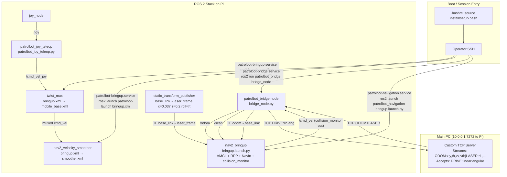
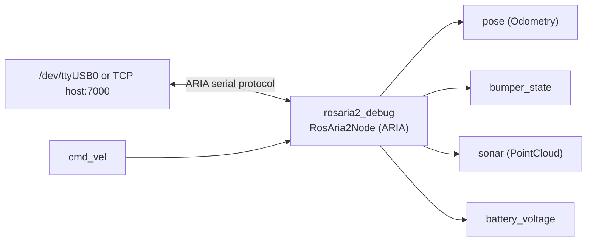

# PatrolBot Raspberry Pi Architecture

> October 15, 2026: the deployment notes below are dated historical evidence.
> Current core/navigation/web roles differ; use `docker/deployments/observed-20261015.json`
> and `docs/operations/source-and-release-state.md`, not the July image/paths or
> historical single-image assertion, to identify the running release. No old
> commissioning value, motor command or service-restart recipe is authorized here.

> Current deployment note (live-audited 2026-07-15): `robot-pi2`
> (`patrolbot-rpi5`, Ubuntu 24.04.4, aarch64) is the main driver. The canonical
> Pi source is `/home/yousef/Projects/repos/patrolbot-repo/ros2_ws/src`; deployed
> remote trees are copies, not source of truth. The three active services run as
> `patrolbot-bringup`, `patrolbot-bridge`, and `patrolbot-navigation` containers.
> `rosaria2` remains versioned but excluded from Docker. Process liveness is
> checked without recurring DDS participants; `docker/status.sh` separately
> reports hardware/ROS readiness.
>
> All three machines were reachable during the audit. The SBC services were
> active and a live `ODOM|LASER` stream was sampled. In the final snapshot, Pi 5
> `eth0` was live at `10.0.0.2/24`, 100 Mbps/full duplex; the SBC socket,
> `/odom`, `/scan`, active lifecycle states, and both required TF links were
> verified. `/etc/netplan/60-sbc-link.yaml` now persistently assigns
> `10.0.0.2/24` with DHCP disabled. The Pi 5 containers
> were healthy at revision `fa14b9b5cedfd56beaffca746e1c37256d67d1f0`.
> The powered Pi 4's bare-metal services were also active and visible as duplicate
> ROS nodes over Wi-Fi; stop them while Pi 5 is the main driver.

> Generated: 2026-06-22 | Updated: 2026-07-07 (controller DWB→RPP, DDS discovery-server
> reverted to plain multicast, map now 3192×2205 @ 0.075 m — all verified live on robot-pi)
> Read-only filesystem audit of `~/Projects/patrolbot/pi` (maps to `/home/ubuntu` on the Pi).
>
> **Historical scope:** most file-level detail below was audited from the Pi 4
> before the monorepo migration. Preserve it as architecture history, but use the
> deployment note above for current ownership and runtime state.

---

## 1. System Overview

The PatrolBot Pi is an Ubuntu-based Raspberry Pi running ROS 2 Jazzy. It functions as the **on-robot navigation computer**, bridging a separate main PC (the "SBC") with the ROS 2 ecosystem. The Pi-side runtime endpoint is the dedicated Ethernet link at `10.0.0.1:7272`; older notes may mention the SBC's lab-LAN SSH address `172.20.87.231`. The SBC streams a custom text protocol (`ODOM:x,y,th,vx,vth|LASER:r1,r2,...\n`) at approximately 20 Hz over TCP, and accepts `DRIVE:linear:angular\n` commands back. The Pi connects to this server, translates the stream into native ROS 2 messages (`/odom`, `/scan`, TF), and routes velocity commands back to the main PC.

The Pi's ROS 2 stack is structured around **`patrolbot_bridge`** (the active TCP bridge node), **`patrolbot_navigation`** (Nav2 bringup and joystick teleop), and the **`patrolbot-launch`** mobile base package (twist_mux + velocity smoother), all three launched **by package name from the colcon install tree** (`ros2_ws/install/`). There is also a legacy **`rosaria2`** package that wraps ARIA/AriaCoda for direct serial control of the Pioneer base — superseded by the TCP bridge but kept as a fallback. On the main Pi 5 these run as three Docker Compose containers with `restart: unless-stopped`; the Pi 4 retains the older three-systemd-service rollback path.

> **2026-06-28 cleanup:** the bringup service previously launched from a stale colcon build-artifact directory (`~/build_backup/patrolbot-launch/launch/bringup.xml`). That backup was deleted and the service repointed to `ros2 launch patrolbot-launch bringup.xml` (installed package). **Never point a launch/service at a `build*/`, `install/`, or `backup` path** — only at a package name or `src/`.

The physical robot is a **Pioneer PatrolBot-SH** (differential-drive, 425 mm wide, 4 physical rear sonar sensors, SICK LMS-200 laser on the main PC's serial port `/dev/ttyS2`). The ARIA profile defines 16 generic sonar positions, but 12 are unpopulated and filtered. The Pi never talks to the laser directly — it receives laser data over the TCP bridge.

---

## 2. Architecture Diagram



### Legacy / Inactive Path (rosaria2)



---

## 3. Entry Points

| Type | Invocation | What It Runs | Status |
|------|-----------|--------------|--------|
| Docker — mobile base | `patrolbot-bringup` → `ros2 launch patrolbot-launch bringup.xml` | twist_mux + nav2_velocity_smoother + lifecycle_mgr.py | **USED — main Pi 5** |
| Docker — TCP bridge | `patrolbot-bridge` → `ros2 run patrolbot_bridge bridge_node` | PatrolBotBridge node | **USED — main Pi 5** |
| Docker — Nav2 | `patrolbot-navigation` → `ros2 launch patrolbot_navigation bringup.launch.py` | Nav2 (AMCL + RPP controller + Navfn planner + collision_monitor), joy_node, patrolbot_joy_teleop, static TF | **USED — main Pi 5** |
| systemd | 3 user units with equivalent commands | linger-enabled, `Restart=always` | **Pi 4 rollback only; stop during Pi 5 operation** |
| .bashrc | Pi 4 login shell | Sources `~/ros2_ws/install/setup.bash` | Pi 4 rollback |
| crontab | (none) | No cron jobs | N/A |

---

## 4. File-by-File Reference

### Root-Level Pi 4 Files (historical audit)

| File | Type | Purpose | Status |
|------|------|---------|--------|
| `patrolbot-sh.p` | ARIA param file | Pioneer PatrolBot-SH hardware config: dimensions, 16-sonar layout, SICK LMS-200 on `/dev/ttyS2` at 38400 baud, PTZ VCC4 camera | USED (by rosaria2 legacy path) |

### ARIA Directory

`ARIA/` is the AriaCoda robot library (subset kept after cleanup).

| Path | Purpose | Status |
|------|---------|--------|
| `ARIA/lib/` | `libAria.so` prebuilt shared library | USED by rosaria2 at runtime |
| `ARIA/include/` | C++ headers | USED by rosaria2 at build time |
| `ARIA/params/patrolbot-sh.p` | PatrolBot-SH hardware config (duplicate of root-level) | USED by rosaria2 |
| `ARIA/maps/` | ARIA map format files | MAYBE (reference) |
| `ARIA/bin/` | ARIA utility binaries | MAYBE |
| `ARIA/README.md` | Docs | Explains what was kept and why | — |

### patrolbot-launch (mobile base package — `ros2_ws/src/patrolbot-launch`)

Standard colcon package; built into `ros2_ws/install/patrolbot-launch` and launched
**by name**: `ros2 launch patrolbot-launch bringup.xml` (what the Pi 5 container and
Pi 4 rollback service run). The install tree symlinks back to `src/`, so launch/param edits are live without a
rebuild (rebuild only when adding new files). **The old `~/build_backup/patrolbot-launch`
copy was deleted 2026-06-28 — do not recreate it or point anything at a build/backup path.**

| File | Purpose | Status |
|------|---------|--------|
| `launch/bringup.xml` | **Active startup launch file.** Includes mobile_base.xml + smoother.xml | USED |
| `launch/mobile_base.xml` | Starts twist_mux with mux.yaml | USED |
| `launch/smoother.xml` | Starts nav2_velocity_smoother + lifecycle_mgr.py | USED |
| `param/defaults/mux.yaml` | twist_mux topic priority config | USED |
| `param/defaults/smoother.yaml` | Velocity smoother parameters | USED |
| `lifecycle_mgr.py` | Configures and activates the velocity smoother lifecycle node | USED |
| `launch/rosaria2.xml` | Launches rosaria2_debug (commented out in bringup.xml) | NOT USED |
| `launch/joy.xml` | Joy teleop (commented out in bringup.xml) | NOT USED |
| `README.md` | Package description | — |

### Package: patrolbot_bridge (ACTIVE)

Entry point: `bridge_node = patrolbot_bridge.bridge_node:main`

| File | Purpose | Status | Topics |
|------|---------|--------|--------|
| `patrolbot_bridge/bridge_node.py` | **PRIMARY TCP BRIDGE.** Connects to `10.0.0.1:7272`. Parses `ODOM+LASER` (nav) and the separate `AUX:` (sonar/battery/flags) lines independently, publishes ROS topics and TF. Forwards `/cmd_vel` as DRIVE commands. Self-healing: non-blocking reconnect with `RECV_TIMEOUT`. | USED | Pub: `/odom`, `/scan`, `/sonar`, `/battery`, `/diagnostics`, TF `odom→base_link`; Sub: `/cmd_vel` |
| `patrolbot_bridge/__init__.py` | Empty package marker | USED | — |
| `setup.py` | Declares `bridge_node` console_scripts entry | USED | — |
| `setup.cfg` | Install config | USED | — |
| `package.xml` | ROS manifest | USED | — |
| `test/test_copyright.py`, `test_flake8.py`, `test_pep257.py` | ament test templates | MAYBE (CI only) | — |
| `README.md` | Package description | — | — |

### Package: patrolbot_navigation (ACTIVE)

CMake package. Installs scripts as executables.

| File | Purpose | Status | Topics |
|------|---------|--------|--------|
| `launch/bringup.launch.py` | Launches Nav2 full stack + joy_node + patrolbot_joy_teleop + static TF. Sets ROS_DOMAIN_ID=0, MAGICK_THREAD_LIMIT=1, OMP_NUM_THREADS=1. | USED | Orchestrates Nav2 |
| `scripts/patrolbot_joy_teleop.py` | F710 → ramped velocity → `/cmd_vel_joy`; RB deadman + joy-loss watchdog (0.4 s) | USED | Sub: `/joy`; Pub: `/cmd_vel_joy` |
| `scripts/patrolbot_safety_watchdog.py` | Sensor-loss safe-hold: holds robot if /scan or /odom >0.5 s stale, via twist_mux priority-10 input/safety_controller; releases when fresh. **Must be chmod +x.** | USED — safety | Sub: `/scan`,`/odom`; Pub: `/input/safety_controller` |
| `config/nav2_params.yaml` | Nav2 params: AMCL differential, **RPP controller** `desired_linear_vel 0.22` (base max 0.26 m/s), Navfn planner, collision_monitor stop box ±0.3 m | USED | Consumed by nav2_bringup |
| `maps/second_map.yaml` + `.pgm` | Active occupancy map — CMU-Q 2nd-floor CAD plan, **3192×2205 @ 0.075 m** (≈239×165 m), origin `[-1,-1,0]` (replaced 2026-06-27, re-resolutioned to 0.075 m; scale operator-confirmed; see §6.2) | USED | Loaded by map_server |
| `maps/cmuq_1st_floor.yaml` + `.pgm` | Older CMU-Q map — not in active launch | KEPT (not active) | — |
| `scripts/lms200_sanitizer.py` | Fixes SICK LMS-200 header fields (`/bad_scan` → `/good_scan`). No `/bad_scan` publisher in current stack. | MAYBE — future use | Sub: `/bad_scan`; Pub: `/good_scan` |
| `scripts/twist_mux.yaml` | Velocity priority config — twist_mux not launched (collision_monitor handles arbitration) | MAYBE — reference | — |
| `rviz/patrolbot_nav.rviz` | RViz visualization layout | MAYBE — manual operator use | — |
| `CMakeLists.txt`, `package.xml` | Build config | USED | — |
| `README.md` | Package description | — | — |

### Package: patrolbot-launch (source file inventory)

Detailed file list for the package described above. `src/` is the single source of truth
(the install tree symlinks back to it; there is no separate "active copy" anymore).

| File | Purpose | Status |
|------|---------|--------|
| `launch/bringup.xml`, `mobile_base.xml`, `smoother.xml`, etc. | The launch files (install symlinks here) | Source of truth |
| `param/defaults/mux.yaml`, `smoother.yaml` | Parameter files | Source of truth |
| `lifecycle_mgr.py` | Velocity smoother lifecycle manager | Source of truth |
| `setup.py`, `setup.cfg`, `package.xml` | Build config | USED |
| `README.md` | Package description | — |

### Package: rosaria2 (LEGACY — built but not in active launch)

| File | Purpose | Status | Topics |
|------|---------|--------|--------|
| `src/test.cpp` | Entry point → `RosAria2Node` → spin. Builds as `rosaria2_debug`. | MAYBE | — |
| `src/rosaria2_node.cpp` | ARIA wrapper: connects serial/TCP, drives Pioneer, 600 ms cmd_vel watchdog | MAYBE | Pub: `pose`, `bumper_state`, `sonar`, `sonar_pointcloud2`, `battery_voltage`, etc.; Sub: `cmd_vel`; Srv: `enable_motors`, `disable_motors` |
| `src/laser_publisher.cpp` | Publishes ARIA laser as LaserScan; broadcasts `base_link → laser_frame` TF | MAYBE | Pub: `*_laserscan`, `*_pointcloud` |
| `include/rosaria2/*.hpp` | C++ headers (4 files) | MAYBE | — |
| `msg/BumperState.msg` | Custom message: bool[] front/rear bumpers | MAYBE | — |
| `CMakeLists.txt`, `package.xml` | Build config | MAYBE | — |
| `README.md` | Package description including known TF/cmd_vel conflicts | — | — |

---

## 5. ROS 2 Topic / Service Graph

### Active Topics

| Topic | Type | Publisher | Subscriber(s) |
|-------|------|-----------|---------------|
| `/odom` | nav_msgs/Odometry | patrolbot_bridge | Nav2 (AMCL, bt_navigator, controller_server) |
| `/scan` | sensor_msgs/LaserScan | patrolbot_bridge | Nav2 (AMCL, costmaps, collision_monitor) |
| `/sonar` | sensor_msgs/PointCloud2 | patrolbot_bridge (from SBC `AUX:`) | RViz / obstacle viz (16 sonar points, base_link, ~5 Hz) |
| `/battery` | sensor_msgs/BatteryState | patrolbot_bridge (from SBC `AUX:`) | monitoring (voltage; SoC = NaN, base has no SoC) |
| `/diagnostics` | diagnostic_msgs/DiagnosticArray | patrolbot_bridge (from SBC `AUX:`) | rqt_robot_monitor (motors/fault/stall/bumper-raw) |
| `/cmd_vel` | geometry_msgs/Twist | Nav2 collision_monitor | patrolbot_bridge |
| `/cmd_vel_joy` | geometry_msgs/Twist | patrolbot_joy_teleop | twist_mux |
| `/joy` | sensor_msgs/Joy | joy_node | patrolbot_joy_teleop |
| TF `odom → base_link` | TF2 | patrolbot_bridge | Nav2 tf_buffer |
| TF `base_link → laser_frame` | TF2 | static_transform_publisher (`x=0.037`, `z=0.2`, `roll=π`) | Nav2 tf_buffer |

### Inactive Topics (only with rosaria2 active)

| Topic | Type | Publisher |
|-------|------|-----------|
| `pose` | nav_msgs/Odometry | rosaria2_node |
| `bumper_state` | rosaria2/BumperState | rosaria2_node |
| `sonar` | sensor_msgs/PointCloud | rosaria2_node |
| `battery_voltage` | std_msgs/Float64 | rosaria2_node |
| `/bad_scan` | sensor_msgs/LaserScan | (no current publisher) |
| `/good_scan` | sensor_msgs/LaserScan | lms200_sanitizer (if launched) |

---

## 6. Key Architecture Notes

1. **Pi 5 boot is automated by Docker Compose.** The three containers use
   `restart: unless-stopped`. The following user services describe the Pi 4
   rollback deployment (linger enabled for `ubuntu`):
   - `patrolbot-bringup.service` → `ros2 launch patrolbot-launch bringup.xml` (twist_mux + smoother)
   - `patrolbot-bridge.service` → `ros2 run patrolbot_bridge bridge_node` (auto-reconnects to SBC)
   - `patrolbot-navigation.service` → `ros2 launch patrolbot_navigation bringup.launch.py` (Nav2)
   - `patrolbot-discovery.service` — **DISABLED (reverted 2026-06-29).** The FastDDS Discovery
     Server experiment for remote-RViz-over-VPN was rolled back; the unit file is still on disk
     but `is-enabled` = **disabled** and does NOT start at boot. The three ROS2 services no longer
     set `FASTRTPS_DEFAULT_PROFILES_FILE` at all — the pre-revert unit files are kept as
     `*.service.prevpn.bak`. **The robot is back on plain LAN DDS multicast (SIMPLE discovery).**
     `.bashrc` sets only `RMW_IMPLEMENTATION=rmw_fastrtps_cpp` (no profile file). See §6.2.

   Pi 4 rollback log viewer: `~/patrolbot-logs.sh [bringup|bridge|nav|status|topics|tf|-h]`.

   **Historical Pi 4 boot time (measured, real cold boot 2026-06-27):** /scan+/odom +2m34s, 2D-Pose-ready
   (localization active) +2m49s, Goal-ready (full Nav2) ~+3m15s. Pure software activation
   is fast (Pose +12s, localizing +48s [SBC laser-warmup-bound], Goal +62s from service
   start) — the rest was **~2 min wasted in `systemd-networkd-wait-online`**.

   **Pi 4 boot-time fix (applied 2026-06-28):** netplan auto-generates
   `/run/systemd/system/systemd-networkd-wait-online.service.d/10-netplan.conf` that makes
   the waiter block on **eth0**, but eth0 has **no cable** (`no-carrier`) so it hit the 120 s
   timeout every boot before the lingered patrolbot services started. Fix = a persistent
   `/etc/systemd/system/systemd-networkd-wait-online.service.d/zz-wait-any.conf` (sorts after
   `10-netplan.conf`, so its `ExecStart=` reset wins) that runs
   `systemd-networkd-wait-online --any` — satisfied instantly by wlan0 (WiFi). Verified: the
   command now returns in 0.03 s (was 120 s). Safe because nothing must block for the network
   (bridge retries the SBC every 3 s; Nav2 is local). This describes the Pi 4
   rollback board only. The main Pi 5 needs `eth0=10.0.0.2/24` for the dedicated
   SBC link. Expected Pi 4 post-fix timing was Pose-ready ~40 s, Goal-ready ~70 s.

2. **Manual equivalent** (same three, if running by hand):
   ```bash
   ros2 launch patrolbot-launch bringup.xml                               # mobile base
   ros2 run patrolbot_bridge bridge_node                                   # TCP bridge
   ros2 launch patrolbot_navigation bringup.launch.py                     # Nav2
   ```

   Startup timing: **localization (map_server + AMCL) is active in a few seconds** → map + map→odom + 2D Pose Estimate work almost immediately. The **full navigation stack takes ~2.5 min** to activate (was ~8 min before the map was downsampled). Setting a Nav2 Goal requires navigation active; the map and pose estimate do not.

   **Map replaced 2026-06-27, re-resolutioned since** — the operator made a NEW 2nd-floor map (the previous `second_map` was geometrically wrong) from a **CMU-Q architectural floor-plan** (CAD export). The **current map** (verified on the Pi 2026-07-07 and against this monorepo on 2026-07-15) is **`second_map.{pgm,yaml}` = 3192×2205 @ 0.075 m** (≈239×165 m), GIMP-exported P5 grayscale, `origin [-1,-1,0]`, `negate 0`, thresholds 0.65/0.196. (Earlier iterations at 0.1 m / 2394×1653 and 0.2 m were intermediate; 0.075 m is the finalized resolution.) The Pi 5 mounts the deployed package source read-only into its container; deploy the canonical revision and restart `patrolbot-navigation`. The Pi 4 rollback install is symlinked to source and uses its systemd service. `global_costmap` resolution stays 0.2; `local_costmap` 0.1.

   ✅ **Scale CONFIRMED (operator-verified).** The earlier "scale unverified" caveat is closed — the laser-vs-map overlay in RViz was checked and the `/scan` points land on the mapped walls. **Do not change the map resolution/scale.**

   ⚠️ **Remaining caveat — CAD artifacts.** Being an architectural drawing, the source contains a title block, a drawing border frame, and furniture/door-swing/hatching detail the laser never sees → phantom obstacles (mostly in unreachable margins). If they ever interfere with planning, whiten those regions in the source and re-export at 0.075 m.

   **Nav2 launch internals** (`patrolbot_navigation/launch/`):
   - `bringup.launch.py` builds the stack itself instead of calling `nav2_bringup/bringup_launch.py`, because that file hard-codes `bond_timeout: 4.0` and never reads our params. It creates one `nav2_container`, then includes the two patched sub-launches.
   - `patrolbot_localization_launch.py` / `patrolbot_navigation_launch.py` are local copies of the nav2_bringup launches with **`bond_timeout: 0.0`** added to the lifecycle managers (both composed and non-composed paths). Without this, inflating the huge map starves `map_server`'s bond > 4 s and the lifecycle manager aborts → no AMCL → no `map→odom` → blank map.
   - **Composition is mandatory** here: separate-process mode (`use_composition:=False`) spawns ~13 DDS participants that exhaust FastDDS `/dev/shm` port locks (`ulimit -n` is 1024), breaking lifecycle discovery. One container = one participant; the huge map flows map_server→costmaps intra-process.
   - Navigation is delayed 20 s via `TimerAction` so it doesn't steal CPU from AMCL during early startup (lets `map→odom` lock in fast).
   - If `nav2_container` dies, an `OnProcessExit→Shutdown` handler tears the launch down so the Pi 5 container restart policy (or Pi 4 systemd `Restart=always`) brings the whole stack back fresh; a respawned component container would come back empty.

   **Resilience — full fault-tolerance audit 2026-06-28** (detect → safe-hold → keep
   listening → auto-resume). All fault-injected live unless noted. No manual intervention for:
   - *SBC link loss/recovery*: bridge retries every 3 s; Nav2 nodes stay active (`bond_timeout: 0.0`); `map→odom` + data resume automatically when the link returns.
   - *Bridge crash*: the Docker restart policy on Pi 5 or systemd on Pi 4 restarts it and it reconnects (TESTED: held ~1 s, back ~10 s).
   - *Nav container/node crash*: `OnProcessExit→Shutdown` → container/systemd restart; localization + map back in seconds (TESTED: NRestarts 0→1, /navigate_to_pose back).
   - *SBC freeze (no TCP FIN)*: bridge 3 s read-timeout + Pi safety watchdog hold; auto-resume on reconnect (TESTED via SIGSTOP/CONT: held 8 s, released on resume).
   - *Sensor loss (/scan or /odom stale >0.5 s)*: **`patrolbot_safety_watchdog`** node holds the robot via twist_mux priority-10 `input/safety_controller` (zero Twist), releases when fresh. MUST be `chmod +x` (CMakeLists install(PROGRAMS)) or launch throws "executable not found" → restart-loop.
   - *twist_mux / velocity_smoother crash*: now `respawn="true"`; `lifecycle_mgr.py` is PERSISTENT and re-activates a respawned (unconfigured) smoother in ~2 s (TESTED: both back in 2-3 s). Before this they did NOT recover — the cmd_vel path stayed dead while bringup showed "active".
   - *Robot runaway on any cmd-path loss*: SBC command watchdog (no DRIVE 750 ms ⇒ stop) + stop-on-disconnect, plus teleop joy-loss watchdog (no /joy 0.4 s ⇒ drop deadman). See [[project_nav2_reconnect_resilience]] / `sbc-architecture.md`.
   - *Pi or SBC reboot*: services autostart; Docker handles Pi 5 and lingered user services handle the SBC and Pi 4.
   - joy_node, teleop, and the safety watchdog all run `respawn=True`.

   The laser static TF is `base_link→laser_frame` at `x=0.037 y=0 z=0.2`, `roll=π` (3.14159). **✅ RESOLVED 2026-06-27 — this TF is CORRECT, confirmed against the robot's own ARIA param file `patrolbot-sh.p` (authoritative, it generates the scan):** `LaserX 37` (mm) → `x=0.037` ✓; `LaserY 0` → `y=0` ✓; **`LaserFlipped true` ("Laser_1 is upside-down") → `roll=π` is the correct compensation** (this is why it's roll, and why it's π). The long-standing "scan appears mirrored" worry is closed: the mount is physically upside-down and the TF accounts for it. (`z=0.2` is the one soft spot: the guide says the laser is ~0.30 m above the floor; 0.2 is consistent only if base_link sits ~0.1 m up at the wheel axle. Z is cosmetic for 2D nav — costmaps flatten it — so it was left as-is.) Physical orientation also confirmed via Fig 6-1 of the user guide + a wall test: **front = laser/charger-contacts; rear = LCD screen + 4 sonar + red E-stop.**

   **Controller is RPP, not DWB (swapped 2026-06-29 when autonomous nav was commissioned).**
   `FollowPath` = `nav2_regulated_pure_pursuit_controller::RegulatedPurePursuitController`
   (`desired_linear_vel 0.22`, `lookahead_dist 0.45`, `use_rotate_to_heading true` @ 0.9 rad/s).
   Why: un-tuned DWB scored the near-stationary trajectory best (commanded ~0.05 rad/s, below the
   base's rotational deadband) so the robot never moved → "Failed to make progress". RPP rotates
   **in place** to face the path at an above-deadband speed, then drives — robust for this
   0.26 m/s diff-drive. Planner is `nav2_navfn_planner::NavfnPlanner`.
   **LANDMINE:** RPP `use_collision_detection: false` (set 2026-06-29) — RPP's own footprint check
   treats the inscribed band (cost 253, ≈0.213 m = robot half-width) around obstacles as a
   collision and froze the robot mid-doorway on any door narrower than ~0.85 m clear, even though
   the 0.43 m-wide robot physically fits. **Keep it False**; the collision_monitor stop_box
   (±0.3 m hard-stop) is the sole automatic collision guard in the nav path. See
   [[project_nav2_reconnect_resilience]].

   **Nav2 goal failures fixed 2026-06-24**: `local_costmap update_frequency` was `1.0 Hz` while the controller runs at 5 Hz → "Costmap timed out waiting for update" → "No valid trajectories" → goal aborts. Raised `local_costmap` `update_frequency: 5.0`, `publish_frequency: 2.0` (verified: published_footprint now ~5 Hz). 2D Pose Estimate and Nav2 Goal are published correctly in the `map` frame by RViz.

   **cmd_vel topology (rewired 2026-06-24 — twist_mux is now the single arbiter):**
   - Joystick: `patrolbot_joy_teleop` → `/input/joy` (launch remap), twist_mux priority 8
   - Navigation: `collision_monitor` `cmd_vel_out_topic: input/navi`, twist_mux priority 5
   - `twist_mux → /cmd_vel_out → teleop_velocity_smoother → /cmd_vel → bridge`
   - So moving the joystick overrides nav; releasing it (joy input times out after 1 s) returns control to nav. `/cmd_vel` publishers are now just `teleop_velocity_smoother` (+ `docking_server`, niche).

   **Joystick teleop** (`patrolbot_joy_teleop.py`, rewritten for **Xinput**): Logitech pad switch on **X**, plugged into the **Pi's USB**. Hold **RB (button 5, deadman)**; left-stick Y drives and left-stick X turns, with D-pad axes 7/6 as fallback. Defaults are `max_linear=0.35`, `max_angular=0.7`, deadzone 0.12, and a 0.4 s joy-loss watchdog. While RB is held it publishes the ramped command, including zero at centered sticks; after release it ramps to zero, publishes one final zero, then goes silent so the mux returns control to navigation.

   **RViz client-side notes** (user's desktop, not the robot): the `glsl120/indexed_8bit_image` "active samplers... same texture image unit" error is an OGRE/Mesa Map-display shader bug — map usually still renders; harmless to the robot. The `Message Filter dropping ... laser_frame ... queue is full` lines tagged `[rviz2]` are RViz's own scan-display TF queue, also client-side.

   **RViz /map QoS** (verified 2026-06-27): `map_server` publishes `/map` as RELIABLE + TRANSIENT_LOCAL. RViz's Map display must be set to **Reliability: Reliable** (not the default Best Effort). With Best Effort, FastDDS will not deliver the transient-local cached map to a late-joining RViz subscriber. The `patrolbot_nav.rviz` config already has `Reliability Policy: Reliable` for all Map displays — if RViz is launched without this config, the map will be invisible. Always launch with `rviz2 -d /path/to/patrolbot_nav.rviz`.

   **AMCL after SBC restart** (2026-06-27): SBC restart resets odom to (0,0,0). AMCL does not auto-republish `map→odom` without a new 2D Pose Estimate — it only updates when its particle filter runs, which requires either an `/initialpose` trigger or robot motion. After every SBC restart: set **2D Pose Estimate** in RViz at the robot's current physical location before sending any navigation goals.

   **SBC laser warmup — TF churn fixed** (2026-06-27): previously the SBC bound port 7272 before the laser was ready; the bridge connected but got no data, hitting RECV_TIMEOUT every 3 s for ~45 s (6–10 cycles). Each cycle reset the bridge socket and disrupted AMCL's TF message filter. Fixed in patrolbot_server.cpp: socket now bound only AFTER laser connects; bridge gets clean `ECONNREFUSED` during warmup. **Effect: SBC restarts no longer break AMCL localization** (TF is stable throughout warmup).

   **DDS discovery — plain LAN multicast (FastDDS Discovery Server REVERTED 2026-06-29).**
   The robot uses **default SIMPLE (multicast) discovery** on the LAN. A FastDDS Discovery
   Server (unicast/TCP) was wired up 2026-06-28 to reach RViz from home over the Cisco VPN, then
   **rolled back the next day** — the VPN remote-viz scenario was dropped for now.
   - `patrolbot-discovery.service` is **on disk but DISABLED** (does not start at boot). The three
     ROS2 service files **no longer set `FASTRTPS_DEFAULT_PROFILES_FILE`**; the pre-revert copies
     are kept as `~/.config/systemd/user/*.service.prevpn.bak`.
   - `~/.bashrc` sets only `RMW_IMPLEMENTATION=rmw_fastrtps_cpp` — **no** profile file. On-Pi
     `ros2` CLI and LAN RViz "just work" again over multicast (no client profile needed).
   - **LAN RViz / remote viz:** RViz on the same LAN discovers the robot directly. Map is served
     to a remote viewer by a VM on `/map_viz` (kept off the nav2 map topic to avoid conflict);
     WiFi multicast is verified working. If VPN remote RViz is ever needed again, the discovery
     server can be revived from the `.prevpn.bak` unit files + the `patrolbot_fastdds_*.xml`
     profiles still in the repo — but treat it as a from-scratch re-enable, not the current state.
   - **SBC is NOT involved in DDS** — it runs no ROS and only streams plain TCP:7272 to the Pi; it
     has no DDS participants. All ROS2 topics RViz needs are published by the Pi.
     See [[project_telemetry_and_remote_viz]].

3. **`patrolbot-launch` runs from the installed package** (`ros2 launch patrolbot-launch bringup.xml`). The `install/` tree symlinks back to `src/patrolbot-launch/`, so launch/param edits are live immediately; only `colcon build` is needed when adding new files. (The old `build_backup/` copy that used to be the run target was removed 2026-06-28.)

4. **rosaria2 conflicts** if run alongside bridge_node: competing TF broadcasts on `odom→base_link` and `base_link→laser_frame`, plus double cmd_vel consumption. Do not run both.

5. **Laser TF `roll=π`** — the SICK LMS-200 is mounted **upside-down** (`LaserFlipped true` in `patrolbot-sh.p`), so the static TF rolls it 180° about X to correct the flip. The laser faces **forward** (front of robot; see resolved note in §6.2). Earlier text here said "facing rearward" — that was wrong; corrected 2026-06-27.

6. **SICK LMS-200 is on the main PC** (serial `/dev/ttyS2`). The Pi receives laser data over the TCP stream — it never talks to the laser directly.

7. **MAGICK_THREAD_LIMIT=1 and OMP_NUM_THREADS=1** in `bringup.launch.py` — required to prevent OOM crash when Nav2 loads the large map on the Pi.

8. **All Pi package source is monorepo-owned.** Deployed trees must not retain
   historical nested `.git/` directories.

9. **`SCAN_RANGE_MIN = 0.25` m in bridge_node.py — footprint-clearance floor** (set 2026-06-27). Drops returns at/inside the robot's own body (0.22-0.25 m) that would otherwise sit permanently in the footprint and deadlock the controller. **DO NOT raise much above 0.25** — real obstacles can legitimately be at 0.25-0.40 m. (History: symmetric ~0.25 m returns once looked like body self-occlusion, but a reposition test proved they were REAL nearby objects — they vanished when the robot moved. A staged 0.35 m value was reverted as unsafe.) On Pi 5, deploy the canonical source and restart `patrolbot-bridge`; on Pi 4 rollback, restart `patrolbot-bridge.service`.

10. **Footprint is an OCTAGON, not a circle** (set 2026-06-27, both costmaps in `nav2_params.yaml`). Replaced the undersized `robot_radius: 0.22` (which only covered the half-WIDTH and left the front/rear ends 3-7 cm outside the model). Octagon from the robot's own dims — `RobotLength 510 mm` (±0.255 x), `RobotWidth 425 mm` (±0.2125 y), corner vertices at the user-guide swing radius 0.29 m: `[[0.255,0.138],[0.197,0.213],[-0.197,0.213],[-0.255,0.138],[-0.255,-0.138],[-0.197,-0.213],[0.197,-0.213],[0.255,-0.138]]`. Verify with `ros2 topic echo /local_costmap/published_footprint` (8 points). Restart the Pi 5 `patrolbot-navigation` container (or Pi 4 rollback service) to apply; AMCL then needs a fresh 2D Pose Estimate.

11. **`/sonar` = real rear-sonar detections only** (changed 2026-06-27). Robot physically has **4 rear sonar** (user guide; FrontSonar unused), but `patrolbot-sh.p` defines a generic 16-sonar ring. The SBC now emits a point only for a valid echo (`getRange() < 4335 mm`), so `/sonar` width is the live detection count (often 0-2), not 16 phantom max-range points. Frame `base_link`; feeds NO costmap (both costmaps use only `/scan`), so it never affects navigation. NOT in the saved RViz config — Add → By topic → `/sonar` → PointCloud2, Size ~0.2 m to see it.

---

## 7. Cleanup Log (2026-06-24)

Quarantined to `/home/ubuntu/_cleanup_quarantine_2026-06-24/` then permanently deleted (~247 MB):

**ARIA SDK bulk** (A11–A23): `obj/`, `docs/`, `ArNetworking/`, `python/`, `java/`, `src/`, `examples/`, `advanced/`, `pythonExamples/`, `javaExamples/`, `tests/`, `utils/`, `matlab/`

**ARIA params** (A24): all `.p` files except `patrolbot-sh.p`

**Stale colcon artifacts** (A26): `install_backup/`

**Dead packages** (A3, B2, B3): `ros2_ws/src/sick_lms200_custom/`, `patrolbot-launch.backup/`, `patrolbot-launch.backup2/`

**Duplicate source files** (A1, A2): `patrolbot_bridge/copy_bridge_node.py`, `copy2_bridge_node.py`

**Workspace clutter** (A6–A10, B4): `ekf_test.yaml`, `scripts/tcp.py`, `frames_*.gv`, `frames_*.pdf`, `READPLEASE`, `copy_bringup.launch.py`

**READMEs added**: `patrolbot_bridge/`, `patrolbot_navigation/` (replaced), `ros2_ws/src/patrolbot-launch/`, `rosaria2/`, `ARIA/`, `yousef/`

---

## 8. Summary Statistics (post-cleanup)

| Label | Count |
|-------|-------|
| **Used** | 22 |
| **Maybe** | 16 (rosaria2 pkg ×11, lms200_sanitizer, twist_mux.yaml, rviz config, ARIA maps/bin, cmuq maps) |
| **Dev tools** | historical Pi 4 audit only; not present in the 2026-07-15 check |
| **Total source files** | monorepo inventory is authoritative; ignore this historical count |
