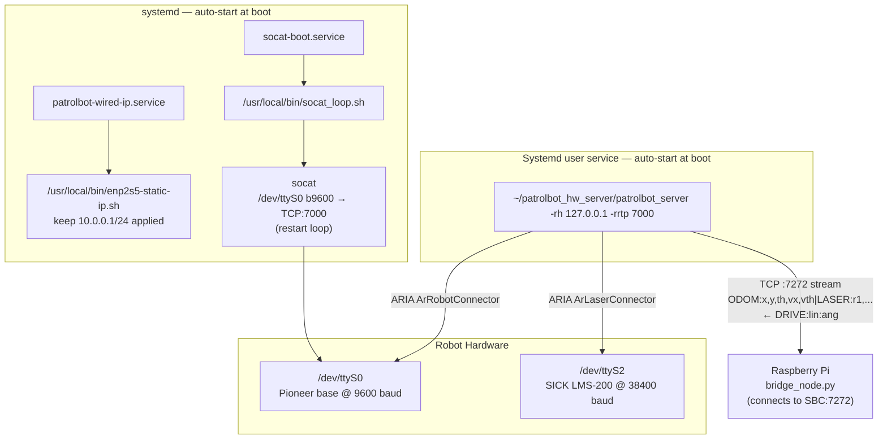

# PatrolBot SBC Architecture

> October 15, 2026: historical architecture below predates explicit motor control,
> owned undock, LiDAR power and odometry-origin changes. In particular, automatic
> motor enabling described below was removed; never reinstate it from this note.
> Current executable SHA256 is `1767110d…`; exact source/profile evidence is in
> `docker/deployments/observed-20261015.json` on `deployed/robot-20261015`.

> Generated: 2026-06-24
> Role: **Hardware data bridge only** — dumps ODOM + LIDAR to the Raspberry Pi over TCP. All navigation and compute runs on the Pi.

---

## 1. System Overview

The SBC's sole current function is to sit between the physical Pioneer PatrolBot-SH hardware and the Raspberry Pi. It reads odometry from the Pioneer base microcontroller (`/dev/ttyS0`) and range data from the SICK LMS-200 laser (`/dev/ttyS2`) using the ARIA library, then streams that data to the Pi over TCP port 7272 as a plain-text telemetry line. It also reads sonar, battery and base status flags from ARIA and streams them on a separate lower-rate `AUX:` line (see §5). It also receives velocity commands back from the Pi and forwards them to the Pioneer base. Nothing else on the SBC is involved in robot operation — the entire ROS2 navigation stack lives on the Pi.

At boot, system unit `patrolbot-wired-ip.service` keeps `10.0.0.1/24` applied to
`enp2s5`, system unit `socat-boot.service` bridges `/dev/ttyS0` to TCP port
7000, and the linger-enabled `patrolbot-server.service` user unit starts
`patrolbot_server`. No manual session start is required.

---

## 2. Architecture

### Serial conflict — resolved

`socat-boot.service` holds `/dev/ttyS0` open at boot. `patrolbot-server.service` routes ARIA through the socat bridge using `-rh 127.0.0.1 -rrtp 7000` (ARIA flag is `-rrtp`, not `-rrp`). No serial conflict.

---

## 3. Entry Points

| Type | What runs | Status |
|------|-----------|--------|
| `patrolbot-wired-ip.service` (systemd system, auto) | `/usr/local/bin/enp2s5-static-ip.sh` keeps `10.0.0.1/24` on `enp2s5`; `Restart=always` | **Enabled + active, verified 2026-07-15** |
| `socat-boot.service` (systemd system, auto) | `/usr/local/bin/socat_loop.sh` → `socat file:/dev/ttyS0,b9600,raw,echo=0 tcp4-listen:7000,reuseaddr` | **Active at boot** |
| `patrolbot-server.service` (systemd user, auto) | `patrolbot_server -rh 127.0.0.1 -rrtp 7000` — ARIA TCP server: reads Pioneer via socat + SICK laser direct, serves TCP:7272 | **Active at boot** (`Linger=yes`, verified 2026-07-15) |

---

## 4. patrolbot_hw_server/ Files

| File | Purpose | Status |
|------|---------|--------|
| `patrolbot_server.cpp` | Core source: ARIA connects to Pioneer (`/dev/ttyS0`) and SICK laser (`/dev/ttyS2`); enables motors + sonar; streams `ODOM:...\|LASER:...\n` at ~20 Hz and a separate `AUX:SONAR/BATT/FLAGS` line at ~4–5 Hz on TCP:7272; reads `DRIVE:linear:angular\n` back. Self-healing: re-accept loop, EAGAIN/keepalive dead-peer detection. **Changes 2026-06-27**: (1) sonar position computed from `getSensorX/Y/DX/DY + range` instead of `getLocalX/Y` (which stays 0,0 until first SIP update — ARIA default); (2) TCP server socket binding moved to AFTER laser init to prevent 6–10 connect/timeout cycles during 45-s laser warmup that were disrupting Pi TF buffer | **Used** |
| `patrolbot_server` | Compiled binary (last built 2026-06-28; matches the §6 command-watchdog / stale-laser / e-stop changes) | **Used** |
| `Makefile` | Build: `g++ -I/usr/local/Aria/include -lAria -lArNetworking -lpthread` | **Used** |

---

## 5. Wire Protocol (SBC ↔ Pi)

| Direction | Format | Rate |
|-----------|--------|------|
| SBC → Pi | `ODOM:x,y,th,vx,vth\|LASER:r1,r2,...,rN\n` | ~20 Hz |
| SBC → Pi | `AUX:SONAR=x,y;x,y;...\|BATT=volt,soc,chargeState,temp\|FLAGS=flags,faultFlags,stallValue,motorsEnabled,eStopPressed\n` | ~4–5 Hz |
| Pi → SBC | `DRIVE:linear:angular\n` | on demand (non-blocking read) |

Units: meters, radians (ARIA mm/deg converted in patrolbot_server.cpp before sending).

The **`AUX:` line is a separate, independent line** emitted every 5th nav frame. It is
deliberately decoupled from the `ODOM|LASER` nav line: the Pi parses each line on its own,
so a problem building/parsing AUX can never disturb the navigation-critical data. Each
section is built defensively under `robot.lock()` (sonar enabled at startup via
`robot.enableSonar()`):
- `SONAR` — REAL detections only, `;`-separated `x,y` in robot frame (m), computed as `sensor_mount + range * direction` from `getSensorX/Y/DX/DY` (param-file values, always valid; `getLocalX/Y` is NOT used — it stays (0,0) until a live SIP). **A point is emitted only when `getRange() < 4335 mm` (a valid echo).** Robot physically has **4 rear sonar** (user guide: "4 at rear"; FrontSonar unused), but `patrolbot-sh.p` defines a generic 16-sonar ring, so `getNumSonar()` returns 16 and the 12 absent units sit at the ArSensorReading default 5000 mm — those are now skipped. So the wire/`/sonar` width is the live detection count (often 0-2), not 16. (Updated 2026-06-27; the earlier version emitted all 16 as a max-range ring.)
- `BATT` — `getRealBatteryVoltageNow()`, `getStateOfCharge()` (`-1` if `!haveStateOfCharge()`),
  `getChargeState()`, `getTemperature()`.
- `FLAGS` — `getFlags()`, `getFaultFlags()`, `getStallValue()`, `areMotorsEnabled()`,
  `isEStopPressed()` (5th field added 2026-06-28; bridge parses `f[4]` tolerant of older
  servers). `/diagnostics` surfaces `estop_pressed` + `motors_enabled`, with a top-priority
  ERROR "E-STOP ENGAGED — release the red button to move" and a WARN "motors disabled". This
  exists because a latched hardware e-stop silently blocks all motion (see §6).

The Pi's `bridge_node.py` republishes these as `/sonar` (PointCloud2), `/battery`
(BatteryState) and `/diagnostics` (DiagnosticArray). Because AUX rides the same TCP stream,
it inherits the stream's self-healing (recv-timeout reconnect on the Pi, EAGAIN/keepalive
re-accept on the SBC) — verified: the topics resume automatically after an SBC freeze/restart.

The server re-accepts after every Pi disconnect — outer `while (robot.isRunning())` loop wraps `accept()`. If the Pi disconnects, it is re-accepted automatically.

---

## 6. Status

Live status and resolved risks:
- **Wired-IP resilience**: `/etc/network/interfaces` pins `enp2s5` to
  `10.0.0.1/24`; enabled system unit `patrolbot-wired-ip.service` runs a
  five-second repair loop that re-applies the address after carrier loss.
- **Serial conflict**: patrolbot-server.service passes `-rh 127.0.0.1 -rrtp 7000` to route ARIA through socat TCP bridge.
- **Autostart**: `~/.config/systemd/user/patrolbot-server.service` is enabled and active; `Linger=yes` was verified live on 2026-07-15.
- **Single-client server**: outer re-accept loop in patrolbot_server.cpp handles Pi disconnects.
- **Laser warmup TF churn** (fixed 2026-06-27): TCP socket now bound AFTER laser connects so Pi gets clean `ECONNREFUSED` during 45-s warmup instead of connect/timeout cycles. Previously those cycles disrupted Pi TF buffer and stalled AMCL localization.
- **Sonar all-zeros** (fixed 2026-06-27): sonar positions now computed explicitly; see SONAR note in §5.
- **Robot runaway on command-path loss** (fixed 2026-06-28): ArRobot's state reflector re-sends the last `setVel` to the base forever, so if the Pi stops sending DRIVE (nav/bridge/link death) the robot kept coasting at its last velocity. `patrolbot_server.cpp` now has a **command watchdog** — no DRIVE for 750 ms ⇒ `setVel(0)/setRotVel(0)` — and explicitly **stops the base on Pi disconnect** before re-accepting. Keystone anti-runaway: one fix covers every cmd-path failure.
- **Stale laser streamed as live** (fixed 2026-06-28): a dead SICK left `getRawReadings()` returning the last cached scan, which the SBC streamed as if fresh ⇒ Pi published a frozen `/scan` ⇒ blind navigation. Now only streams ranges if `laser->isConnected()` AND the newest reading's `getTimeTaken().mSecSince() < 500`; otherwise emits an EMPTY `LASER:` field so the Pi's `/scan` stops and the loss is detected (the Pi safety watchdog then holds the robot). Auto-resumes when ARIA reconnects. Recompile with `make -B`; verified 0 false "stale" fires. See [[project_nav2_reconnect_resilience]].
- **"Commands sent but robot won't move" — motors disabled / e-stop** (diagnosed + hardened 2026-06-28): startup `enableMotors()` is not enough — the base can sit with motors DISABLED (e-stop power-up, late/again-disabled, or a latched hardware E-STOP). Added **re-enable-on-demand**: when a DRIVE with nonzero v/w arrives while `!areMotorsEnabled()`, call `enableMotors()` (throttled 500 ms) before `setVel`, so the robot drives the instant the cause clears — no restart. A **latched hardware e-stop cannot be overridden in software**; it now shows in `/diagnostics` (see §5). Confirmed the e-stop case with `~/patrolbot_hw_server/test_motors.cpp` (standalone ARIA: `isEStopPressed()=1`, `enableMotors()` rejected, `setVel(100)→getVel=0`). NOTE: the server runs under **user systemd** (`systemctl --user restart patrolbot-server.service`, `XDG_RUNTIME_DIR=/run/user/$(id -u)`), connects to the base via **socat** (`/dev/ttyS0`↔tcp:7000, single connection), and its **ArLog output is not captured by journald**.

~~Remaining one-time action: `sudo loginctl enable-linger ros` on the SBC.~~ **DONE 2026-06-28** — linger enabled for `ros`, so `patrolbot-server.service` now starts at boot without a login session.
