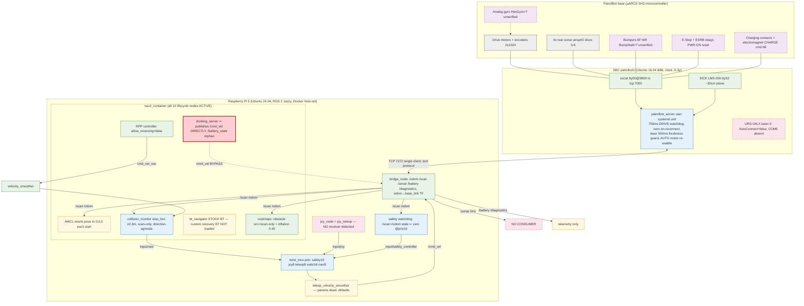

# PatrolBot Raspberry Pi 5 Read-Only System Audit

## 1. Audit metadata

| Item | Value |
|---|---|
| Date | 2026-07-16 |
| Start / end time | ≈16:08 – ≈17:10 (+03, Asia/Qatar), two consecutive read-only sessions |
| Raspberry Pi hostname | `patrolbot-rpi5` — Raspberry Pi 5 Model B Rev 1.0, arm64, 8 GB RAM |
| SBC hostname | `patrolbot1` — i686 (32-bit), 1 GB RAM, Versalogic-era onboard computer |
| Raspberry Pi OS / kernel | Ubuntu 24.04.4 LTS, 6.8.0-1060-raspi |
| SBC OS / kernel | Ubuntu 16.04.7 LTS (EOL), 4.4.0-210-generic |
| ROS distribution | ROS 2 Jazzy (verified: `/opt/ros/jazzy` sourced in entrypoint; Nav2 Jazzy binaries) |
| RMW implementation | `rmw_fastrtps_cpp` (verified in container env), `RMW_FASTRTPS_PUBLICATION_MODE=ASYNCHRONOUS` on bridge |
| ROS domain | `ROS_DOMAIN_ID=0` (verified in container env) |
| Docker | 29.1.3; Docker Compose 2.24.6; systemd 255 (Pi) / 229 (SBC) |
| Repository | Workstation checkout `~/Projects/repos/patrolbot-repo`, branch `main`, HEAD `29c4e17` ("Refresh docs branding and Pi 5 guidance"); working tree: `.gitignore` modified. **The deployed tree on the Pi (`/home/ubuntu/patrolbot-repo`) is NOT a git repository** — deployment is by file copy; provenance unverifiable on-robot. |
| Audit mode | Strictly read-only. No configuration, lifecycle, service, container, or hardware state was changed; no ROS messages published; no action goals sent; no second hardware-server client created; no µARCS serial session opened; no network scans. |
| SBC access | Existing SSH alias (`robot-sbc`, user `ros`, key auth) over Wi-Fi; the Pi↔SBC Ethernet link (10.0.0.x) observed passively from both ends. |
| Manuals reviewed | Both, **completely** (full pdftotext extraction, all pages): ① *Autonomous Research PatrolBot* datasheet 09366-PTLB Rev. A; ② *Research PatrolBot 3rd Generation User's Guide* Rev. A (10247-000 Rev. B, Jan 2012), 96 pp. The mandated `/mnt/data/` paths do not exist on this workstation; copies were located at `misc/manual_docs/` in the repo (and `~/Downloads/`). |
| Internet | Available; used for Nav2 upstream verification (see §22). |
| Major limitations | Robot docked and charging throughout; no motion, actuation, or physical inspection possible; SBC journal volatile (history limited to current boot); SBC syslog timestamps corrupted by a 5.3-year clock error; µARCS FLASH parameters (WatchDog, BumpStall, HasGyro, Charger, TicksMM…) not readable without opening a client connection, which was prohibited; runtime observed ≈1 hour. |

Sudo usage record: Pi — `sudo ss -tnp`, `sudo ls /proc/<pid>/fd`, `sudo dmesg` (×2), `sudo ufw status`, `sudo ss -tulnp` (all observational). SBC — `sudo -n` attempted once for journal access and **refused** (password required); all SBC evidence gathered as unprivileged `ros` (adm group grants journal/syslog read). No sudo was used for any modifying action.

---

## 1A. Post-audit implementation disposition and remaining work

**Update time:** 2026-07-17, approximately 01:42 +03.

### Reading rule

Sections 2–23 below are retained as the complete evidence record from the
original 16:08–17:10 read-only audit. Their runtime observations and
`Current status: Confirmed` labels describe that audit window. This section is
the authoritative later disposition after the PB-AUDIT-001/PB-AUDIT-002 Pi
implementation and the follow-on seven-item Pi hardening deployment. The
original update did not claim that any SBC or physical validation occurred;
the later 2026-07-21 subsection below records the supervised SBC return.

Several original quick-fix examples are explicitly superseded:

- A future docking producer must **not** be connected directly to the main
  `cmd_vel_mux`; that would bypass Collision Monitor. It may publish only to
  `/input/docking` on the upstream `nav_command_mux`.
- Dock release and motor enable are separate, explicitly acknowledged hardware
  operations. `CHARGE 0` must never imply motor enable or motion.
- Dock departure uses the guarded Nav2 BackUp path; global RPP reversing remains
  disabled.
- The generic `SimpleChargingDock` `/battery_state` remap is insufficient for
  this robot because the Jazzy plugin infers charging from battery current. The
  staged PatrolBot plugin uses typed raw charge state and `/battery` freshness.
- AMCL no longer assumes that every restart occurred at the dock. Dock-pose
  initialization requires an operator-authorized, configured pose and a
  convergence check.

The superseding design and exact implementation are recorded separately in
`PB-AUDIT-001-002-IMPLEMENTATION-REPORT.md`,
`PI5-SEVEN-ITEM-HARDENING-IMPLEMENTATION.md`, and
`PI5-SEVEN-ITEM-HARDENING-CODE-CHANGES.md`.

### Current Raspberry Pi 5 state

The following was live-revalidated after the 2026-07-21 stationary Pi/SBC
protocol commissioning and the 2026-07-22 commit-provenance cutover:

| Item | Current result |
|---|---|
| Production image | Bridge and navigation use `patrolbot:undock-complete-20260726t1242z`; image manifest `sha256:6f01f7a385760069a046c6968c52966a4a047365924c90cd241c5e66c7262622`; revision `ca66321-undock-complete` |
| Containers | bringup, bridge, and navigation healthy; zero restarts; bringup intentionally retains its previously accepted image because this cutover changed only bridge/navigation |
| Source provenance | Final image label, embedded source, and deployed source all equal SHA-256 `9d32c4ed6a444c7fe9c9a4caa331bd1b895070a5d6ebe8b0e3f6fe309817a8ad` |
| DDS exposure | All three host-network containers use Jazzy `ROS_AUTOMATIC_DISCOVERY_RANGE=LOCALHOST`; remote DDS/RViz discovery is intentionally unavailable, while SSH management remains available |
| PB-AUDIT-001 containment | `docking_server` absent; generic docking actions absent |
| Upstream arbitration | controller → `/input/nav_controller`; behavior server → `/input/nav_behavior`; reserved docking input `/input/docking` has zero publishers; `nav_command_mux` alone publishes `/cmd_vel_nav` |
| Final command endpoint | `/cmd_vel` publisher `teleop_velocity_smoother`; subscriber `patrolbot_bridge` |
| Guarded interfaces | Release, explicit enable, dock-pose initialization, 0.50 m guarded BackUp, capped 180-degree Spin, final release, and motor disable completed in one successful `/patrolbot/undock` action |
| Final manual smoother | Live `max_velocity=[0.35, 0.0, 0.7]`; declared Jazzy parameters replace ignored legacy keys |
| Priority-10 policy | Scan, odometry, battery freshness/23.0 V minimum, typed hardware state, E-stop, and FAULTFLAGS enforced; bumper enforcement installed but deliberately disabled until physical mapping |
| Physical-value scaffolds | URG candidate launch, physical-calibration schema, footprint/main-laser/near-field gates installed but all remain uncommissioned and absent from the active launch |
| Manual control | F710 receiver and centered `/joy` path are present; nonzero/deadman motion acceptance remains PB-AUDIT-015 work |
| SBC-dependent readiness | Single hardware session active; scan, odom, sonar, battery, and base state fresh; bridge session generation `1`; motors disabled; faults zero; odometry zero; deployed SBC SHA-256 `97655f948a57c1b71d147272639ae5460feace7aa5b9a31b25c0c2f3f4472c7e` |
| Dashboard bridge | Separate container restored after cutover; command mode is enabled and exposes goal/pose operations but no `/cmd_vel` path. No navigation status or queued command appeared during acceptance. |
| Operational documentation | Reconciled on 2026-07-22 with the deployed protocol, motor policy, command path, loopback DDS boundary, fail-closed docking/localization gates, and verified rollback workflow; strict MkDocs build passed. |
| Overall status | PB-AUDIT-002 production undock is commissioned. Automatic docking, joystick/deadman motion, enabled-motor E-stop cutoff, and the remaining physical sensor/calibration findings remain fail-closed. |

### Successful production undock — 2026-07-26

The final operator-authorized action, goal
`bb6701246df5443882920929dfd22b6b`, started from verified charging state `3`,
motors disabled, E-stop clear, zero faults, fresh/clear rear sonar, valid
bumper state, stationary odometry, one TCP 7272 client, one final `/cmd_vel`
publisher, and a freshly converged `main_charger` pose.

It released charging, explicitly enabled motors, reversed
`0.5031948089599609 m` at the requested `0.08 m/s`, completed the existing
Nav2 Spin goal for 180 degrees with `max_rotational_vel=0.70 rad/s`, stopped,
disabled the motors, and finalized the charger release. The first final-release
request correctly refused residual ARIA rotation; after one second of stable
zero odometry the manager retried exactly once and obtained stable state `0`.
The action returned `success=true`, code `0`, state `COMPLETE`,
`manual_recovery_required=false`, and ROS action status `SUCCEEDED`.

Post-run telemetry proved zero odometry twist, motors disabled, no E-stop,
zero faults, clear front/rear bumpers, no active action, one `/cmd_vel`
publisher, and the unchanged hardware session. Raw µARCS charge state later
returned to float state `3` away from bumper contact; the result and audit keep
that controller behavior visible. It no longer interrupts the tightly scoped
reverse or turn authorization.

### Supervised SBC stationary cutover — 2026-07-21

The Pi and SBC candidates were deployed under checksum-verified rollback. One
charging motor-enable request was deliberately rejected, and one zero-motion
charge-release request plus its identical UUID replay was commissioned. No
velocity, pose, navigation goal, dock/undock action, successful motor-enable
request, or robot motion occurred.

| Item | Revalidated result |
|---|---|
| Hardware connection | Exactly one established TCP session, `10.0.0.2:* -> 10.0.0.1:7272`; no second hardware client was opened |
| Hardware telemetry | `/scan`, `/odom`, `/sonar`, `/battery`, and `/patrolbot/base_state` fresh; zero odometry velocity; one `/odom` and `/scan` publisher |
| Base state | Session generation `2`, link and raw state valid, stable charge state `3`, motors disabled, E-stop clear, zero fault flags, bumper mapping invalid |
| Readiness | Stationary, rear sonar fresh/clear, command path valid, navigation idle; blocked by invalid bumpers/localization/dock pose and absent joystick/E-stop commissioning |
| Active SBC executable | Deployed/running SHA-256 `b9606502dc815c602397f93f48a0af7eb783ab3e819d87e77fcdf01d40394393`; matching source SHA-256 `a122210a6bc8887924cf06ec85a2e3b31d696717699397122ba8694dd33182e9` |
| Protocol commissioning | Charging motor enable rejected with code `3`; charge release reached raw state `0`; identical UUID replay caused no second hardware action; charging automatically resumed at state `3` with motors disabled and zero motion |
| Rollback evidence | Full backup `20260721T181448Z-pb002-stationary-cutover` plus narrow pre-deploy backup `20260721T204423Z-pb002-manual-release-deploy`; every host-local/off-host manifest verified from copied files; old binary hash pinned |
| Deployment disposition | Stationary cutover complete; successful motor enable, reverse, undock, and physical regression remain deferred |

The SBC-only audit findings were refreshed again during supervised root
maintenance on 2026-07-22. No PatrolBot process was restarted and no hardware
command was sent:

- **PB-AUDIT-010 is corrected in software and survived a real reboot; RTC
  hardware remains open:** authenticated legacy `chronyc -a makestep` advanced the system clock
  to current 2026 time, and `makestep 1.0 -1` is active in `chrony.conf`.
  Chrony restarted active and synchronized within a millisecond. The RTC still
  reports 2008. The 2026-07-23 power cycle proved automatic Chrony recovery;
  battery replacement and a post-replacement cold-boot validation remain.
- **PB-AUDIT-012 SBC portion remains open:** no `genpowerd`, UPS daemon, or
  equivalent graceful shutdown process is installed. The active socat bridge
  still carries serial bytes through TCP and provides no demonstrated RI-based
  shutdown handoff.
- **PB-AUDIT-013 is closed after reboot acceptance:** the compatible user unit
  auto-started after the 2026-07-23 power cycle, and the root-owned persistent
  journal retained both the prior clean shutdown and the current boot. It
  remained bounded at 16 MiB and recorded laser initialization, the 7272
  listener, and the sole Pi reconnection.
- **PB-AUDIT-019 residual SBC container cleanup is complete:** all 14 stopped
  experimental containers were removed after preserving container/image
  inspection, logs, and the only non-empty writable filesystem in verified
  host-local and off-host rollback bundles. Images and bind-mounted host data
  were retained. The live server, sole TCP session, Pi health, and zero
  odometry velocity were unchanged afterward.
- **PB-AUDIT-022 is hardened live but remains open at the platform level:**
  OpenSSH 7.2 now resolves password and challenge-response authentication off
  and root login off. Fresh alias and direct-IP key-only sessions succeeded;
  a password-only attempt was refused. Xenial/i686/kernel 4.4 remains EOL, so
  the full finding cannot close until the appliance is migrated.
- **PB-AUDIT-023 remains unverified:** the static ARIA profile includes only a
  `GyroScaler`; firmware `HasGyro` state was not queried because doing so would
  require disrupting the sole live hardware connection.

Current-boot `dmesg` showed a normal EXT4 mount/remount and no reported EXT4
I/O or corruption error. The RTC battery, outage cause, physical sensor
inventory, bumper masks, true footprint, and laser height still require later
operator or hardware work.

The root-maintenance assets remain intentionally non-automatic. They were
applied from checksum-matched commit `edaca6504e3bc3ae097821781b8a73dd02786237`
under verified pre/post backup sets
`20260721T212751Z-pb010-pb013-pb022-root-maintenance` and
`20260721T215358Z-pb010-pb013-pb022-postchange`. The server retained PID 21102,
binary hash `b9606502...94393`, session generation `2`, one TCP client, fresh
telemetry, motors disabled, and zero odometry. PB-AUDIT-012 still has no
executable SBC shutdown service because the live serial-to-TCP topology exposes
no demonstrated RI or other power-fail signal to Linux; deploying a daemon
without a real input would only create false confidence.

### Stationary E-stop signal/reset commissioning — 2026-07-23

Operator inspection resolved the inventory ambiguity: this physical robot has
one top/rear twist-release E-stop. The datasheet, equipment table, emergency
instructions, and §6.4 operating description are singular; only the JoyDrive
and reset procedures contain stray “both buttons” wording. Operational
instructions now follow the observed single-button hardware.

With the robot charging, software motors disabled, and every velocity/odometry
sample zero:

1. the operator-latched E-stop reported `estop_pressed=true`, `flags=1060`;
2. twist-releasing the button alone left the ESRB latch asserted, as expected;
3. physical PWR ON cleared the latch to `estop_pressed=false`, `flags=1028`;
4. the priority-10 watchdog stopped publishing after the clear state stabilized;
5. pressing the E-stop again produced `false -> true`, restored `flags=1060`,
   and caused the watchdog to publish zero; and
6. charge state remained `3`, motors remained disabled, fault flags remained
   zero, and command/odometry remained zero throughout.

This commissions physical-button detection, the mandatory PWR ON recovery
sequence, typed telemetry, and the software fail-closed path. It does not prove
the ESRB removed power from enabled motors because motors were deliberately
disabled throughout; that final hardware-cutoff observation remains coupled to
the later supervised motor-enable phase.

The deployed safe navigation path is now:

```text
controller_server -> /input/nav_controller --+
behavior_server   -> /input/nav_behavior -----+-> nav_command_mux
future docking    -> /input/docking ----------+       |
                                                        v
                                                  /cmd_vel_nav
                                                        |
                                              velocity_smoother
                                                        |
                                               /cmd_vel_smoothed
                                                        |
                                               collision_monitor
                                            (/scan and /sonar)
                                                        |
                                                  /input/navi
                                                        |
                                                   cmd_vel_mux
                                      safety/manual inputs join here
                                                        |
                                                  /cmd_vel_out
                                                        |
                                         teleop_velocity_smoother
                                                        |
                                                    /cmd_vel
                                                        |
                                               patrolbot_bridge
```

### Finding-by-finding current disposition

Severity and confidence remain the original audit classifications. “Pi
implemented” means the repository and deployed Pi contain the change; it does
not substitute for SBC or physical commissioning.

| ID | Current disposition | What changed or remains | Can be completed with the Raspberry Pi 5 only? |
|---|---|---|---|
| PB-AUDIT-001 | **Contained and live-verified on Pi** | Generic docking server removed from both launch variants and lifecycle management. An upstream mux reserves `/input/docking`; the final `/cmd_vel` has one controlled publisher. | **Yes for active-stack containment, completed.** Future automated docking still needs the physical campaign before its producer may be enabled. |
| PB-AUDIT-002 | **Closed; production undock live-verified** | Typed release/enable services, all 12 bumper masks, measured charger pose, fresh AMCL/sonar gates, a 0.503 m guarded BackUp, capped 180-degree Spin, final charge release, and motor disable completed in one successful action. | **Completed with Pi, SBC, and supervised physical acceptance.** Automatic docking remains disabled and is a separate future campaign. |
| PB-AUDIT-003 | **Pi implementation complete; shared BackUp live-verified** | Custom recovery BTs are selected; the same Nav2 BackUp path completed a live 0.100125 m, 0.05 m/s reverse. RPP reversing remains disabled. | **Software yes, completed.** The complete BackUp-before-Spin recovery scenario still needs a separate regression. |
| PB-AUDIT-004 | **Pi integration complete; clear-path reverse verified** | Collision Monitor and the dock manager consume `/sonar`; rear sonar stayed fresh and clear throughout the live reverse. Rear stop uses `min_points: 1`, a 0.5 s timeout, and stale/missing data blocks reverse. | **Software yes, completed.** Obstacle, dropout, geometry, and bumper-fallback stop tests remain. |
| PB-AUDIT-005 | **Pi scaffold complete; physical finding open** | Official Jazzy `urg_node` is in the image and an opt-in candidate launch exists, but it requires an identified stable device and measured transform. It is not in active bringup. Low forward obstacles remain physically invisible to the main scan; URG presence/cabling remains unknown. | **Pi preparation completed.** Presence, mounting, power, interface, transform, coverage, and stopping tests are physical prerequisites. |
| PB-AUDIT-006 | **All 12 panels mapped; motion cutoff validation remains** | Physical presses established front mask `0x7e00` and rear mask `0x007e`; the bridge now publishes valid typed contact state. The dock-held center-front baseline is accepted only for straight guarded reverse, while rear contact remains an abort. General priority-10 bumper enforcement remains disabled. | **Partly.** Mapping and typed undock gating are complete; firmware BumpStall and enabled-motion cutoff behavior still require supervised physical validation. |
| PB-AUDIT-007 | **Main charger pose commissioned; broader regression pending** | Forced origin reset is removed. The measured `main_charger` pose is configured, and operator-authorized `/patrolbot/initialize_dock_pose` repeatedly produced healthy AMCL convergence. The manager forces standard AMCL no-motion updates while a guarded departure is active. | **Partly.** Dock recovery is live-verified; restart/relocation away from the charger and general navigation-goal localization gating still require regression work. |
| PB-AUDIT-008 | **Open** | Footprint still reflects the ARIA body rather than a verified bumper/attachment envelope. | **Configuration can be changed on Pi, but must not be guessed.** Measure first, then update both costmaps and run doorway/near-wall tests. |
| PB-AUDIT-009 | **Explicit enable commissioned; enabled E-stop cutoff pending** | The deployed server never enables motors at startup or from DRIVE. The typed service rejected ordinary enable while charging, then succeeded only after a UUID-correlated release inside an operator-authorized undock. Enabled feedback was observed before motion, and recharge/expiry returned motors to disabled. | **Core motor-enable defect completed.** Enabled-motor physical E-stop cutoff remains a separate supervised acceptance item. |
| PB-AUDIT-010 | **Software clock fix reboot-verified; RTC hardware pending** | The system clock was stepped to current time and `makestep 1.0 -1` is active. A real power cycle again began from the bad 2008 RTC, after which Chrony automatically stepped to current 2026 time and synchronized. | **Partly.** RTC-battery replacement and a post-replacement cold-boot validation require physical maintenance. |
| PB-AUDIT-011 | **Pi interface corrected; release/recharge transition verified** | The PatrolBot Jazzy plugin uses typed raw charge state plus fresh `/battery`; live release reached raw state `0` and contact charging resumed at state `3`. Generic docking stays disabled. | **Software and stationary transition completed.** Full docking-server enablement still requires the physical dock campaign. |
| PB-AUDIT-012 | **Pi portion implemented; SBC shutdown path open** | Documented FAULTFLAGS are decoded into named bridge diagnostics. The priority-10 watchdog now blocks motion on stale battery, voltage below 23.0 V, faults, invalid hardware state, or E-stop; 24.0 V is reported as the recharge warning threshold. | **Pi portion completed.** The serial-RI/genpowerd graceful SBC shutdown path still requires SBC/hardware work. |
| PB-AUDIT-013 | **Closed after live reboot acceptance** | The compatible journal-only unit auto-started after a real power cycle. The bounded persistent journal retained the prior clean shutdown and current boot, including laser/server startup and the sole Pi reconnection. | **Completed and live-verified.** |
| PB-AUDIT-014 | **Closed on Pi** | Ignored Kobuki-era keys were replaced with declared Jazzy `nav2_velocity_smoother` parameters. Static contracts and live readback verify the final cap `[0.35, 0.0, 0.7]`, 0.5 s timeout, and explicit accel/decel limits. | **Completed and deployed.** Physical manual-control response remains part of PB-AUDIT-015, not this configuration defect. |
| PB-AUDIT-015 | **Receiver and neutral path verified; motion acceptance pending** | F710 defaults and a deadman takeover path are deployed. The XInput receiver is present, `joy_node` publishes centered axes/all-zero buttons, and `patrolbot_joy_teleop` is the sole `/joy` consumer. RB takeover, timeout, and nonzero command behavior remain physically untested. | **Partly.** The device/data path is proven; supervised deadman and motion acceptance remain. |
| PB-AUDIT-016 | **Cause resolved; prevention remains under PB-AUDIT-012** | Operator confirmed the earlier outages were forced shutdowns before the main PC/SBC completed its shutdown sequence. | **Root cause closed by operator evidence.** Prevention requires the documented orderly shutdown procedure now and a real automatic shutdown signal path later. |
| PB-AUDIT-017 | **External DDS exposure contained on Pi** | Jazzy discovery is now `LOCALHOST` in every container. The host-network containers still communicate via loopback, but LAN/Wi-Fi DDS participants cannot discover the command graph. SSH management was preserved; remote DDS/RViz is intentionally unavailable. | **Current exposure addressed.** Any future remote visualization must use a separately reviewed secure transport or coordinated SROS2 design, never by silently restoring `SUBNET` discovery. |
| PB-AUDIT-018 | **Intentional filter retained; candidate scaffold uncommissioned** | `SCAN_RANGE_MIN=0.25` remains pinned. Direction-aware velocity polygons preserve front protection and add sonar protection for reverse. A separately named raw-scan candidate publisher exists but defaults false and is not an active topic or safety source. | **Safe Pi scaffold completed.** Self-occlusion and physical stop tests are mandatory before that candidate can be enabled or connected. |
| PB-AUDIT-019 | **Closed after dependency review** | Removed the empty component container, ignored `cmd_vel_topic`, obsolete LiDAR/alternate-driver/teleop/smoother launch experiments, unused EKF reference, and 14 stopped SBC experiment containers. `rosaria2` source and old images are explicitly retained offline rollback assets. | **Completed.** No dormant alternate command launcher remains in the production image; retained rollback assets are excluded from runtime. |
| PB-AUDIT-020 | **Closed live** | Runtime commit `b98090a7796d` produced and now runs image `patrolbot:git-b98090a7796d`; revision, embedded digest, image label, and deployed source match. Pre/post rollback sets verify locally and off-host. | **Completed.** Exact commit/image/source identity and drift refusal are live-verified. |
| PB-AUDIT-021 | **Measurement scaffold complete; finding open** | The physical-calibration record requires a measured main-LiDAR height before commissioning. The active static TF was not guessed or changed. | **Pi preparation completed; closure requires measurement.** |
| PB-AUDIT-022 | **SSH hardened live; platform replacement open** | Password and challenge-response authentication and root login are disabled. Two fresh key-only paths passed and password-only authentication was refused. | **No for full closure.** The addressable SSH exposure is fixed; platform closure still requires Pi-direct µARCS/SICK migration or SBC replacement. |
| PB-AUDIT-023 | **Unverified** | Gyro FLASH mode and physical performance remain unknown. | **No.** Requires µARCS/physical validation. |
| PB-AUDIT-024 | **Accepted design note** | New control-protocol framing/idempotency tests were added; the direct wired TCP transport design is unchanged. | No corrective action required on Pi for this informational item. |

### Seven-item Raspberry Pi 5 backlog disposition

All safe work from the earlier seven-item Pi-only list has now been performed:

1. **PB-AUDIT-014 — done:** official Jazzy smoother parameters are deployed,
   statically pinned, and live-read back.
2. **PB-AUDIT-012 Pi portion — done:** named fault diagnostics and fail-closed
   24/23 V policy are deployed. Graceful SBC shutdown remains out of Pi scope.
3. **PB-AUDIT-006 Pi portion — done but uncommissioned:** the general bumper
   hold and tests exist; enforcement remains false until the physical masks and
   BumpStall behavior are verified.
4. **PB-AUDIT-015 — attempted and blocked:** the receiver is absent. The Pi
   device path/readiness checks remain ready for a stationary test when it is
   attached.
5. **PB-AUDIT-017 — deployed:** DDS discovery is loopback-only and management
   SSH remains available. Remote DDS/RViz access is deliberately unavailable.
6. **PB-AUDIT-019/020 — done for the high-confidence Pi scope:** proven-dead
   launch artifacts were removed and image/source identity is machine-verified.
7. **PB-AUDIT-005/008/018/021 preparation — done:** the URG launch and physical
   calibration/test gates exist but cannot activate with unset measurements.

No further parameter choice can safely close the remaining physical findings.
The next work requires hardware availability: restore and stationary-test the
manual controller, restore the SBC under supervision, map bumpers and sensors,
survey the dock/laser geometry, and then follow the dependency order below.

### Binding dependency order for PB-AUDIT-002 closure

1. Keep PB-AUDIT-001 containment and the one-publisher command-path contract
   intact — **done on Pi**.
2. Restore and stationary-validate the supervised manual-control path
   (PB-AUDIT-015).
3. Validate the deployed rear-sonar integration and map all bumpers
   (PB-AUDIT-004/006).
4. Activate and validate the BackUp-first recovery behavior
   (PB-AUDIT-003).
5. Survey, configure, initialize, and validate localization at the dock
   (PB-AUDIT-007).
6. Validate the PatrolBot charge-state plugin/interface while docking remains
   disabled (PB-AUDIT-011).
7. Deploy the SBC release/explicit-enable protocol in a coordinated stationary
   window (PB-AUDIT-002/009); verify acknowledgement, duplicate replay,
   reconnect generation, and **zero motion** — **completed 2026-07-21**. The
   charging rejection and release/replay paths passed; successful enable stays
   with step 9.
8. Resolve the physical E-stop-versus-charge flag and PWR ON behavior; do not
   infer it from software.
9. Run the two-person, very-short guarded reverse test, then the full departure
   test.
10. Pass re-docking, charging, cancellation, sensor-loss, link-loss, and
    no-old-velocity regression tests before autonomous operation resumes.

No Pi-only action may bypass or reorder the remaining physical steps 8–10.

---

## 2. Executive summary

> **Historical audit-window summary.** PB-AUDIT-001 and several PB-AUDIT-002
> prerequisites were implemented later on 2026-07-16. Use §1A for current
> disposition and remaining work; retain this section as the original finding
> baseline.

The retrofit is architecturally sound and deliberately engineered: a single, well-guarded TCP bridge owns the hardware link; command arbitration, a sensor-loss watchdog, and a collision monitor exist and are active; container hardening and self-healing are thoughtful. However, the system is **not ready for unattended autonomous operation**, and autonomous use should **remain suspended** until the items below are addressed and physically validated.

Findings: **1 Critical, 6 High, 11 Medium, 4 Low, 2 Informational.**

- **Most important safety concern:** the Nav2 docking server publishes directly to `/cmd_vel`, bypassing twist_mux, both velocity smoothers, the collision monitor, and the safety-watchdog priority scheme (PB-AUDIT-001). It is dormant but active and one action goal away from unguarded motion. Close behind: bumper events reach nothing in the software safety chain, and their firmware behavior is unverified (PB-AUDIT-006).
- **Most important functional concern:** the robot cannot leave its charging dock — an over-determined failure spanning the charge-time motor inhibit, a missing undock sequence (µARCS `CHARGE 0` is never sent by anything), a controller that cannot reverse, a direction-agnostic stop box fed only by the front laser, and localization that resets to map origin on every restart (PB-AUDIT-002/003/004/007).
- **Most important reliability concern:** the SBC's clock is 5.3 years slow with chrony configured to never step it, its service logging is silently broken, and it suffered an unexplained, unclean ~17-hour power outage the night before the audit (PB-AUDIT-010/013/016).
- **Most important underutilized capability:** the rear sonar — the manual's designated sensor "for obstacle sensing while backing up" — is published to ROS and consumed by nothing (PB-AUDIT-004). Runner-up: a factory-configured URG-04LX low-obstacle laser that is configured off and physically cannot connect to the current SBC (PB-AUDIT-005).
- **Ready for controlled testing?** Yes, for supervised, teleoperated and bench testing (once a joystick receiver is re-attached — none is currently detected). The two deferred physical test campaigns in §19 are the gate to anything more.

This audit observed the software side only. Nothing here proves that motors, bumpers, E-stop hardware, or dock mechanics behave correctly under actuation — those are explicitly deferred.

---

## 3. Scope and limitations

**Inspected:** Raspberry Pi 5 (host OS, Docker, all three containers, full ROS 2 graph, params, TF, topics, rates, logs, resources, network posture); legacy SBC (OS, processes, sockets, systemd units incl. user units, socat/serial ownership, `patrolbot_server` full source, ARIA per-robot params `patrolbot-sh.p`, journal/syslog, chrony, docker leftovers, SSH posture); both manuals in full; workstation git repository; deployed-vs-repo file comparisons (hash + diff); Nav2 upstream documentation for version-sensitive parameters.

**Not tested (prohibited or impossible read-only):** any motion; motor/encoder/gyro response; bumper actuation; E-stop actuation; dock engage/release; charging cycle transitions; network-loss/bridge-interruption failure injection; µARCS FLASH readout; physical measurement of footprint, sensor heights, or the URG's presence; long-duration resource trends. Historical logs are materially incomplete on the SBC (volatile journal, clock-corrupted syslog with NUL blocks from unclean power-offs).

**Runtime observation window:** ≈1 hour, robot docked and charging, navigation idle. Rates, freshness, and state observations reflect that condition.

---

## 4. Source-of-truth hierarchy

1. **Manufacturer manuals** (datasheet 09366-PTLB Rev. A; User's Guide 10247-000 Rev. B) — original hardware, electrical and safety design, µARCS/protocol/watchdog semantics, dock behavior, limits.
2. **Current repository** — retrofit design intent (bridge, launch, Nav2 config, compose).
3. **Runtime observations** — what is actually active (processes, sockets, ROS graph, lifecycle states, rates, live topic values).
4. **Deployed configuration** — actual installed files on the Pi and SBC (checked against repo: `bridge_node.py` sha256-identical; `nav2_params.yaml` functionally identical, comment-level drift proves copy-based deployment; server source read directly on the SBC).
5. **Official external documentation** — Nav2 upstream (see §22) for version-sensitive parameters.

**Conflict resolution:** differences from the manuals were classified (intentional modernization / necessary adaptation / undocumented modification / etc.) rather than auto-flagged as defects — e.g., ARNL/MobileEyes/SONARNL are **intentionally retired** in favor of ROS 2 + Nav2 (legitimate), but the audit then verified whether each retired element's *safety function* was preserved; where it was not (genpowerd shutdown path, dock release command, sonar-guarded reversing), that became a finding. Where the manual contradicts itself (BumpStall FLASH encoding, page 80 table vs page 83 prose), both readings are recorded and the item marked as requiring physical/uARCScf verification.

---

## 5. Reconstructed architecture

> **Historical architecture at audit time.** The later deployed Pi command path
> and containment state are shown in §1A. This diagram is intentionally retained
> because it is the evidence baseline for PB-AUDIT-001.

**Boot → operational path (verified, single startup mechanism, no duplicates):**
Pi boots → systemd → `docker.service` → Docker restarts compose project `patrolbot` (three containers, `restart: unless-stopped`, config `/home/ubuntu/patrolbot-repo/docker/docker-compose.yml`) → each container's `/entrypoint.sh` sources ROS 2 Jazzy + overlay → `bringup` (twist_mux, teleop velocity smoother, lifecycle script, one **empty** component container), `bridge` (bridge_node), `navigation` (composed nav2_container + joy + teleop + safety watchdog + static TF).
SBC boots → systemd → `socat-boot.service` (µARCS ttyS0@9600 ↔ localhost:7000) + `patrolbot-wired-ip.service` (static 10.0.0.1) → user `ros` lingering session → `patrolbot-server.service` (user unit, `Restart=always`) → ARIA connect via TCP:7000 → SICK LMS-200 on ttyS2 → after laser init, listens on TCP:7272 → bridge connects.



Legend: green=confirmed active; blue=safety path; amber=active with a defect; red-dashed=configured/present but unused or absent; bold red=safety bypass; purple-dashed=unverified (physical validation required). Replaced legacy components (ARNL, MobileEyes, SONARNL, ArNetworking, genpowerd, ROS 1 Kinetic stack, commented `rosaria2.xml` path, dormant SBC Docker containers) are intentionally retired and not drawn, except where a safety function they carried was not re-provided (§17).

**Command path (verified end-to-end):** Nav2 RPP → `cmd_vel_nav` → nav `velocity_smoother` → `cmd_vel_smoothed` → `collision_monitor` → `input/navi` → `twist_mux` → `cmd_vel_out` → `teleop_velocity_smoother` → `/cmd_vel` → bridge → `DRIVE:` line → patrolbot_server → ARIA `setVel/setRotVel` → µARCS → motors. Teleop and safety-watchdog enter at mux priority 8/10 (teleop therefore bypasses the collision monitor — by design, operator responsibility). The docking server is the only path that skips everything (PB-AUDIT-001).

---

## 6. Device utilization matrix

| Component | Expected role (manual) | Installation status | Detection evidence | Driver / process | ROS interface | Downstream consumer | Utilization | Confidence | Notes |
|---|---|---|---|---|---|---|---|---|---|
| Raspberry Pi 5 | (retrofit; replaces role of onboard nav computer) | Confirmed | device-tree model; uname | Ubuntu 24.04 + Docker | all | — | Fully utilized | High | 67.8 °C, no throttle/undervolt events |
| Legacy SBC | robot control computer | Confirmed | hostnamectl, ps | patrolbot_server via socat | none (TCP relay) | bridge | Fully utilized (as protocol shim) | High | EOL OS; clock −5.3 y |
| µARCS microcontroller | mobility, sensors, power, E-stop, watchdog | Confirmed | SYNC2 identity: TexasAMQ5100 / Pioneer / patrolbot-sh, S/N CHJ_C05100 | socat on ttyS0 @9600 | via bridge topics | nav stack | Fully utilized | High | FLASH values unreadable read-only |
| Drive motors + controllers | differential drive | Confirmed installed | SIP flags/stall data flowing | µARCS PID | /cmd_vel chain | — | Utilized | High | actuation untested (deferred) |
| Wheel encoders (2×1024 quad) | odometry | Confirmed | live /odom pose+twist | µARCS integration | /odom, odom→base_link TF | AMCL, Nav2, watchdog | Fully utilized | High | single integration; no double-fusion (no Pi-side EKF running) |
| Integrated gyro (320°/s) | heading correction | Installed (std. equipment) | GyroScaler in .p; 'G' LCD indicator exists | µARCS (if HasGyro=2) | fused inside /odom or none | — | **Unverified** | Low | HasGyro FLASH unknown; no client-side gyro code (correct for mode 2, wasted for mode 1) — PB-AUDIT-023 |
| SICK LMS-200 | primary nav sensor, single plane ~30 cm | Confirmed | server journal: connect after power-cycle; /scan 25 Hz live | patrolbot_server, ttyS2 | /scan (181 rays, BEST_EFFORT) | costmaps, AMCL, collision monitor, watchdog | Fully utilized | High | bridge caps range 8 m (LMS does 16 m) — acceptable indoors; <0.25 m returns deleted (PB-AUDIT-018) |
| **URG-04LX low-obstacle laser** | ground-level sensing beneath front bumpers (option PN 10896-000) | **Configured but not detected** | .p Laser-2 section populated (urg, X=200 mm, ±55°, COM5); accessory list "(installed in robot)"; **no COM5 UART exists (dmesg: 4×16550A), zero USB devices** | none | none | none | **Unused (0 %)** | High (unused) / Medium (physically present) | PB-AUDIT-005; physical inspection deferred |
| Rear sonar (4, array #2 discs 3-6) | "obstacle sensing while backing up" | Confirmed | flags bit2 (array 2 enabled); /sonar 5 Hz, plausible rear echo observed | µARCS → server AUX line | /sonar PointCloud2, base_link | **none** | **Published, consumed by nothing** | High | PB-AUDIT-004 |
| Front bumpers (6 seg.) | contact stop (BumpStall) + dock-contact detection | Confirmed installed (manual std.; .p FrontBumpers=6) | stall-word bumper bits in SIP | µARCS | raw bits in /diagnostics only | telemetry only | **Partially utilized / unverified** | Medium | constant raw bit (left=8) even idle; manual self-contradicts on BumpStall FLASH encoding — PB-AUDIT-006 |
| Rear bumpers (6 seg.) | contact stop while reversing | Confirmed installed (manual std.) | as above | µARCS | as above | telemetry only | **Unverified** | Medium | PB-AUDIT-006 |
| AUX bumper inputs (8) | payload bumpers | Present (I/O well) | manual; no payload configured | — | — | — | Optional, not in use | Medium | no attached payload declared |
| E-Stop system (single latching button + ESRB) | remove motor power; reset requires button release **+ physical PWR ON** | Confirmed present | operator physically identified the single top/rear twist-release button; live state transition observed; manual §6.4 | µARCS flags bit 5 | /diagnostics | operator | Reported to telemetry; hardware power-removal function still requires an enabled-motor validation | High for inventory/signal path | The guide is internally inconsistent: most descriptions and the datasheet are singular, while two procedures incorrectly say “both.” |
| Joystick (F710 USB receiver, replaces inductive joystick) | manual drive | **Configured but not detected** | `lsusb`: root hubs only; `/joy` silent | joy_node (running) | /joy → input/joy | twist_mux | **Unused at audit time** | High | PB-AUDIT-015; teleop joy-loss watchdog makes absence safe |
| Motion lamps | flash when driving | Installed (std.) | µARCS MOTIONLAMPPORT default 12 | µARCS-managed | none | — | Firmware-managed, unverified | Low | no software involvement needed |
| LCD + Scroll/Select | status/manual control | Installed (std.) | manual | µARCS | none | operator | Firmware-managed | Medium | shows E/S/B/G indicators — useful during deferred tests |
| Battery (2×12 V lead-acid, 20 Ah) | power; thresholds 24/23/22.7 V | Confirmed | /battery 29.7 V, status CHARGING | µARCS → AUX line | /battery | **telemetry only** | Partially utilized | High | no ROS-side thresholds/mission gating — PB-AUDIT-012 |
| Temperature sensor | battery/system temp | Confirmed (protocol) | AUX BATT field; TEMPERATURE=-127→NaN handling | bridge | /battery.temperature | telemetry | Utilized | Medium | value currently NaN (sensor reports unavailable) |
| Charge state / power-good | recharge monitoring | Confirmed | charge state >0 observed; flags bit 10 set | bridge | /battery.power_supply_status | telemetry (+ docking server *wants* it on wrong topic) | Partially utilized | High | PB-AUDIT-011 |
| Charging station + contacts + electromagnet | manual & automated charging; release via CHARGE 0 | Confirmed present (robot charging on it) | /battery CHARGING; manual §6.3/§9 | dock hardware + µARCS | none | — | **Manual use only; no automated dock/undock** | High | PB-AUDIT-002 |
| Speakers / audio amp | speech output (std. equipment) | Unverified | no device/driver/consumer found on either computer | none | none | none | Presumed intentionally retired | Low | no project declaration of use |
| Cameras / PTZ / stereo | optional | Not installed (no declaration, no devices) | lsusb/lspci empty of such | — | — | — | Optional, absent | High | correctly not configured |
| User digital/analog I/O (Versalogic) | payload I/O | Present on SBC hardware | manual; amrio module **not loaded** | none | none | none | Unused | Medium | acceptable — no payload; power ports are µARCS-switched (cmd 31), not amrio |
| Wi-Fi (Pi wlan0) | (replaces robot 802.11) | Confirmed | ip addr; DDS bound | kernel | DDS transport + remote RViz | operator | Utilized | High | open DDS exposure — PB-AUDIT-017 |
| Pi↔SBC Ethernet (10.0.0.0/24) | (replaces ETH client link) | Confirmed | ss both ends; ip neigh | kernel + static-IP shim services | bridge TCP | — | Fully utilized | High | shim needed because SBC ifupdown broken since 2021 |

---

## 7. Software and startup inventory

- **Workspaces:** Pi containers use `/opt/patrolbot_ws` (src bind-mounted **read-only** from `/home/ubuntu/patrolbot-repo/ros2_ws/src/<pkg>`, symlink-install; deployed `bridge_node.py` sha256 = repo copy). Workstation repo is the only git checkout. One stale risk: image-baked `install/` vs mounted `src/` (egg-link points into `build/` → mounted src is live for Python; `nav2_params.yaml` install copy differs from repo only in comments).
- **Packages:** `patrolbot_bridge`, `patrolbot_navigation`, `patrolbot-launch`, `rosaria2` (legacy, not launched).
- **Launch:** `bringup.xml` → `mobile_base.xml` (empty component container + twist_mux) + `smoother.xml` (teleop smoother + persistent lifecycle re-activator); `bringup.launch.py` (nav2 composed container, custom localization/navigation launch with `bond_timeout: 0.0`, joy, teleop, watchdog, static TF). Legacy includes (`rosaria2.xml`, `joy.xml`) commented out — single launch path per component, **no duplicate startup mechanisms found**.
- **systemd:** Pi — only `docker.service` (stock units otherwise). SBC — `socat-boot.service`, `patrolbot-wired-ip.service`, user unit `patrolbot-server.service` (+ broken `log.conf` drop-in). No cron jobs found for robot control on either host.
- **Containers:** compose project `patrolbot`; host network + host IPC (justified: DDS SHM + participant unification), `init: true`, `no-new-privileges`, not privileged, log rotation (json-file 10 MB × 5), `stop_grace_period: 20s`, healthchecks every 30 s.
- **Health checks:** `patrolbot-healthcheck` verifies **process existence only** (reads `/proc` cmdlines; deliberately creates no DDS participants). It proves *process exists* — not device open, not fresh data, not valid downstream output, and it **cannot detect a connected-but-stale bridge**. That gap is covered at a different layer (safety watchdog + costmap `expected_update_rate` + collision monitor source timeout stop the *robot*, though nothing restarts a wedged-but-alive process). Classification per §Phase-9 scale: "process exists."
- **Environment:** ROS_DOMAIN_ID/RMW duplicated between the compose anchor and per-service blocks (harmless drift risk). `docker/.env` supplies image tag/revision (not read into this report beyond existence).
- **Backups practice:** `.bak-*` files accumulate next to live configs (compose, status.sh) — consistent with operator's revert-first policy, but untracked (no git on Pi).

---

## 8. ROS 2 graph assessment

31 nodes, 85 topics enumerated (16:20–16:35). Key results:

- **Lifecycle:** all 12 Nav2 lifecycle nodes `active`; both lifecycle managers report "Managed nodes are active"; teleop smoother kept active by the persistent `lifecycle_mgr.py` re-activator.
- **Rates (docked, idle):** `/scan` 25.0 Hz, `/odom` 25.0 Hz, `/sonar` 5.0 Hz, `/tf` 75 Hz (bridge 50 Hz timer + AMCL), `/local_costmap/costmap` 1.67 Hz (cfg 2.0), `/diagnostics` ~4-5 Hz. All fresh; values plausible (odom (0,0,0) static, battery 29.7 V charging, scan geometry consistent with a dock face).
- **Duplicate publishers:** `/cmd_vel` has **two publishers** — `teleop_velocity_smoother` (legitimate terminus) and `docking_server` (**bypass — PB-AUDIT-001**). No other duplicated interfaces; `/tf` published only by `patrolbot_bridge` + `amcl`; `/tf_static` only by `laser_static_tf`; exactly one odometry source; one map→odom source.
- **Orphans:** `/battery_state` — subscription (docking_server) with **zero publishers** (PB-AUDIT-011). `/joy` — publisher present, no data (no receiver hardware, PB-AUDIT-015). `/sonar`, `/battery`, most `/global_costmap/*` visualization topics — published, no subscribers (telemetry/idle; acceptable, but `/sonar` is a safety-relevant orphan → PB-AUDIT-004). `input/teleop`, `input/switch` — mux inputs with no publishers (reserved; harmless).
- **QoS:** `/scan`/`/sonar` BEST_EFFORT sensor QoS by design (documented in bridge source to avoid remote-RViz-induced back-pressure — a previously-diagnosed real incident); consumers demonstrably receive them (costmap current, collision monitor processes scan). No incompatible-QoS symptoms observed in logs.
- **Timestamps:** bridge stamps with Pi clock at parse time (Pi is NTP-synced); collision monitor logs show scan-vs-node timestamp deltas only during past SBC outages (correct stale-source stops). SBC clock error does **not** contaminate ROS data (no SBC timestamps cross the protocol).
- **Parameters vs deployed config:** runtime `bt_navigator.default_nav_to_pose_bt_xml` = stock `navigate_to_pose_w_replanning_and_recovery.xml` — confirming the repo's custom BT is not wired in (PB-AUDIT-003). Teleop smoother's YAML keys are not declared by `nav2_velocity_smoother` → running on defaults (PB-AUDIT-014).
- **Graph stability:** no node restarts observed during the window; navigation container logs show collision-monitor stale-source stops correlating exactly with SBC outages (defence working as designed).

---

## 9. Navigation and localization assessment

**TF:** single tree, correct directions: `map→odom` (AMCL) → `odom→base_link` (bridge, 50 Hz timer decoupled from scan) → `base_link→laser_frame` (static; x=0.037 matching ARIA LaserX 37 mm; roll=π correcting the flipped SICK — verified rationale documented in launch). No loops, no duplicates, no leading-slash issues, no future-dated stamps. **Defect:** static z=0.2 m vs manual "~30 cm above floor" (PB-AUDIT-021, no 2-D nav impact). Frames referenced by config all exist. `base_footprint`, wheel, caster, dock frames: not modeled (acceptable minimalism; no URDF/robot_state_publisher in this stack — a deliberate simplification, so "URDF vs actual placement" reduces to the one hand-written static TF).

**Odometry:** single source (µARCS integrates encoders ± gyro; server converts mm/deg → m/rad correctly; bridge publishes pose+twist). No second integration layer, no EKF double-correction (an `ekf_test.yaml` path exists in launch but nothing launches robot_localization). Covariances left at zero-default — AMCL's motion model uses alphas instead; acceptable, but any future fusion must not trust the zero covariances (noted §15). Reset behavior: µARCS resets pose at power-up; bridge just republishes — AMCL absorbs this only if re-initialized (see below). No wraparound issue (ARIA handles internal units). Encoder/gyro fault flags (FAULTFLAGS bits 4,7,8,9) are transported in `/diagnostics`… as raw `fault_flags` int only — no decode, no alarm mapping for gyro/encoder specifically (folded into PB-AUDIT-012 recommendation).

**Localization (AMCL):** likelihood-field on `/scan`, frames correct, `transform_tolerance 1.0`, 500–1500 particles. **Defects:** `set_initial_pose: true` + `always_reset_initial_pose: true` + `initial_pose [0,0,0]` → every stack restart forcibly de-localizes the robot; observed live: docked robot believes it is at map origin (map→base_link identity). Nothing gates navigation on localization validity (stock Nav2 behavior) → a goal sent now would plan from a false pose (PB-AUDIT-007). Behavior after bridge reconnection is otherwise sound (initial_transform_timeout parking, bond_timeout 0.0, base_shift_correction False — all deliberate, documented, and correct for this platform's failure history).

**Map:** static map `second_map.yaml` (CMU-Q CAD-derived floor plan, 3192×2205 @ 0.075 m), replaced 2026-06-27; scale operator-confirmed. Known limitation: CAD artifacts = phantom obstacles (documented in repo memory). No SLAM running (localization-only — appropriate). Keepout/speed-filter infrastructure available in Jazzy but unused (see §18). Whether the dock/wall is drawn correctly at the dock pose is **unverifiable while unlocalized** — deferred.

**Nav2:** all servers active and composed; NavFn planner (forward, holonomic-path output); RPP controller — parameter record and reverse-motion audit in §6 of the geometry note below; behavior server has spin/backup/drive/wait; **stock BT gates recoveries** behind `WouldA*RecoveryHelp` (custom always-recover BT exists in repo, never referenced — runtime param confirmed); progress checker 0.25 m/30 s; goal checker 0.25 m/0.5 rad; velocity smoother ±0.26 m/s; collision monitor stop_box ±0.3 m `min_points: 8`, `base_shift_correction: False`, source timeout 2 s with stop-on-stale (verified firing in logs).

**Costmaps:** identical octagonal footprint both maps (record: `[[0.255,0.138],[0.197,0.213],[-0.197,0.213],[-0.255,0.138],[-0.255,-0.138],[-0.197,-0.213],[0.197,-0.213],[0.255,-0.138]]`, `footprint_padding` unset=0.0, no robot_radius); obstacle layer source `/scan` only, marking+clearing on, `expected_update_rate 0.5`, obstacle/raytrace ranges at defaults (2.5/3.0 m); inflation 0.40 m / cost_scaling 4.0; local 3×3 m rolling @0.1 m; global static+obstacle+inflation @0.2 m (static layer forces map resolution). `inf` returns (which the bridge substitutes for <0.25 m readings) are **dropped** by the obstacle layer (`inf_is_valid` default false) — they neither mark nor clear (interacts with PB-AUDIT-002/018).

**Velocity-command path:** fully traced in §5; every hop verified by config + live endpoint. Arbitration: twist_mux priorities (safety 10 > joy/teleop 8 > switch 6 > navi 5) with 0.2–1.0 s input timeouts; zero-on-shutdown: bridge exits→socket closes→server zeroes+stops; stale commands: server 750 ms watchdog; **no path can resume an old velocity after reconnect** (server resets `lastCmdTime` and zeroes on disconnect; bridge stores no command). Bypass exceptions: teleop (by design), docking server (PB-AUDIT-001). Twist (unstamped) used consistently end-to-end. Reverse motion: permitted by mux/smoothers/bridge/server/µARCS; prohibited by RPP (`allow_reversing: false`, officially mutually exclusive with `use_rotate_to_heading` — §22 ref) and unreachable in practice via the stock BT's gated BackUp; unguarded by any rear sensor if it ever runs (PB-AUDIT-003/004).

### Dock-departure focused finding (mandatory)

- **Dock geometry:** station back against a wall (manual install requirement); robot docks nose-in until a **front bumper switch triggers** (manual's automated-docking procedure), front laser facing wall/station.
- **Front LiDAR observation (live, docked):** 182 rays; the ~90 dead-ahead rays are `inf` (wall closer than the bridge's 0.25 m floor — deleted); flanks visible at 0.251–0.33 m; **exactly 8 points inside the ±0.3 m stop box = its `min_points` trigger threshold** (installed-header semantics: "minimum number of data readings within a zone to trigger the action").
- **Rear sonar:** available (5 Hz, real-detection points, rear area open at observation) — integrated **nowhere** (not in collision monitor sources, not a costmap source, not watched for freshness).
- **Reverse-motion capability:** none in the autonomous stack (RPP can't; BackUp recovery present but gated by the stock BT, ordered after Spin — which would sweep the 0.29 m swing radius into a <0.29 m wall with RPP collision check disabled — and its output is zeroed by the triggered stop box anyway). Teleop reverse exists but bypasses collision monitoring and is currently unavailable (no joystick receiver).
- **Costmap state:** flank wall points mark+inflate; dead-ahead wall is invisible (inf-dropped) but stale marks from the approach persist (no clearing through inf rays).
- **Footprint state:** consistent octagon; see geometry below — likely under-covers the bumper envelope.
- **Charging/motor interlocks (live):** `estop_pressed=True` (SIP FLAGS bit 5 "Stop button pressed"), `motors_enabled=False`, flags bit 10 "recharging power-good" set, charge state CHARGING. Manual: driving is excluded while charging; `CHARGE 68` (0=release / 1=deploy: "halt robot motion…, disable the motors, and deploy the electromagnet") is the designed dock/undock mechanism; **nothing in the current system ever sends CHARGE 0**; E-stop reset requires physically pressing PWR ON (ESRB relay) — software `enableMotors()` cannot restore motor power after a true E-stop.
- **Root-cause confidence:** High that departure is currently impossible and over-determined (5 independent blockers); Medium on the precise source of the e-stop flag while docked (dock-asserted vs a physically latched button) — the very first step of the deferred test resolves it.
- **Safe remediation options:** implement a controlled `UNDOCK` sequence (server sends CHARGE 0 → verify charge state 0 → enable motors → short sonar-guarded reverse); integrate rear sonar as a collision-monitor source; wire in the custom BT (or better, an explicit backup-first dock-exit action); make stop response direction-aware; route docking server through the mux and feed it `/battery` (or remap); initialize AMCL from the known dock pose. **Never** by: shrinking the footprint, raising `SCAN_RANGE_MIN`, lowering `min_points`, deleting the wall from the map, or disabling the front laser.
- **Required controlled validation:** §19 test 1.

### Geometry audit (mandatory)

| Quantity | Configured | Physical (manual) | Verdict |
|---|---|---|---|
| Footprint | octagon 0.510×0.425 m, corners on 0.29 m swing radius (both costmaps identical; padding 0.0) | Body per ARIA params 510×425 mm; **overall robot 589×483 mm (Guide p.53) — bumpers included**; swing radius 290 mm; ground/body clearance 51 mm | Footprint = ARIA *body*, **not** the bumper envelope: bumper faces ≈39 mm beyond footprint front/rear, ≈29 mm per side (PB-AUDIT-008; physical measurement deferred) |
| Front/rear overhang | ±0.255 m | ±~0.295 m overall | under-modeled |
| LiDAR pose | x=0.037, z=0.20, roll=π | center-mounted, ~0.30 m plane height, flipped | x ✔, roll ✔, z off by ~0.10 m (record error) |
| Sonar mounts | .p ring (real: indices 10–13, rear corners x≈−0.232…−0.263) | 4 rear discs (array 2) | ✔ consistent |
| Attachments | none modeled | Pi 5 enclosure, antennas — extent unknown | measure during §19 test 2 |
| Units/orientation/center | meters ✔, base_link-centered ✔, front/rear symmetric ✔ | — | ✔; no inconsistent duplication across components (collision-monitor box is intentionally different) |

**Motion limits vs manufacturer limits:** configured max |v|=0.26 m/s, |ω|=1.0 rad/s (57 °/s), accel 2.5 m/s² — all far inside µARCS tops (1.8 m/s, 300 °/s, 1.4 m/s² TransAccTop... note configured 2.5 m/s² *request* exceeds TRANSACCTOP 1400 mm/s² default; µARCS clamps to its FLASH top, so this is a silent clamp, not a hazard). No configured limit exceeds a manufacturer limit. Payload/slope limits are operational constraints (no payload declared).

---

## 10. Sensor assessment

Complete data paths (device → interface → OS → driver → process → topic → frame → consumer → function) are given in §6; per-sensor verdicts:

- **SICK LMS-200:** fully utilized; freshness triple-guarded (server 500 ms raw-reading guard → empty scan; Pi watchdog 0.5 s; costmap expected_update_rate; collision-monitor source timeout). Software adds a 0.25 m close-range deletion ring (PB-AUDIT-018).
- **URG-04LX:** see PB-AUDIT-005 — the single biggest sensing gap.
- **Rear sonar:** healthy at the source, dead-ends at `/sonar` (PB-AUDIT-004). Numbering/direction verified against the .p mount table and Appendix B (array 2 discs 3–6). Units correct (mm→m). No freshness monitoring on the AUX path (acceptable only while nothing consumes it).
- **Bumpers:** PB-AUDIT-006. Front/rear 6+6 per manual; SIP stall-word carries bumper bits; bridge decodes raw and deliberately excludes from alarming due to a constant set bit; InvertBump/BumpStall FLASH unknown; manual's own FLASH table and prose disagree on BumpStall encoding; segment mapping unverified; firmware stall-on-bump unverified; software chain does nothing with a bump. Bumpers must remain last-resort — but last-resort must *work*.
- **Encoders/gyro:** §9. Encoder faults only visible as an undecoded int.
- **Battery/temperature/charging:** transported correctly (voltage, charge state mapping ARIA>0→CHARGING, SOC correctly NaN — manual: STATEOFCHARGE "not applicable"); consumed by nothing operational (PB-AUDIT-011/012); manual thresholds (24 warn / 23 stop-operating / 22.7 shutdown+90 s power cut) exist nowhere in the ROS side.
- **Cameras/microphones/speakers/depth:** none detected, none configured, none declared — correctly absent (speakers presumed retired; unverified).

### Low-obstacle detection coverage focused finding (mandatory)

- **Main LiDAR scan height:** ~30 cm per manual (TF claims 20 cm — measure). **Lowest reliably observable obstacle: nothing below the single scan plane is observable, at any distance, by any consumed sensor.**
- **Available lower sensors:** URG-04LX (configured off; port absent; presence unconfirmed — accessory list annotated "(installed in robot)" and per-robot .p populated with mount geometry, suggesting factory fit); rear sonar (rear-only; unconsumed); bumpers (contact-only; unverified).
- **Sonar coverage:** rear corners only; contributes nothing to forward low obstacles even if integrated.
- **Bumper coverage:** front+rear at bumper height; firmware stop behavior unverified.
- **Costmap sources:** `/scan` only. **Current footprint:** §9 geometry — under-covers bumper envelope.
- **Blind zones:** (a) everything below the scan plane, all around; (b) software ring <0.25 m at scan height; (c) rear hemisphere above sonar/below plane during reversing.
- **Root-cause classification:** *sensor blind spot* (physical) + *unused installed/optional sensor* (URG) + *bumper safety handling unverified*. Explicitly **not** supported: footprint/inflation as detection fixes (parameters cannot detect what no sensor observes), stopping distance (≤ ~8 cm at 0.22 m/s with 2.5 m/s² decel and pipeline latency), TF/driver error for the main laser, costmap integration error, stale data.
- **Per-incident forensics:** not possible — no persisted `/diagnostics`, SBC log history destroyed by clock/rotation/NUL corruption. Incident height/speed/bumper-event correlation must come from the §19 test 2 campaign.
- **Safe remediation options:** physically locate the URG; integrate it via the Pi 5 (preferred — `urg_node2` → `/scan_low` → costmap observation source + collision-monitor source) or a USB-serial adapter on the SBC; if absent, add a low forward sensor; meanwhile use Nav2 speed-limit/keepout zones for known low-obstacle areas and reduce speed in blind-spot-sensitive spaces; verify and surface bumper events into the safety chain as a final layer — never as the primary detector.
- **Required controlled validation:** §19 test 2.

---

## 11. SBC and bridge assessment

**Connection ownership (verified both ends, two evidence points each):** exactly one hardware-server client — `10.0.0.2:49444 (bridge_node pid 1398 fd 18) ↔ 10.0.0.1:7272 (patrolbot_serve pid 1289 fd 6)`; listener backlog 5, Recv-Q 0 (no queued/abandoned handshakes); server accepts one client at a time (a second connector would sit unserved — none exists); healthchecks open no sockets; socat (no `fork`) enforces a single µARCS client, and only `patrolbot_server` holds ttyS2 (SICK). No obsolete competing startup services (ROS 1 Kinetic present but never started; SBC Docker leftovers all Exited).

**Protocol and safety semantics vs manual:**

| Manual requirement / behavior | Current implementation | Verdict |
|---|---|---|
| µARCS watchdog (FLASH WatchDog, default 2 s) stops robot without client packets; **revives at last speed when commands resume** | ARIA state reflection keeps packets flowing; server adds a *stricter* 750 ms DRIVE-silence zero-velocity watchdog and zeroes+stops before every re-accept, so the dangerous "revive at last speed" can't fire with a stale velocity | Preserved & improved (High conf.) |
| Motors disabled on fresh connection; explicit ENABLE required | Server auto-enables at startup **and on any nonzero DRIVE** (throttled) | Deviation — PB-AUDIT-009 |
| Packet checksums (0xFA0xFB framing + 2-byte checksum) on the serial protocol | Intact on the µARCS↔ARIA leg (ARIA verifies). The *new* SBC↔Pi text protocol has no checksum — TCP integrity only, direct wired link | Necessary adaptation; acceptable (documented) |
| SIP 10 Hz @ HOST baud (FLASH default 9600) | socat fixed at 9600 (can't renegotiate baud over TCP proxy) — works; a fixed latency floor | Compatible replacement (note) |
| Client cmd rate ≤ 1 per 3–5 ms | ≤ ~25 Hz DRIVE → ≤ 50 ARIA commands/s | Compliant |
| Units mm/deg ↔ m/rad | verified correct in all four conversions | ✔ |
| Rear-sonar numbering/frames | verified vs .p + Appendix B | ✔ |
| Bumper bits in stall word | decoded raw; left/right per ARIA convention; segment mapping unverified | PB-AUDIT-006 |
| Encoder+gyro integrated once (µARCS) | single integration; no client re-fusion | ✔ |
| ShutdownVolts → RI pin → genpowerd graceful PC shutdown → power cut after 90 s | **genpowerd absent; socat ignores modem lines** — SBC will be hard-cut on battery exhaustion | PB-AUDIT-012 |
| CHARGE 68 deploy/release dock | never sent by any software | PB-AUDIT-002 |

**Freshness/timeouts:** laser — 500 ms server guard, 0.5 s Pi watchdog; odom — implicit (SIP loss drops ArRobot connection → server exit → restart → bridge disconnect → watchdog hold); link — 3 s recv timeout + SO_KEEPALIVE both sides + TCP_USER_TIMEOUT 5 s server-side + EAGAIN guard; per-line 0.5 s stale-discard on the Pi; **AUX path (sonar/battery/flags) has no freshness tracking** (tolerable only while display-only). Bounded latest-only queues prevent backlog; back-pressure incidents are counted and logged.

**Startup/restart history:** server binds 7272 only after laser init (deliberate; produces clean ECONNREFUSED during warm-up — 26 refusals ≈3.5 min observed at today's boot, matching the SICK power-cycle retry in the journal). Overnight: unclean power loss ≈23:11 Jul 15 (bridge recv-timeout, then 7,533 SYN timeouts ≈16.7 h — SBC dead/unpowered; syslog NUL blocks = no shutdown ran), power-on ≈15:51 Jul 16, Pi reconnected ≈15:55; the Pi watchdog held the robot for the entire outage (PB-AUDIT-016). Logging: user-unit `append:` drop-in silently unsupported on systemd 229 (empty log file since Jun 28); journal volatile; syslog rotation wrecked by the frozen clock (PB-AUDIT-013, -010).

---

## 12. Safety assessment

| Mechanism | Classification | Evidence / note |
|---|---|---|
| Pi safety watchdog (scan/odom stale → zero @ mux prio 10; fail-safe default-hold before first data) | **Observed operational** | held robot through the 17 h outage; releases on recovery (logs) |
| SBC 750 ms DRIVE watchdog → zero velocity | Confirmed through software evidence | source + design; not physically failure-injected |
| Zero + stop before re-accept; no velocity resume after reconnect | Confirmed through software evidence | source both ends; reconnect not deliberately induced (deferred) |
| µARCS 2 s firmware watchdog | Configured (FLASH default) but **untested/unread** | requires uARCScf/CONFIGpac (deferred) |
| Collision monitor stop_box (nav path) | **Observed operational** for stale-source stops; polygon-trigger behavior confirmed by live point-count at threshold; physically untested | direction-agnostic; scan-only source (PB-AUDIT-002/004) |
| Costmap staleness (`expected_update_rate`) | Confirmed through software evidence | config + isCurrent design |
| twist_mux arbitration + input timeouts | Confirmed through software evidence; priorities verified in config; live single-arbiter confirmed | teleop bypasses collision monitor **by design** |
| Hardware E-stop chain (buttons, ESRB, PWR-ON reset) | **Requires controlled physical validation** | software only *reports* flags bit 5; never assert function from telemetry |
| Bumper stop (firmware BumpStall) | **Potentially bypassed / unverified** | FLASH unknown; manual self-contradictory; constant raw bit; software consumes nothing (PB-AUDIT-006) |
| Motor-enable discipline | **Deviation** — auto re-enable on demand (PB-AUDIT-009); cannot override hardware E-stop (correct) |
| Charging interlock (no driving while charging) | Observed (motors disabled + estop flag while docked); mechanism attribution deferred | PB-AUDIT-002 |
| Battery-low behavior | **Missing in software**; firmware cutoff will hard-kill the SBC (PB-AUDIT-012) |
| Overtemperature | Firmware TEMPTHRESHOLD (unread); ROS side: temperature transported, unconsumed | unverified |
| Localization-invalid lockout | **Missing** (PB-AUDIT-007) |
| Multiple velocity publishers | One bypass exists: docking server (**PB-AUDIT-001, potentially bypassed safety**) |
| Node/container crash behavior | respawn + lifecycle re-activation + compose restart + `init:true`; nav container exit → full launch teardown → docker restart (deliberate, documented) | Confirmed through software evidence |
| Network/ROS-graph loss | mux timeouts + SBC watchdog + (for hardware link) reconnect machinery | Confirmed through software evidence; loss injection deferred |
| Speed limits vs manufacturer | 0.26 m/s / 57 °/s ≪ 1.8 m/s / 300 °/s | Confirmed compliant |

Code able to defeat protections (audit-required enumeration): docking server bypass (exists — PB-AUDIT-001); teleop bypass of collision monitor (by design, operator-gated); `use_collision_detection: false` in RPP (documented, compensated by stop box); bumper events ignored in software (PB-AUDIT-006); auto motor re-enable (PB-AUDIT-009); `SCAN_RANGE_MIN` deletion ring (PB-AUDIT-018); treating unavailable safety data as clear — **not found** for scan/odom (fail-safe default-hold), but true for sonar/bumpers (unconsumed) and battery (unconsumed).

---

## 13. Reliability, performance, and resources

- **Pi:** load ~0.4–1.5 / 4 cores; containers: navigation 27 % CPU / 683 MB, bridge 10 % / 94 MB, bringup 1 % / 140 MB; RAM 1.2/7.9 GB; disk 19 % of 58 GB; SoC 67.8 °C, **zero undervoltage/throttling events** (dmesg count 0; vcgencmd unavailable on this image — /dev/vcio absent); logs bounded (docker json-file 10 MB×5; ROS logs 31 MB navigation dir — watch, not urgent); no OOM, no core dumps found; no USB resets; NTP synced.
- **SBC:** load ~1.5 on an old single-core (CPU 92 % idle — load is I/O-flavored; functioning), RAM 88/963 MB, no swap use, disk 47 % of 36 GB; kernel 4.4 EOL; **clock −166,875,136 s** (chrony upstream-synced, slew-only, no `makestep`, RTC suspected dead — PB-AUDIT-010); syslog contains NUL corruption from unclean power-offs; logrotate confused by the frozen date.
- **Link/DDS:** single stable TCP session since 15:55; 7,566 lifetime bridge connect-log lines are dominated by the two big SBC outages (17 h overnight; earlier multi-hour gap on Jul 15), not by flapping; no DDS discovery errors in the window; `/scan` BEST_EFFORT prevents the historical Wi-Fi back-pressure failure mode (documented in source and compose).
- **Correlation:** collision-monitor stale-source stops, safety-watchdog holds, and bridge reconnect timestamps align exactly with SBC outages — the failure chain behaves as designed.
- **Assessment:** current resource use **normal/sustainable**; the SBC hardware/OS is the reliability weak point (age, clock, unclean power-offs, 9600-baud fixed link).

---

## 14. Security assessment

- **Exposure:** DDS (RTPS/UDP) bound on **all interfaces including Wi-Fi** — unauthenticated, unencrypted ROS 2: anyone on the LAN can subscribe to everything and **publish `/cmd_vel` or `input/*`** (PB-AUDIT-017). ufw present but inactive (no rules) on the Pi; SBC iptables not inspectable without root (no filtering evidence; dnsmasq listening on local interfaces).
- **SSH:** Pi — key-based (not exhaustively audited); SBC — `PermitRootLogin prohibit-password`, pubkey enabled, `PasswordAuthentication` unset → **defaults to yes** on 16.04; user `ros` is in `sudo` (password-gated) and `docker` (root-equivalent on that host) groups.
- **Credentials:** manual-era defaults (`guest`/`root` = `mobilerobots`) belong to the *original* Debian/WinXP image, not the current 16.04 install; current password strength **unverified** (not tested — prohibited). No plaintext secrets found in compose/env/units read during the audit (docker/.env carries image tags); Wi-Fi PSK exists in `/etc/wpa_supplicant.conf` on the SBC (root-readable config; **not read, not reproduced**).
- **Containers:** not privileged, `no-new-privileges`, host network justified; processes run as root inside containers (common for ROS; acceptable with above hardening); writable host mounts limited to log directories (cannot alter safety-critical host config).
- **Unsupported software:** Ubuntu 16.04 / kernel 4.4 / i686 on the SBC — out of support entirely (PB-AUDIT-022); Pi stack current.
- **Recommended posture (approach only):** put DDS on the wired/robot VLAN or enable SROS2 if remote RViz must stay; enable ufw allowlists on the Pi; disable SSH password auth on the SBC; rotate any manual-era or weak passwords. No secrets are reproduced in this report.

---

## 15. Maintainability assessment

- **Strengths:** exceptional in-line documentation of *why* (nav2_params, bridge, compose comments encode hard-won incident knowledge); clean package boundaries; single startup path; log rotation; `.bak` snapshots before edits; deployed files verified equal to repo (bridge exact, params comment-drift only).
- **Weaknesses:** deployed tree on the Pi is not a git checkout (no provenance; drift already visible at comment level; `.bak` files are the only history) — PB-AUDIT-020; dead config (`smoother.yaml` kobuki names — PB-AUDIT-014; `cmd_vel_topic` in nav2_params known-ignored but retained); unreferenced files that contradict reality (custom BT XMLs, `ekf_test.yaml` path, rosaria2 package, commented launch includes, SBC docker experiment containers incl. `myros2`) — PB-AUDIT-019; magic numbers duplicated across layers (0.25 SCAN_RANGE_MIN vs 0.22/0.29 footprint radii vs ±0.3 stop box — each documented, but their *coupling* is not captured anywhere machine-checkable); zero-covariance odometry a trap for future fusion; **tests:** `patrolbot_bridge/test` and `patrolbot-launch/test` contain only style/lint stubs — no unit tests for protocol parsing, unit conversion, stale-command handling, bumper/sonar bit mapping, or reconnection safety (all high-value, pure-python testable); no runbook for dock recovery / SBC clock / power-loss; calibration records (TicksMM/RevCount/DriftFactor/gyro) absent from the repo — they live only in FLASH.

---

## 16. Findings summary

> **Original finding classifications and audit-time states.** See §1A for the
> current disposition of every ID.

| ID | Severity | Confidence | Category | Finding | Affected component | Priority |
|---|---|---|---|---|---|---|
| PB-AUDIT-001 | Critical | High | safety-bypass | Docking server publishes directly to /cmd_vel, bypassing mux, smoothers, collision monitor, watchdog priority | docking_server | P0 |
| PB-AUDIT-002 | High | High | functional/safety | Robot cannot leave charging dock: charge inhibit + no undock sequence + blockers 003/004/007 | dock path (system-wide) | P0 |
| PB-AUDIT-003 | High | High | navigation | Autonomous stack cannot command reverse; custom recovery BT (with BackUp) not loaded — stock BT active | RPP, bt_navigator | P1 |
| PB-AUDIT-004 | High | High | sensor-integration | Rear sonar published but consumed by nothing; reverse motion unguarded | /sonar, collision_monitor, costmaps | P1 |
| PB-AUDIT-005 | High | High(unused)/Med(present) | sensing-coverage | Low-obstacle blind zone below ~30 cm plane; URG-04LX configured off and physically unconnectable to current SBC | URG, costmaps | P1 |
| PB-AUDIT-006 | High | Medium | safety | Bumper events absent from software safety chain; firmware BumpStall unverified; manual self-contradictory; constant raw bumper bit suggests wiring/config fault | bumpers, bridge, µARCS FLASH | P1 |
| PB-AUDIT-007 | High | High | localization | AMCL resets pose to (0,0,0) each restart; nothing prevents navigation while unlocalized; observed live | AMCL, bt_navigator | P1 |
| PB-AUDIT-008 | Medium | Medium | geometry | Configured footprint (0.510×0.425) smaller than manual overall envelope incl. bumpers (0.589×0.483) | costmap footprints | P2 |
| PB-AUDIT-009 | Medium | High | safety | Server auto-enables motors on any nonzero DRIVE (no controlled sequence) | patrolbot_server | P2 |
| PB-AUDIT-010 | Medium | High | reliability | SBC clock 5.29 years slow; chrony slew-only (no makestep); RTC suspected dead | SBC | P2 |
| PB-AUDIT-011 | Medium | High | configuration | docking_server subscribes /battery_state — no publisher exists (bridge publishes /battery) | docking_server | P2 (with 001) |
| PB-AUDIT-012 | Medium | High | safety/reliability | Low-battery protections lost in retrofit: genpowerd absent (hard power cut at ShutdownVolts); battery data & fault flags telemetry-only, undecoded | SBC, bridge, mission logic | P2 |
| PB-AUDIT-013 | Medium | High | observability | SBC service logging broken: `append:` drop-in ignored (systemd 229), volatile journal, clock-wrecked rotation, NUL-corrupted syslog | SBC systemd/rsyslog | P2 |
| PB-AUDIT-014 | Medium | High | configuration | teleop_velocity_smoother YAML uses undeclared (kobuki-era) parameter names — node runs entirely on nav2 defaults (0.5 m/s, 2.5 rad/s) | smoother.yaml | P2 |
| PB-AUDIT-015 | Medium | High | hardware-availability | Joystick USB receiver not detected at audit time; /joy silent; teleop (and its E-stop-adjacent role) unavailable | joy_node | P2 |
| PB-AUDIT-016 | Medium | Medium | reliability | Unexplained, unclean ~17 h SBC power loss overnight (no shutdown ran) | SBC power | P2 |
| PB-AUDIT-017 | Medium | High | security | DDS unauthenticated/unencrypted on all interfaces incl. Wi-Fi; anyone on LAN can publish /cmd_vel; ufw inactive | ROS 2 graph | P2 |
| PB-AUDIT-018 | Medium | High | sensing | Bridge deletes laser returns <0.25 m (documented anti-self-occlusion tradeoff) → close-range software blind ring; interacts perversely with stop box at dock | bridge SCAN_RANGE_MIN | P3 (with 002) |
| PB-AUDIT-019 | Low | High | maintainability | Vestigial components: empty nodelet-manager container, unreferenced BT XMLs/ekf path/rosaria2, commented launches, dormant SBC docker containers | various | P3 |
| PB-AUDIT-020 | Low | High | maintainability | Deployment by unversioned file copy; Pi tree not a git repo; drift observable; .bak-file history only | deployment | P3 |
| PB-AUDIT-021 | Low | High | model-accuracy | Laser TF z=0.20 m vs manual ~0.30 m | laser_static_tf | P3 |
| PB-AUDIT-022 | Low | High | security/maintainability | SBC on EOL Ubuntu 16.04/i686; SSH password auth default-on; ros in docker group | SBC | P3 |
| PB-AUDIT-023 | Info | Low | verification | Gyro utilization unverifiable read-only (FLASH HasGyro unknown); no client-side gyro handling exists | µARCS/odometry | — |
| PB-AUDIT-024 | Info | High | design-note | Custom TCP text protocol lacks checksums (TCP-only integrity, wired link); 9600-baud fixed serial leg; µARCS "revive at last speed" semantics fully mitigated by server zeroing | protocol | — |

---

## 17. Detailed findings

### PB-AUDIT-001: Docking server publishes velocity directly to /cmd_vel, bypassing the entire safety chain

**Severity:** Critical  **Confidence:** High  **Category:** safety-bypass  **Affected components:** `docking_server` (opennav_docking, in nav2_container), bridge, robot  **Current status:** Confirmed

#### Expected behavior
Every velocity producer must pass through arbitration (twist_mux), the collision monitor, and smoothing before reaching the bridge — the design encoded in `nav2_params.yaml` (controller output remapped to `cmd_vel_nav`; collision monitor output to `input/navi`). The manual's equivalent expectation is a single guarded control channel to µARCS.

#### Observed behavior
Direct observation: `ros2 topic info /cmd_vel --verbose` lists **two publishers**: `teleop_velocity_smoother` (the legitimate terminus) and `docking_server`. Config: `patrolbot_navigation_launch.py` gives docking_server `remappings=remappings` only — no `cmd_vel` remap (unlike controller_server/behavior_server which get `('cmd_vel','cmd_vel_nav')`). The server is loaded, lifecycle-active, and exposes dock/undock actions. It is currently dormant (no dock database, nothing sends goals).

#### Evidence
- Runtime: `/cmd_vel` publishers = {teleop_velocity_smoother, docking_server}; subscriber = patrolbot_bridge (live endpoint listing, 2026-07-16 ≈16:45).
- Config: `ros2_ws/src/patrolbot_navigation/launch/patrolbot_navigation_launch.py` composed-node block: docking_server has no cmd_vel remapping (lines ~321–327); contrast controller_server line ~262.
- All 12 lifecycle nodes active (`ros2 lifecycle get`), including docking_server.

#### Impact
Safety: an `undock_robot` or `dock_robot` action goal (from any DDS participant on the LAN — see PB-AUDIT-017) drives the robot with no collision monitoring, no arbitration, no watchdog-priority override, no smoothing. Jazzy's docking server performs no collision checking of its own. Functionality: also the only nav component that *would* reverse — currently a liability rather than an asset.

#### Most likely cause
Confirmed cause: the local navigation launch was patched from stock nav2_bringup for composition/bond reasons; the docking server was added with default remappings and never wired into the mux (its topics also mismatch — see PB-AUDIT-011). Contributing: the feature has never been used, so the gap never surfaced.

#### Recommended approach (not executed)
1. Preparation: decide whether docking automation is wanted near-term. 2. Baseline: save current launch + `ros2 topic info /cmd_vel --verbose` output. 3. Backup: `.bak` the launch file (operator convention). 4. Smallest change: either remove docking_server from `lifecycle_nodes` + composed nodes (if unused), or remap its `cmd_vel` → a new twist_mux input (e.g. `input/docking`, priority between navi and teleop) and fix PB-AUDIT-011 in the same review (one component, one change-set). 5. Controlled test: with robot on blocks/E-stop attended, verify `/cmd_vel` has exactly one publisher; if kept, exercise undock in a supervised test (§19). 6. Validation: endpoint listing + mux state. 7. Rollback: restore `.bak`, restart navigation container.

#### Recommended fix (unexecuted example)
In `patrolbot_navigation_launch.py`, docking_server ComposableNode: `remappings=remappings + [('cmd_vel', 'docking_cmd_vel')]` plus a `docking` entry in `mux.yaml` (`topic: docking_cmd_vel`, priority 6–7, timeout 0.5) — or deletion of the node and its lifecycle entry.

#### Verification after fixing
`ros2 topic info /cmd_vel --verbose` shows a single publisher; `ros2 topic info /docking_cmd_vel` shows docking_server→twist_mux; a deliberately-published zero-velocity docking command is arbitrated (visible in `cmd_vel_out` only at correct priority); collision-monitor stop still zeroes docking motion in a supervised test.

#### Mistakes to avoid while fixing
Editing the repo while the robot runs the mounted copy (same file — container restart required to take effect); leaving both the remap and the old direct path in different launch variants; choosing a mux priority above the safety watchdog; restarting the navigation container while the robot is undocked and motors enabled; assuming the docking feature works after re-plumbing without fixing `/battery_state` (PB-AUDIT-011).

#### Rollback plan
Restore the `.bak` launch file, `docker compose restart navigation` (operator action, not audit), confirm previous endpoint set.

#### Sources
Live endpoint listing; launch file lines cited; Nav2 docking-server design (docs.nav2.org, accessed 2026-07-16 — §22).

---

### PB-AUDIT-002: The robot cannot leave the charging dock (no undock path; motion inhibited while charging)

**Severity:** High (operationally blocking; becomes Critical only if a workaround bypasses safety)  **Confidence:** High that departure is impossible and over-determined; Medium on the exact source of the docked e-stop flag  **Category:** functional/safety  **Affected components:** patrolbot_server, µARCS/dock hardware, RPP, BT, collision_monitor, AMCL  **Current status:** Confirmed (composite), with one attribution deferred

#### Expected behavior
Manual (Guide p.26–27, 74): the dock is engaged by driving in until a front bumper triggers, then µARCS `CHARGE(68) 1` — "halt robot motion…, disable the motors, and deploy the electromagnet"; charging excludes driving ("you can continue operating the PatrolBot, other than driving it, while charging"); departure = `CHARGE(68) 0` ("gracefully cancel charging"), then drive away — originally orchestrated by ARNL docking modes (intentionally retired). A modern replacement must re-provide the release + guarded-reverse sequence.

#### Observed behavior
Live while docked: `/battery` CHARGING (29.7 V); `/diagnostics`: `estop_pressed=True`, `motors_enabled=False`; SIP FLAGS=1060 = bits {2,5,10} = sonar-array-2 enabled, **Stop button pressed**, **recharging power-good** (decoded per Guide p.60). Front scan: dock face <0.25 m dead ahead (deleted to `inf`), flanks at 0.251–0.33 m, **8 points inside the ±0.3 m stop box = exactly its min_points trigger**. Nothing in either codebase sends CHARGE 0 (`grep` of server source; bridge protocol has only DRIVE). RPP `allow_reversing: false` (mutually exclusive with the enabled rotate-to-heading — §22). Stock BT gates the BackUp recovery. Robot unlocalized (map→base_link identity at origin). Operator report ("nav treats wall as blocking obstacle") is one true layer, but subordinate to the hardware inhibit and missing release.

#### Evidence
Two-point rule satisfied per layer: manual text + live flags (inhibit); source grep + protocol definition (no CHARGE); config + official parameter docs (no reverse); live scan geometry + installed header semantics (stop box); config + live TF (localization). Details in §9.

#### Impact
Autonomous patrol-charge cycling (the robot's headline capability — datasheet: "500 km … and automatic recharge without intervention") is impossible; any manual workaround (pushing the robot, cycling power) causes unclean SBC shutdowns (see PB-AUDIT-016) and localization loss.

#### Most likely cause
Confirmed: retirement of ARNL removed the only dock-release orchestration; the retrofit never re-implemented it. Probable (deferred): the docked `estop_pressed` flag is asserted by the charging/dock state rather than a physically latched button. Contributing: 003/004/007/018. Remaining uncertainty: whether motor re-enable after CHARGE 0 requires the physical PWR ON press (manual says yes after a *button* E-stop; behavior after a *charge-inhibit* release is undocumented).

#### Recommended approach (not executed)
1. Run §19 Test 1 step 1 first (attribution: buttons confirmed released → observe flags). 2. Baseline: capture docked scan/sonar/TF/costmaps/flags. 3. Backup server source + params. 4. Smallest change: add an `UNDOCK` protocol command to patrolbot_server that sends `ArRobot::comInt(ArCommands::CHARGE, 0)`, waits for chargeState==0, then (and only then) enables motors — no motion. 5. Controlled test: §19 Test 1. 6. Validation: charge state transitions observed in /battery; motors enable; reverse remains blocked until 003/004 land. 7. Rollback: restore server binary/unit from backup; robot remains chargeable manually.

#### Recommended fix
Staged: (a) server UNDOCK command as above; (b) rear-sonar collision-monitor source (PB-AUDIT-004); (c) reverse capability for the departure move only — either invoke the behavior-server BackUp action from a small dock-exit script/BT, or the re-plumbed docking server's undock with staging pose ~0.7 m behind dock; (d) AMCL dock-pose initialization (PB-AUDIT-007). Keep the front stop box; add a rear polygon fed by sonar so reverse is guarded, not blind.

#### Verification after fixing
Full §19 Test 1 procedure and success criteria.

#### Mistakes to avoid while fixing
Clearing the wall from the map, raising SCAN_RANGE_MIN, lowering stop-box min_points, shrinking the footprint, or disabling the front laser to "let it out"; sending CHARGE 0 with no operator present; assuming software enableMotors() cleared a *button* E-stop (it cannot — ESRB requires PWR ON); testing reverse before rear-sonar guarding exists; publishing test cmd_vel while Nav2 is active.

#### Rollback plan
Restore server from backup, restart its user unit (operator action), re-dock manually per manual §6.3; charging is unaffected by the rollback.

#### Sources
Guide pp. 26–28 (charging, PWR ON/E-stop reset), p. 60 (FLAGS bits), p. 64 (CHARGE 68), p. 74 (automated recharging procedure); live topic observations; `patrolbot_server.cpp`; `nav2_params.yaml:99-130,323-360`; §22 refs.

---

### PB-AUDIT-003: Autonomous stack cannot command reverse; custom recovery BT is not actually loaded

**Severity:** High  **Confidence:** High  **Category:** navigation  **Affected components:** controller_server (RPP), bt_navigator  **Current status:** Confirmed

#### Expected / Observed
Expected per repo intent: `navigate_recovery_always_try.xml` (BackUp always reachable) drives recovery. Observed: runtime `default_nav_to_pose_bt_xml` = stock `/opt/ros/jazzy/share/nav2_bt_navigator/behavior_trees/navigate_to_pose_w_replanning_and_recovery.xml`; no params/launch reference the custom files; RPP `allow_reversing: false` — official docs: reversing only on cusp paths and mutually exclusive with `use_rotate_to_heading` (both true is invalid); NavFn emits forward paths only.

#### Evidence
`ros2 param get /bt_navigator default_nav_to_pose_bt_xml` (runtime); repo-wide grep: zero references to the custom XMLs; `nav2_params.yaml:110-114` (`use_rotate_to_heading: true`, `allow_reversing: false`); docs.nav2.org RPP page (§22).

#### Impact
Recovery from false dead-ends (documented CAD-phantom problem) is gated by error-code classification the team explicitly built the custom BT to avoid; the robot has zero reverse capability anywhere in autonomy — directly feeding PB-AUDIT-002.

#### Most likely cause
Confirmed: the BT files were authored but the `default_nav_to_pose_bt_xml` / `default_nav_through_poses_bt_xml` parameters were never added to `bt_navigator` in nav2_params. (RPP reversing false is *correct* while rotate-to-heading is used — not a defect per se; the gap is the unreachable BackUp.)

#### Recommended approach / fix (not executed)
Add to `bt_navigator.ros__parameters`: `default_nav_to_pose_bt_xml: $(find-pkg-share patrolbot_navigation)/config/behavior_trees/navigate_recovery_always_try.xml` (and the through-poses twin). One change; restart navigation container; verify with `ros2 param get`. Do **not** also flip `allow_reversing` (mutually exclusive with rotate-to-heading; would change controller behavior globally). Reverse for dock-exit comes from the BackUp behavior/dock-exit sequence (PB-AUDIT-002), not from RPP.

#### Verification
Runtime param shows the custom path; induce a planning failure in a supervised test and observe ClearCostmaps→Spin→Wait→BackUp round-robin in `/behavior_tree_log`.

#### Mistakes to avoid
Editing the stock BT under `/opt/ros` inside the image; enabling allow_reversing together with rotate-to-heading (startup error/ambiguity); assuming BackUp collision-checks the rear (it consults the local costmap, which is blind behind — pair with PB-AUDIT-004); forgetting the through-poses variant.

#### Rollback
Remove the two parameter lines, restart container.

#### Sources
Runtime param; `config/behavior_trees/*.xml`; docs.nav2.org RPP + BT-navigator pages (§22).

---

### PB-AUDIT-004: Rear sonar is published but consumed by nothing

**Severity:** High  **Confidence:** High  **Category:** sensor-integration  **Affected components:** /sonar, collision_monitor, costmaps  **Current status:** Confirmed

#### Expected behavior
Manual §6.6: "The PatrolBot's sonar are for obstacle sensing **while backing up**." Any reverse motion (BackUp recovery, dock exit, future docking) should be guarded by it.

#### Observed behavior
`/sonar` PointCloud2, 5 Hz, real-detection-only points in base_link (mount geometry verified against `.p` SonarUnit table and Appendix B "array 2 discs 3–6"); a plausible rear echo observed live. Zero subscribers. Not in `collision_monitor.observation_sources` (scan only), not a costmap observation source, not monitored for freshness by anything.

#### Evidence
`nav2_params.yaml:193,238-241,357-360`; live `ros2 topic info /sonar` (no subscribers); bridge `_publish_sonar`; server sonar emission code + comment; Guide p.32, p.90.

#### Impact
Every reverse motion is sensor-blind; the BackUp recovery (once reachable per 003) would back into unseen obstacles; blocks safe remediation of 002.

#### Most likely cause
Confirmed: sonar was integrated for telemetry/RViz in the telemetry work-package (repo history) and never plumbed into safety consumers.

#### Recommended approach / fix (not executed)
Smallest change: add a second collision-monitor observation source — Jazzy supports `pointcloud` type: `sonar: {type: "pointcloud", topic: "/sonar", min_height: -1.0, max_height: 1.0}` — and (optionally later) a rear stop/slowdown polygon so it acts directionally. Verify QoS compatibility (publisher is BEST_EFFORT sensor QoS). Optionally add a costmap observation source with `marking: true, clearing: false` (sparse 4-point data shouldn't raytrace-clear). One component at a time; test with hand-held obstacle behind the docked (motor-disabled) robot.

#### Verification
`ros2 topic info /sonar` shows collision_monitor subscription; hand-placed obstacle behind robot appears in `/collision_monitor/collision_points_marker`; a (supervised, §19-gated) reverse command is zeroed when the rear zone is occupied.

#### Mistakes to avoid
Setting `min_points` for the sonar source as high as the scan's (4 transducers → a *single* point must be able to trigger a rear stop… set per-polygon/source thresholds accordingly); letting sparse sonar *clear* laser-marked costmap cells; forgetting sonar's 5 Hz / 4335 mm cap when sizing the polygon; treating sonar as forward coverage (it is rear-only).

#### Rollback
Remove the added source/polygon from params, restart navigation container.

#### Sources
Guide §6.6, Appendix B; params/source cited; live graph.

---

### PB-AUDIT-005: Low-obstacle blind zone; factory-configured URG-04LX is unused and unconnectable as configured

**Severity:** High  **Confidence:** High (blind zone, URG-unused) / Medium (URG physically present)  **Category:** sensing-coverage  **Affected components:** costmaps, collision monitor, URG hardware, SBC serial  **Current status:** Confirmed (coverage gap); Unverified (URG presence)

#### Expected behavior
Guide p.32: LMS-200 scans a single plane "about 30 cm above the floor"; "an optional URG-04LX laser rangefinder is also available mounted beneath the front bumpers … for additional ground-level sensing" (option PN 10896-000, accessory list annotated "(installed in robot)"; powered from switched 5 V port #4 "Floor (URG) laser"; front-cover removal procedure references its power and serial cables "if present").

#### Observed behavior
Operator-reported collisions with objects below the scan plane (report, not confirmed cause). System: only `/scan` feeds costmaps/collision monitor. `patrolbot-sh.p` Laser-2: `urg`, `LaserX 200`, ±55°, 1°, `LaserFlipped true`, `LaserPowerControlled true`, **`LaserPort COM5`, `LaserAutoConnect false`**. SBC dmesg: exactly four 16550A UARTs (ttyS0–S3); `lsusb`: no devices. ArLaserConnector parsed laser 2 at boot and did not connect it; server hooks exactly one laser; the SBC→Pi protocol has no second-laser field.

#### Evidence
Guide pp. 32, 39 (cables), 63/74 (power port 4), 1 (accessory list); `.p` lines 182–235; SBC dmesg/lsusb; server source (`findLaser`, single LASER field); journal (laser 2 parse, no connect).

#### Impact
Forward obstacles below ~30 cm produce **no observation in any consumed source**; first contact is the (unverified) bumper. Per the audit's reasoning requirement: no footprint or inflation parameter can fix this — those only add clearance around *detected* obstacles.

#### Most likely cause
Confirmed: configured-off sensor + missing serial port on the current SBC (original Cobra EBX-12 also lists only 4 RS-232 ports — the URG option likely used a PC/104 add-on or different wiring; the current machine has no path to it). Uncertainty: whether the unit is physically present under the bumpers.

#### Recommended approach / fix (not executed)
1. §19 Test 2 step 1: physical inspection (presence, cabling, power wiring to port 4). 2. If present: prefer integrating on the **Pi 5** (USB-serial or its native serial; `urg_node2` → `/scan_low`; add as costmap observation source + collision-monitor source; static TF at measured height/x≈0.2 m) — avoids the EOL 32-bit SBC entirely; note `LaserPowerControlled true` implies power via serial handshake or µARCS port 4 (`SETPBIOPORT 4 1` — would need a small server addition). 3. If absent: procure/mount a low forward sensor (2-D lidar or depth camera) on the Pi. 4. Interim mitigations regardless: Nav2 speed-restricted zones / keepout filters for known low-obstacle areas; reduced cruise speed in blind-spot-sensitive spaces; verified bumpers (PB-AUDIT-006) as final layer.

#### Verification
Test objects at 5–35 cm heights appear in `/scan_low` and the local costmap at several distances (§19 Test 2); collision-monitor stops on a low object in a controlled approach.

#### Mistakes to avoid
Claiming footprint/inflation changes detect below-plane objects; wiring the URG to the SBC's nonexistent COM5 or an unstable `/dev/ttyUSB*` name (use udev alias); powering it from the wrong port (check fuse table, 5 V budget 2 A); treating rear sonar as forward coverage; relying on bumpers as the primary detector.

#### Rollback
New sensor path is additive (new topic + costmap source); remove the source entries and TF to revert.

#### Sources
Guide sections cited; `.p` file; SBC hardware inventory; datasheet (EBX-12 ports).

---

### PB-AUDIT-006: Bumper safety handling unverified and absent from the software chain

**Severity:** High  **Confidence:** Medium  **Category:** safety  **Affected components:** bumpers, µARCS FLASH, bridge, /diagnostics  **Current status:** Suspected (fault) / Confirmed (software non-consumption)

#### Expected behavior
Guide: 6+6 segments; BumpStall stops the robot on contact in the direction of travel ('B' on LCD); removed bumpers **must** be reflected in FrontBumps/RearBumps FLASH "otherwise the robot may stall incessantly and ARIA won't let you drive." Note: the manual **contradicts itself** on BumpStall FLASH encoding (p.80 table: default 3 = both enabled; p.83 prose: default 0 = both, 3 = disabled). Client command #44 encoding differs again (0=disable, 1=front, 2=rear, 3=both).

#### Observed behavior
Bridge decodes stall-word bumper bits raw (`left_bumper_bits_raw=8` constant even idle/healthy — bridge comment: "no bumpers wired / reserved bit") and deliberately excludes them from alarm level; no software consumes a bump event; firmware BumpStall state unknown (FLASH unreadable read-only); physical actuation untested. Docking, per the manual, *depends* on a front bumper triggering.

#### Evidence
`bridge_node.py:404-455` + comment; live `/diagnostics` values; Guide pp. 28 (LCD 'B'), 49 (panel switch test), 80/83 (contradiction), 74 (dock uses bumper).

#### Impact
The last-resort contact layer for both the low-obstacle blind zone (005) and reverse motion (004) is of unknown integrity; a constant bumper bit may mask a stuck/dented panel (manual p.49: a dented panel can hold its switch depressed) or a FLASH misconfiguration that could also cause "stall incessantly" symptoms or *silent* non-protection.

#### Most likely cause
Probable: either a reserved/unwired bit on this SH-variant (bridge comment's hypothesis), a wiring fault, or FrontBumps/RearBumps/InvertBump FLASH not matching the hardware. Uncertainty: high until §19 Test 2 step 4.

#### Recommended approach / fix (not executed)
1. §19 Test 2 step 4: motors disabled; press each of 12 segments; map bits in `/diagnostics`; verify LCD 'B'. 2. uARCScf session (maintenance port, robot NOT under client control, values recorded before/after) to read FrontBumps/RearBumps/InvertBump/BumpStall — resolve the manual's encoding contradiction empirically against observed behavior. 3. Then surface debounced bumper bits in the bridge as a proper diagnostic level and (small change) a zero-velocity hold via `input/safety_controller` on bump-while-moving. 4. Physically test one supervised low-speed BumpStall event before trusting it.

#### Verification
Each segment maps to a distinct bit; a pressed bumper while moving (controlled) stalls the base ('B' + stall bits + motion stops); bridge escalates the event; released bumper recovers per StallCount.

#### Mistakes to avoid
Changing BumpStall FLASH based on either manual reading without empirical confirmation; changing FLASH without recording originals (uARCScf `save` to file first); reversing front/rear segment mapping; testing bump response at speed; treating the constant bit as "just noise" without isolating which segment it claims to be.

#### Rollback
Restore recorded FLASH values via uARCScf; revert bridge from `.bak`.

#### Sources
Cited manual pages; bridge source; live diagnostics.

---

### PB-AUDIT-007: Localization resets to map origin on every restart; navigation not gated on localization validity

**Severity:** High  **Confidence:** High  **Category:** localization  **Affected components:** AMCL, bt_navigator  **Current status:** Main charger recovery commissioned; general navigation gate/regression remains

Expected: after restart, the robot should recover a valid pose (persisted pose, dock-pose initialization, or operator-forced re-localization) before any navigation. Observed: `set_initial_pose: true` + `always_reset_initial_pose: true` + `initial_pose [0,0,0]` (`nav2_params.yaml:39-41`); live map→base_link = identity while physically docked elsewhere; nothing refuses goals while unlocalized. Evidence: config + live `tf2_echo`/`/amcl_pose`. Impact: any goal now would plan from a false pose (collision monitor still guards forward laser-visible obstacles, but global paths and rotate-in-place would be wrong; docked departure planning impossible). Likely cause: the reset was chosen so restarts have *deterministic* rather than stale-restored state (defensible), but the deterministic state is wrong and unguarded. Approach/fix (unexecuted): set the initial pose to the **dock pose** (robot restarts overwhelmingly happen docked) or disable `always_reset_initial_pose` and use AMCL's saved-pose behavior; longer-term, gate mission start on a localization-health check (covariance + scan-match sanity) in the dock-exit sequence. Verify: restart stack docked → `/amcl_pose` ≈ dock pose, covariance sane; particle cloud converged after first motion. Mistakes to avoid: initializing to the dock pose while the robot is actually elsewhere (document the assumption; provide the operator re-localization runbook); confusing map frame origin with dock pose; editing repo copy but not restarting the container. Rollback: restore previous three parameter lines. Sources: params lines cited; live TF observation; AMCL docs (§22).

2026-07-26 live update: automatic origin claims remain disabled. The operator
measured the seated robot at `(99.28925458355519, 126.33778290362004,
-1.578938606346 rad)`, commissioned that pose as `main_charger`, and repeatedly
received healthy convergence from `/patrolbot/initialize_dock_pose`. A first
guarded goal revealed that normal stationary AMCL silence made the 0.5 s age
gate unreachable. The deployed manager now calls the existing
`/request_nomotion_update` service during its safety phases; a post-fix goal
kept localization fresh, passed precheck, and reached charge release. General
navigation-goal gating and relocation/restart recovery away from the charger
remain outside this dock-specific acceptance.

---

### PB-AUDIT-008: Configured footprint is smaller than the manual's overall (bumper-inclusive) envelope

**Severity:** Medium  **Confidence:** Medium (pending physical measurement)  **Category:** geometry  **Affected components:** both costmap footprints  **Current status:** Suspected

Expected: footprint covers the physical envelope including bumpers (Guide p.53: length 589 mm, width 483 mm; body height clearance figures corroborate the drawing; datasheet dims agree). Observed: octagon 510×425 mm (from ARIA RobotLength/Width — the *body*), corners on the 0.29 m swing radius; bumper faces ≈39 mm (front/rear) and ≈29 mm (sides) outside the modeled polygon. Note the manual's own tension: swing radius 290 mm < half-length 294.5 mm (rounding); rotation is therefore *approximately* covered by the corner radius, but straight-line clearance to the bumper faces is under-modeled. Evidence: params footprint string; `.p` dims; Guide p.53 table. Impact: planner/costmap clearance up to ~4 cm optimistic at bumper faces — relevant in doorways (~85 cm clear needed per existing analysis) and near-wall ops; NOT a cause of below-plane collisions (those objects aren't detected at all). Cause: footprint was (correctly, at the time) rebuilt from ARIA body params, which do not include the bumper ring. Approach/fix (unexecuted): measure the true envelope incl. bumpers and Pi enclosure (§19 Test 2 step "footprint"); then enlarge the octagon to measured bumper faces (e.g. x ±0.295, y ±0.2415 with corner chamfers) *or* add `footprint_padding` ≈0.03–0.04 — evaluate against known doorways first (the RPP inscribed-band freeze history means blind enlargement can re-break doorway transit; that tradeoff must be explicit, not accidental). Verify: supervised doorway + near-wall runs; no new "no valid path" regressions. Mistakes to avoid: changing footprint and inflation simultaneously; mm/m mix-ups; editing only one of the two costmap footprints; forgetting the collision-monitor stop box interacts with the same geometry. Rollback: restore previous footprint strings. Sources: Guide p.53; params; prior doorway analysis in params comments.

---

### PB-AUDIT-009: Hardware server auto-enables motors on any nonzero DRIVE

**Severity:** Medium  **Confidence:** High  **Category:** safety  **Affected components:** patrolbot_server  **Current status:** Confirmed

Expected: manual expects an explicit, deliberate ENABLE after connection; audit brief: "motors are not automatically re-enabled without a controlled sequence." Observed: `enableMotors()` at startup and, throttled to 500 ms, whenever a motion DRIVE arrives with motors off (`patrolbot_server.cpp`, motor re-enable block). A true E-stop still physically gates power (ESRB; reset needs PWR ON — Guide p.28), so the residual risk is bounded: the exposure is *unexpected* re-enablement after µARCS-level disables (post-stall relax, post-charge, post-CLOSE) the moment any stray velocity arrives. Combined with PB-AUDIT-017 (LAN-open cmd_vel), an unauthenticated LAN participant can both wake and drive the robot. Evidence: source; manual pp. 27–28, 66. Approach/fix (unexecuted): make re-enable conditional (e.g., only after an explicit `ENABLE` protocol command from the Pi, which the dock-exit/mission logic sends deliberately), and log every enable with cause. Keep startup enable if desired for operator convenience, but not command-triggered enable. Verify: motors stay disabled after a µARCS disable until the explicit sequence; teleop still works after the deliberate enable. Mistakes: breaking teleop recovery entirely (operators relied on re-enable-on-demand — coordinate the workflow change); assuming software enable clears button E-stops. Rollback: restore server from backup. Sources: server source; Guide pp. 27–28, 66 (OPEN semantics).

---

### PB-AUDIT-010: SBC clock 5.29 years slow; chrony will never step it

**Severity:** Medium  **Confidence:** High  **Category:** reliability/observability  **Current status:** Confirmed

Observed: SBC epoch 1617332973 vs Pi 1784208109 (Δ=166,875,136 s measured near-simultaneously); `chronyc tracking`: upstream synced (time.cloudflare.com, offset knowledge exact: "System time: 166875104.000000000 seconds slow"), but `/etc/chrony/chrony.conf` has no `makestep` → slew-only forever; RTC battery suspected dead (every boot restarts in Apr 2021). Impact: log correlation impossible, logrotate broken, `.p`-file/journal forensics degraded; **no ROS-data impact** (Pi stamps all robot data; verified — no SBC timestamps cross the protocol). Fix approach (unexecuted): add `makestep 1.0 -1` (or one supervised `chronyc makestep`), verify no running process is sensitive to a forward jump of 5 years (patrolbot_server uses ArTime/monotonic-style deltas for watchdogs — a *forward* step is benign for elapsed-time guards but do it while the robot is idle/docked); replace CR2032; verify `timedatectl` and next-boot time. Mistakes: stepping while motion timers are armed mid-drive; forgetting the RTC so the problem returns each boot. Rollback: none needed (correct time is the baseline). Sources: measured epochs; chronyc output; chrony.conf grep.

---

### PB-AUDIT-011: docking_server subscribes `/battery_state`, which has no publisher

**Severity:** Medium  **Confidence:** High  **Category:** configuration  **Current status:** Confirmed

Observed: `/battery_state` — one subscription (docking_server, from `use_battery_status: true` in `SimpleChargingDock`), zero publishers; the bridge publishes `/battery`. Charging detection for dock/undock can never see data → docking actions would hang/timeout on charge verification. Evidence: live endpoint listing; `nav2_params.yaml:147-149`; bridge publisher list. Fix (unexecuted, pair with PB-AUDIT-001): remap docking_server's `battery_state` → `/battery` in its launch entry (message type matches: sensor_msgs/BatteryState), or rename the bridge topic (touches more consumers — prefer the remap). Verify: `ros2 topic info /battery` shows the docking subscription; charge-state transitions visible to the server in a supervised dock test. Mistakes: fixing this while leaving 001's bypass (order: plumb cmd_vel first). Rollback: remove remap. Sources: live graph; params; bridge source.

---

### PB-AUDIT-012: Low-battery protections lost in the retrofit; battery/fault data is telemetry-only

**Severity:** Medium  **Confidence:** High  **Category:** safety/reliability  **Current status:** Confirmed

Expected (manual): warn <24 V; don't operate <23 V; at ShutdownVolts (22.7 V) µARCS signals the PC via HOST-serial RI and cuts all power 90 s later; Linux `genpowerd` performs the graceful shutdown (pre-configured on original PatrolBots). Observed: genpowerd absent from the SBC (`which`/dpkg); socat ignores modem lines, so the RI signal reaches nothing; no ROS-side battery thresholds, no mission gating, FAULTFLAGS (low-battery, gyro fault, encoder degraded/failure, high-temp, PDB faults — Guide p.60-61) transported only as an undecoded integer. Impact: battery exhaustion ⇒ hard power cut of the SBC (filesystem risk on an ext4 16.04 machine — NUL-corrupted logs already show what unclean cuts do), and the Pi loses the link without ever being told why; robot can start a mission at any voltage. Fix approach (unexecuted): decode FAULTFLAGS bits + battery thresholds in the bridge into `/diagnostics` levels; hold missions (and eventually trigger return-to-dock) below 23.5–24 V; on the SBC, reinstate a shutdown path (simplest modern equivalent: a small script watching the voltage via the existing telemetry or a udev/serial monitor, or install/configure genpowerd equivalent) — one change at a time. Verify with BATTEST (#250) **only in a controlled bench session** (it artificially sets reported voltage — powerful and dangerous if left set; always reset with 0). Mistakes: leaving BATTEST engaged; setting Pi-side thresholds that conflict with FLASH LOWBATTERY/SHUTDOWNVOLTS; shutting the SBC down while the robot is moving. Sources: Guide pp. 26 (thresholds), 74 (genpowerd/RI), 79-80 (FLASH); SBC package/process checks; bridge source.

---

### PB-AUDIT-013: SBC service logging is silently broken (three independent ways)

**Severity:** Medium  **Confidence:** High  **Category:** observability  **Current status:** Confirmed

(1) `patrolbot-server.service.d/log.conf` uses `StandardOutput=append:` — unsupported by systemd 229 (journal shows "Failed to parse output specifier, ignoring"); `/home/ros/patrolbot_server.log` empty since Jun 28. (2) Journal volatile (no `/var/log/journal`) — history lost each boot. (3) Syslog rotation/timestamps wrecked by the clock (all boots log as "Apr 2 2021"; NUL blocks from power cuts). Impact: incident forensics (dock failures, low-obstacle contacts, watchdog events) impossible beyond the current boot. Fix approach (unexecuted): after PB-AUDIT-010, either `mkdir /var/log/journal` (persistent journal) or replace the drop-in with a syslog-based redirect (`StandardOutput=syslog` works on 229) plus a logrotate rule. Verify: log lines appear post-restart of the unit (operator-scheduled); survive reboot. Mistakes: fixing logging before the clock (rotation stays broken); letting an unbounded log fill the 36 GB disk. Rollback: remove drop-in/dir. Sources: journal parse errors; file mtimes/sizes; systemd 229 vs 240 (`append:` introduced in v240 — systemd NEWS, §22).

---

### PB-AUDIT-014: Teleop velocity smoother runs on defaults — its YAML parameters are not declared by the node

**Severity:** Medium  **Confidence:** High  **Category:** configuration  **Current status:** Confirmed

`param/defaults/smoother.yaml` sets `speed_lim_v/speed_lim_w/accel_lim_v/accel_lim_w/frequency/decel_factor/robot_feedback` — kobuki-velocity-smoother names. The node is `nav2_velocity_smoother`, which declares none of them (upstream README, §22) → all ignored; node runs on defaults (`max_velocity [0.5, 0.0, 2.5]`, accel `[2.5,…]`, 20 Hz, open-loop, `velocity_timeout` 1 s). Same failure class the team already found once on the *nav* smoother (`cmd_vel_topic` comment in nav2_params). Consequences today are benign-ish (0.5 m/s / 2.5 rad/s caps are within manufacturer limits; joy teleop itself caps 0.35/0.7 by default) — but the file is a booby trap: anyone "raising the teleop speed limit" here changes nothing, and the *real* caps are invisible. Evidence: file contents; upstream parameter list; node executable in `smoother.xml`. Fix (unexecuted): rewrite `smoother.yaml` with real `nav2_velocity_smoother` parameters chosen deliberately (e.g. `max_velocity [0.35, 0.0, 0.9]` to mirror teleop intent). Verify: `ros2 param get /teleop_velocity_smoother max_velocity`. Mistakes: assuming YAML acceptance implies declaration (undeclared params load silently); tuning both smoothers at once. Rollback: restore `.bak`. Sources: §22 nav2_velocity_smoother README; repo file.

---

### PB-AUDIT-015: Joystick receiver not present at audit time — manual override channel unavailable

**Severity:** Medium (operational)  **Confidence:** High (for the audit window)  **Category:** hardware-availability  **Current status:** Confirmed (currently); cause unknown

`lsusb`: no non-hub devices; `/dev/input/js*` absent; `/joy` publishes nothing (hz empty). joy_node + teleop run (healthcheck is process-only — PB-AUDIT/§7 note). The teleop node's joy-loss watchdog makes the absence *safe* (deadman drops), but the operator's primary manual-override and recovery channel is gone, and §19 tests require it. The original inductive joystick port (µARCS-level JoyDrive) remains a manual fallback per the manual (JOYDRIVEOK FLASH default 0 — likely disabled without a client). Recommended: reattach/replace the F710 dongle; verify `/joy` at ~?Hz and stick→`input/joy` mapping before any physical test. Sources: lsusb, /dev listing, silent topic, teleop source docs.

---

### PB-AUDIT-016: Unexplained unclean SBC power loss (~17 h) the night before the audit

**Severity:** Medium  **Confidence:** High  **Category:** reliability  **Current status:** Cause resolved by operator confirmation

Timeline (bridge logs, Pi clock): telemetry died mid-session ≈23:11 Jul 15 (recv timeout — no FIN); 7,533 connect timeouts ≈16.7 h (host dead/unpowered — SYN never answered); 5×host-unreachable (boot window); 26×refused (~3.5 min laser warm-up by design); connected ≈15:55 Jul 16. SBC syslog contains NUL blocks (no shutdown ran). On 2026-07-21 the operator confirmed these SBC outages were caused by forced shutdown before the main PC/SBC finished shutting down. That matches the observed no-FIN, long host absence, and corrupted-log signature and rules out an unexplained network or charging fault as the cause of this event. Prevention: follow the manual shutdown order and wait for the main PC/SBC to finish before physical PWR OFF; retain PB-AUDIT-012 for an automatic graceful-shutdown path once a real RI/modem-line or independent power-controller signal is available. Every unclean cut risks the Xenial ext4 filesystem. Sources: bridge log classification; syslog corruption; operator confirmation; Guide p.27 (PWR OFF semantics).

---

### PB-AUDIT-017: ROS 2/DDS is open and unauthenticated on all interfaces, including Wi-Fi

**Severity:** Medium (security; Critical *potential* in a hostile LAN)  **Confidence:** High  **Category:** security  **Current status:** Confirmed

RTPS/UDP sockets bound on 0.0.0.0 and the Wi-Fi address (`ss` on the Pi); no SROS2; ufw inactive; twist_mux inputs and `/cmd_vel` writable by any LAN participant; action servers (incl. docking — see 001) callable. The LAN is a campus network (172.20.x/21-22). Recommended approach (unexecuted): shortest path is transport scoping — restrict DDS to the wired robot link + a VPN/VLAN for RViz (the team already ran and reverted a discovery-server experiment; a Fast DDS allowlist `FASTDDS_DEFAULT_PROFILES` interface allowlist is a lighter alternative), and/or ufw allowlist; SROS2 if remote tooling must stay on the open LAN. Mistakes: breaking the operator's remote RViz workflow without a replacement; enabling SROS2 piecemeal (all participants must share the plan). Sources: ss output; absence of security env/config; repo memory (RViz-over-LAN is an active workflow).

---

### PB-AUDIT-018: Bridge deletes all laser returns closer than 0.25 m (documented tradeoff with sharp edges)

**Severity:** Medium  **Confidence:** High  **Category:** sensing  **Current status:** Confirmed (intentional, documented)

`SCAN_RANGE_MIN = 0.25` maps closer returns to `inf` (anti-self-occlusion; prevents the historical footprint-deadlock). Consequences: (a) a real obstacle that gets within 0.25 m of the laser vanishes (costmap: `inf` dropped — no mark, **no clear**, so stale marks linger); (b) the collision-monitor stop box goes blind exactly when something is deepest inside it (observed at the dock: the wall dead-ahead is invisible; only flank points trigger); (c) behavior flips discontinuously with parking distance. Not a bug to revert blindly — the 2026-06-27 verification (comment block) shows why it exists. Recommended approach: retain, but (i) don't let safety depend on near-field laser (rear sonar + bumpers per 004/006); (ii) consider passing near returns *through to the collision monitor only* via a second unfiltered topic if a future review shows the stop box must see <0.25 m (design decision, not a quick edit). Sources: bridge source comments; live docked scan; obstacle-layer inf semantics.

---

### PB-AUDIT-019 (Low): Vestigial components. **Current status: closed after dependency review.** The empty `mobile_base_nodelet_manager`, ignored `cmd_vel_topic`, obsolete `readlidar.py`, unused EKF reference, unreferenced alternate-driver/teleop/smoother/LiDAR launchers, and 14 dormant SBC experiment containers have been removed. The source-only `rosaria2` package is an explicit offline fallback excluded from the image; retained SBC images and bind-mounted data are rollback assets with no containers. Git history and verified backup `20260721T195507Z-pb019-container-cleanup` preserve every deletion. Evidence: recursive launch/package references, Dockerfile exclusion, zero SBC containers, post-cleanup service/socket/Pi readiness, and zero odometry.

### PB-AUDIT-020 (Low): Deployment provenance. **Current status: closed live.** The Pi tree remains a deployment copy rather than a Git checkout, but image `patrolbot:git-b98090a7796d` records full commit `b98090a7796d9418cb9df92903ff56b439323114`; its embedded and labelled source digest equals deployed source digest `a15131fc354c272c9ba4abdab2414157051943f9c2959e408e08aa84c1beffcd`. Readiness fails on any drift. Pre/post backup sets `20260721T212034Z-pb020-commit-provenance` and `20260721T221729Z-pb020-commit-provenance-postchange` verify on-host and off-host; the old image remains retained. Evidence: image inspection, deterministic digest, readiness output, container identity, and verified manifests.

### PB-AUDIT-021 (Low): Laser TF height 0.20 m vs manual ~0.30 m. No 2-D nav effect (planar scan) but wrong for any future 3-D use and for test-report accuracy. Measure during §19 Test 2 and correct the `laser_static_tf` z argument. Evidence: launch args vs Guide p.32.

### PB-AUDIT-022 (Low): SBC platform posture. Ubuntu 16.04/i686/kernel 4.4 (EOL, unpatchable); SSH `PasswordAuthentication` default-on; `ros` in `docker` group (root-equivalent locally). A key-only/no-root-login configuration has been parsed successfully by the installed OpenSSH 7.2 and staged with a two-session rollback procedure, but it is not installed. That narrows current exposure after root maintenance; full closure still requires retiring the SBC role onto the Pi (direct serial to µARCS + SICK) or replacing the appliance. Evidence: os-release, sshd_config, id, staged parser output.

### PB-AUDIT-023 (Informational): Gyro utilization unverified. Standard equipment ("Gyroscopic Correction"); GyroScaler present in `.p` (client-side factor); HasGyro FLASH unknown and unreadable read-only; no client-side gyro handling exists (correct if HasGyro=2 — firmware fusion; a wasted sensor if HasGyro=1). Resolve via CONFIGpac inspection during the §19 uARCScf session; 'G' LCD indicator would flag a disabled gyro. No defect asserted.

### PB-AUDIT-024 (Informational): Protocol design notes. The µARCS↔ARIA leg keeps the manual's framed/checksummed protocol; the new SBC↔Pi text protocol relies on TCP integrity (fine on a direct wired link); serial leg fixed at 9600 baud via socat (SIP 10 Hz fits; a fixed latency floor); µARCS's documented "revive at last speed on next command after watchdog stop" is fully mitigated by the server's zero-before-idle/zero-before-reaccept behavior. DRIVE parsing reads ≤255 B and `sscanf`s only the first line per cycle (oldest-first within a 50 ms window; partial-line fragments dropped) — safe direction, worth a unit test (§15).

---

## 18. Underutilized capabilities

| Capability | Current use | Appropriate use | Worthwhile? |
|---|---|---|---|
| Rear sonar | display topic only | reverse guarding (collision monitor + costmap) | **Yes — prerequisite for dock exit** (PB-AUDIT-004) |
| URG-04LX low laser (if present) | none | ground-level forward sensing into costmaps | **Yes if physically present** — the direct fix for Concern B (PB-AUDIT-005) |
| Bumpers (firmware BumpStall + SIP bits) | raw telemetry | verified last-resort stop + software escalation | **Yes** (PB-AUDIT-006) |
| Nav2 BackUp behavior / custom recovery BT | unreachable | recovery + dock exit | **Yes** (PB-AUDIT-003) |
| Docking server (opennav_docking) | dormant, mis-plumbed | automated dock/undock replacing ARNL docking | Yes, after 001/011/002 — staged |
| Route server + AdjustSpeedLimit (already loaded) / keepout & speed costmap filters (available) | unused | speed zones in blind-spot-prone areas; keepouts over CAD phantom artifacts and known low obstacles | Yes — low-risk mitigation layer |
| Battery/charge telemetry + FAULTFLAGS | undecoded display | thresholds, mission gating, return-to-dock, gyro/encoder fault alarms | Yes (PB-AUDIT-012) |
| Gyro | unknown (possibly already fused in firmware) | verify HasGyro; calibrate if unused | Verify first (PB-AUDIT-023) |
| µARCS position commands (MOVE/HEAD), VEL2, SETV/SETA limit enforcement | unused (VEL/RVEL only) | optional firmware-side motion limits as defence-in-depth (SETV caps what any client can command) | Modest value; SETV/SETRV caps worth considering |
| LCD status + speakers | LCD firmware-managed; speakers unverified/retired | operator cues during tests; audible motion warnings | LCD: use as-is in tests. Speakers: leave retired unless a need exists (do not enable to maximize features) |
| Aux bumper inputs / user I/O | unused | only if payloads are added | Correctly unused today |

---

## 19. Unverified and deferred tests

### Test 1 — Controlled dock-departure test (mandatory carry-over)

**Required conditions:** skilled operator; clear safety perimeter; second person at the hardware E-stop; robot initially docked; area behind robot physically inspected and clear; rear sonar confirmed operational before motion; bumpers confirmed active; low initial speed; ROS and SBC logs collected; ability to immediately disable motors; no unrelated cmd_vel publishers.

**Procedure (recommend, not executed):**
1. Capture the docked scan, sonar, TF, costmaps, pose, charging state, motor state.
2. **Attribution step:** with the single red E-stop confirmed released (twist-to-release), observe `/diagnostics`; then press physical PWR ON as the manual requires and verify the stop flag clears. Do not infer a charge-related E-stop assertion from the latched relay state before PWR ON.
3. Confirm reverse velocity is permitted by every command-path component (per this audit it is **not** today — PB-AUDIT-001…004 fixes must land first).
4. Confirm the rear path is clear in sensor data *and* physical inspection.
5. Command only a very short, low-speed reverse departure; stop immediately after clearing the dock.
6. Verify the front-wall observation no longer prevents motion once clear.
7. Verify rear sonar stayed active throughout.
8. Verify no old velocity resumes after stopping (SBC watchdog logs).
9. Repeat only after reviewing logs.

**Success criteria:** robot backs away without rotating into the wall; rear sonar and bumpers remain active; no collision-monitor violation; no stale obstacle prevents departure after physical clearance; motion stops immediately when commanded; docking and localization state remain valid.

### Test 2 — Low-obstacle sensing test (mandatory carry-over)

**Required conditions:** motors disabled for sensor-only phases; controlled, non-rolling test objects of measured heights; safety perimeter; skilled operator; E-stop observer; low-speed motion only after sensor-only tests; no people as obstacles.

**Procedure (recommend, not executed):**
1. Physically inspect beneath the front bumpers for the URG-04LX (PN 10896-000), its serial cable and 5 V power wiring (Guide p.39 lists both cables in the front-cover procedure).
2. Place test objects at measured heights (e.g. 5/10/20/25/30/35/40 cm) at several distances; observe `/scan`, any secondary scan, `/sonar`, and the local costmap for each; record the minimum reliably detected height per distance. Measure the true scan-plane height (TF says 20 cm; manual 30 cm).
3. Confirm whether each object is represented in the local costmap.
4. With motors disabled, press each of the 12 bumper segments (manufacturer-permitted, Guide p.49 panel-switch test); map segments to `/diagnostics` bits and the LCD 'B'; read FrontBumps/RearBumps/InvertBump/BumpStall via uARCScf (record originals first).
5. Measure the physical envelope (bumper faces, Pi enclosure, antennas) for the footprint (PB-AUDIT-008).
6. Only after sensor validation: very low-speed controlled approach to a detectable object; measure stopping distance; verify stop-before-contact wherever non-contact sensing should apply.

**Success criteria:** documented blind zone quantified; all installed sensors contribute as intended; footprint matches measured body+bumper envelope; known low obstacles detected or protected against before harmful contact; bumpers provide final contact protection; the robot does not rely solely on the high LiDAR for low-obstacle safety.

### Other required deferred tests

| Test | Why not performed | Risk | Required conditions | Safe future procedure | Success criteria |
|---|---|---|---|---|---|
| Motor actuation + encoder response | motion prohibited | Med | wheels off ground or perimeter, E-stop attended | short VEL steps, compare commanded vs /odom twist | tracking within tolerance, correct signs |
| Gyro response / HasGyro readout | FLASH unreadable; rotation prohibited | Low | uARCScf session then controlled in-place rotation | read CONFIGpac; rotate 360°, compare heading vs physical | heading error small; HasGyro documented |
| Front & rear BumpStall | contact test prohibited | Med | motors disabled first, then ≤0.1 m/s | Test 2 step 4 then one moving bump per direction | firmware stall + software escalation |
| Hardware E-stop | actuation prohibited | Med | stationary, supervised | press each button while commanding zero/low motion | motor power drops; reset requires PWR ON; flags bit 5 |
| Software E-stop path (watchdog holds) | failure injection prohibited | Med | robot on blocks | stop bridge container (operator), observe SBC zeroing ≤750 ms; restart, verify no motion resume | zero on loss; clean re-accept; no resumed velocity |
| Sonar obstacle response | motion prohibited | Low | docked, motors disabled | hand-held obstacle behind robot; verify /sonar points + (post-004) collision-monitor reaction | correct geometry, rear stop fires |
| Autonomous navigation regression | robot docked/unlocalized | Med | after P0/P1 fixes, supervised | known-good corridor route | goal reached, no stop-box violations |
| Localization recovery / relocation | motion prohibited | Low | operator + RViz | restart stack away from init pose; measure re-convergence | pose recovered per PB-AUDIT-007 fix |
| Charging cycle + dock engage (CHARGE 1) | robot already charging; state change prohibited | Med | §19 Test 1 conditions | full dock→charge→float observation via /battery | charge states per Guide p.75 table |
| Network-loss / Wi-Fi loss / ROS-graph loss | failure injection prohibited | Med | on blocks | disable Wi-Fi (operator), verify nav halted safely; kill a container, verify respawn chain | zero motion during loss; clean self-heal |
| Full shutdown/startup + power-loss recovery | state change prohibited | Med | maintenance window | scripted PWR OFF with SBC shutdown first; cold boot to operational graph; then one *deliberate* power-cut recovery drill | boot to healthy graph unattended; no fs damage |
| SBC clock step + logging fixes validation | change prohibited | Low | idle/docked | per PB-AUDIT-010/013 | correct date after reboot; persistent logs |

---

## 20. Prioritized remediation plan

> **Original audit recommendation.** The binding post-implementation dependency
> order is now §1A. In particular, do not use the original direct-to-main-mux
> docking example or combine charge release with motor enable.

Dependencies are noted; apply **one isolated change, validate, review, then the next**.

**Immediate safety actions (P0):**
1. PB-AUDIT-001 — remove or re-plumb docking_server's `/cmd_vel` (blocks: nothing; unlocks safe work on 002/011).
2. PB-AUDIT-015 — restore the joystick receiver (prerequisite for every physical test).
3. Ask the operator about the overnight power-off (PB-AUDIT-016) before trusting the SBC's power chain in tests.

**High-priority functional corrections (P1, ordered):**
4. PB-AUDIT-004 rear-sonar collision-monitor source → 5. PB-AUDIT-003 wire custom BT → 6. PB-AUDIT-007 dock-pose initial pose → 7. PB-AUDIT-002 server UNDOCK command + dock-exit sequence (depends on 4,5,6, then §19 Test 1) → 8. PB-AUDIT-011 battery_state remap (with 1) → 9. PB-AUDIT-006 bumper verification campaign (with §19 Test 2) → 10. PB-AUDIT-005 URG inspection & integration decision (with §19 Test 2).

**Reliability improvements:** 11. PB-AUDIT-010 clock step + RTC battery → 12. PB-AUDIT-013 SBC logging (after 11) → 13. PB-AUDIT-012 battery thresholds + FAULTFLAGS decode + SBC shutdown path → 14. PB-AUDIT-016 root-cause if not operator action.

**Sensor/hardware utilization:** 15. PB-AUDIT-008 measure envelope, then footprint decision (after doorway impact analysis) → 16. PB-AUDIT-021 TF height → 17. speed/keepout zones (interim Concern-B mitigation, independent) → 18. PB-AUDIT-023 HasGyro readout (piggyback on uARCScf session in 9).

**Security:** 19. PB-AUDIT-017 DDS scoping/allowlist (coordinate with RViz workflow) → 20. PB-AUDIT-022 SSH hardening; longer-term SBC retirement onto the Pi.

**Maintainability:** 21. PB-AUDIT-014 real smoother params → 22. PB-AUDIT-020 versioned deployment → 23. PB-AUDIT-019 vestigial cleanup → 24. §15 unit tests (protocol parse, conversions, bumper/sonar mapping, stale-command, reconnect) + runbooks + FLASH/calibration records in-repo (from the uARCScf `save` file).

---

## 21. Commands executed

All commands were observational. Hosts: **W** = workstation, **P** = robot-pi2 (Pi 5, via SSH), **S** = robot-sbc (via SSH), **C** = inside a Pi container via `docker exec`. Every SSH invocation used `/usr/bin/ssh -o BatchMode=yes`; long-running ROS introspection used `timeout 5–15 s`. No command modified state; the only writes were the report files (workstation repo: this file; earlier session: `AUDIT-2026-07-16.md`, `TODO.md`) and extraction/dump files under the permitted temp dir `/tmp/patrolbot-readonly-audit/` (workstation), removed at the end. Exit status was 0 unless noted. sudo uses are marked †.

| # | Host | Command (abbreviated) | Purpose |
|---|---|---|---|
| 1 | P | hostnamectl; uname -a; uptime; timedatectl; ip -brief addr; ip route | baseline |
| 2 | P | ip neigh; ss -tnp (7272); docker ps; ps aux --sort=-%cpu | processes/sockets |
| 3 | P | †sudo ss -tnp; †sudo ls /proc/1398/fd; docker inspect (bridge net/env); systemctl list-units | socket ownership |
| 4 | W | ls/find repo tree | repo inventory |
| 5–8 | W | Read bridge_node.py, nav2_params.yaml, BTs, watchdog, launches; cat mux/smoother yaml; greps | source review |
| 9–11 | P/C | docker inspect mounts; sha256sum + diff deployed nav2_params & bridge vs repo; find/egg-link | deployed-vs-repo |
| 12–15 | C | ros2 topic echo --once /battery, /diagnostics; scan capture + python analysis (read-only subscriber); topic hz /sonar /scan; sonar decode (read-only rclpy subscriber); ros2 topic echo /collision_monitor_state | live docked state |
| 16 | C | grep nav2_collision_monitor headers (min_points) | semantics |
| 17 | P | docker inspect bringup; docker logs bridge/navigation (greps, counts); free; df | logs/resources |
| 18 | W | grep joy teleop script | teleop review |
| 19–27 | S | hostname/uname/os-release/uptime/date; ip; ss -tnp/-tlnp; ps auxww; /proc/1289 cmdline+fd; systemctl status socat-boot & patrolbot units; cat user unit + drop-in; journalctl -b (greps); cat patrolbot_server.log; †sudo -n journalctl (**denied — password**); id; journalctl --list-boots; last; date +%s.%N; cat patrolbot_server.cpp; grep/sed patrolbot-sh.p; ls /dev/ttyS*; dmesg greps; lsusb; lsmod; chronyc tracking/sources; docker ps -a; systemctl list-unit-files (greps); free/df/loadavg/top -bn1; ls/grep syslogs; cat socat_loop.sh + enp2s5 script; iptables -L (**denied — needs root**); ls /usr/local/Aria; which genpowerd; dpkg -l grep; sshd_config grep; chrony.conf grep; getent passwd | complete SBC audit |
| 28 | P+S | date +%s.%N both ends | clock offset |
| 29 | P | docker logs bridge error-type classification (awk/uniq) | outage timeline |
| 30–31 | W | WebFetch docs.nav2.org RPP (×2, truncated) | external verification (inconclusive fetches) |
| 32 | C | ros2 node info /docking_server | bypass check |
| 33 | C | ros2 topic echo /amcl_pose --once; tf2_echo map base_link | localization state |
| 34 | W | ls/find repo for prior report; TODO check | reporting |
| 35 | W | find manuals; mkdir /tmp/patrolbot-readonly-audit; pdftotext ×2; wc | manuals (this session) |
| 36–39 | W | Read ptlb.txt + guide.txt in full (4 chunks) | complete manual review |
| 40 | P | tr /proc/device-tree/model; vcgencmd (**failed — /dev/vcio absent; not created**) | Pi model/thermal |
| 41 | P | thermal sysfs; †sudo dmesg greps (×2); git -C deployed tree (**fails: not a repo**) | thermal/undervolt/provenance |
| 42 | P | docker --version; compose version; systemd version; compose labels; systemd wants listing; lsusb; /dev/input; docker dir listing | versions/startup/USB |
| 43 | P | cat docker-compose.yml; docker exec cat /entrypoint.sh; udevadm info /dev/input/event*; systemctl is-active ufw; †sudo ufw status | compose/entrypoint/joystick/firewall |
| 44–46 | C | ros2 node list; topic list; topic info --verbose /cmd_vel /battery_state /tf /tf_static; topic hz /joy /odom /tf /local_costmap/costmap; param get bt_navigator BT; ros2 lifecycle get ×12 | graph audit |
| 47 | P | cat bringup.xml, mobile_base.xml, smoother.xml | bringup contents |
| 48 | P | docker stats --no-stream; du logs; df; †sudo ss -tulnp | resources/ports |
| 49 | S | which/dpkg genpowerd; journal gyro grep; .p gyro grep; sshd_config grep; chrony.conf grep; getent | SBC follow-ups |
| 50 | C | docker exec cat /usr/local/bin/patrolbot-healthcheck | healthcheck proof |
| 51–53 | W | WebFetch nav2 RPP README, velocity_smoother README, docs.nav2.org RPP .rst | external citations |
| 54 | W | Write PATROLBOT_RPI5_AUDIT.md; cleanup of /tmp/patrolbot-readonly-audit | reporting |

No output in this report contains credentials; the single credential-adjacent artifact (Wi-Fi PSK location on the SBC) is referenced by path only and was not read.

---

## 22. External references

| Claim supported | Source (title, org) | URL | Accessed | Version relevance | Direct/Inference |
|---|---|---|---|---|---|
| `allow_reversing` default false; reversing only for cusp paths; **mutually exclusive with `use_rotate_to_heading`** | "Regulated Pure Pursuit — Configuration Guide" source (.rst), Open Navigation / Nav2 docs repo | https://raw.githubusercontent.com/ros-navigation/docs.nav2.org/master/configuration/packages/configuring-regulated-pp.rst | 2026-07-16 | current docs (matches Jazzy param set) | Direct |
| RPP `min_approach_linear_velocity`, `use_collision_detection` semantics | nav2_regulated_pure_pursuit_controller README (jazzy branch), Open Navigation | https://raw.githubusercontent.com/ros-navigation/navigation2/jazzy/nav2_regulated_pure_pursuit_controller/README.md | 2026-07-16 | jazzy | Direct |
| `nav2_velocity_smoother` declares only smoothing_frequency/feedback/max_velocity/…, **not** speed_lim_v/accel_lim_v/decel_factor/robot_feedback/frequency | nav2_velocity_smoother README (jazzy branch), Open Navigation | https://raw.githubusercontent.com/ros-navigation/navigation2/jazzy/nav2_velocity_smoother/README.md | 2026-07-16 | jazzy | Direct |
| Collision monitor `min_points` = "Minimum number of data readings within a zone to trigger the action" | installed header `/opt/ros/jazzy/include/nav2_collision_monitor/polygon.hpp` (primary, on-robot) | (local file, ros-jazzy-nav2-collision-monitor binary pkg) | 2026-07-16 | jazzy (installed) | Direct |
| Declared Jazzy velocity-smoother limits, timeout, stamped/unstamped, acceleration, and feedback parameters | "Velocity Smoother Parameters", Open Navigation / Nav2 | https://docs.nav2.org/configuration/packages/configuring-velocity-smoother.html | 2026-07-17 | Jazzy-compatible current documentation and installed Jazzy node | Direct |
| `ROS_AUTOMATIC_DISCOVERY_RANGE=LOCALHOST` restricts automatic discovery to the same process or localhost according to the selected range | ROS 2 Jazzy `rcl` discovery options API | https://docs.ros.org/en/jazzy/p/rcl/generated/function_discovery__options_8h_1ab32988da7cf0f37b4103121d2f9f74a2.html | 2026-07-17 | Jazzy | Direct |
| Collision Monitor source timeout, source interfaces, and polygon behavior | "Collision Monitor Node", Open Navigation / Nav2 | https://docs.nav2.org/configuration/packages/collision_monitor/configuring-collision-monitor-node.html | 2026-07-17 | Jazzy-compatible current documentation plus installed Jazzy integration test | Direct |
| Jazzy `urg_node` package/executable and serial-driver parameters for a future supervised URG commissioning path | `urg_node` 1.1.2 README, ROS 2 Jazzy package documentation | https://docs.ros.org/en/jazzy/p/urg_node/__README.html | 2026-07-17 | Jazzy 1.1.2 | Direct |
| `StandardOutput=append:` requires systemd ≥ 240 (v229 rejects it) | observed directly: systemd 229 journal "Failed to parse output specifier, ignoring"; corroborated by systemd NEWS v240 ("append:" added) | https://github.com/systemd/systemd/blob/main/NEWS (v240 section) | 2026-07-16 | v229 vs v240 | Direct (runtime) + supporting |
| Two attempted fetches of docs.nav2.org RPP HTML returned truncated content (recorded as inconclusive; superseded by the .rst source above) | docs.nav2.org | https://docs.nav2.org/configuration/packages/configuring-regulated-pp.html | 2026-07-16 | — | n/a |

All PatrolBot hardware/protocol/limit claims cite the two manuals (§1) by page in-line. No AI summaries, forums, or content farms were used.

---

## 23. Final audit conclusion

> **Conclusion for the original read-only audit window.** The current Pi state,
> completed implementation, and remaining closure gates are in §1A and the
> separate implementation report.

**Confirmed working:** the single-client hardware link and its ownership discipline; end-to-end command arbitration (mux priorities, timeouts); the layered stale-data protection (server 500 ms laser guard + 750 ms DRIVE watchdog + Pi sensor-loss watchdog + costmap freshness + collision-monitor stale-source stop — the last observed firing correctly through a real 17-hour outage); zero-velocity-on-disconnect and no-resume-after-reconnect on both ends; correct unit conversions and sonar geometry; single-source TF/odometry with correct conventions; compliant motion limits; disciplined container hardening and self-healing; healthy Pi resources.

**Confirmed incorrect:** docking server bypassing the safety chain (001) and subscribed to a topic that doesn't exist (011); custom recovery BT not loaded (003); rear sonar consumed by nothing (004); URG configured off with a nonexistent port while only `/scan` feeds the costmaps (005); AMCL forced to map origin each restart, observed wrong right now (007); teleop smoother running on undeclared-parameter defaults (014); SBC clock/logging broken (010/013); genpowerd shutdown path absent (012); no undock command anywhere (002).

**Likely incorrect (unproven):** footprint under-covering the bumper envelope (008); bumper wiring/FLASH integrity (006); the docked e-stop flag being dock-asserted rather than a latched button (002 attribution).

**Underutilized:** rear sonar, URG-04LX, bumpers, BackUp/custom BT, docking automation, route/keepout/speed filters, battery & fault telemetry, possibly the gyro (§18).

**Unverified / requires physical testing:** everything in §19 — above all the E-stop chain, BumpStall, dock release semantics (CHARGE 0 → motor enable path), URG presence, true scan height and physical envelope, encoder/gyro response, and every failure-injection behavior this audit was prohibited from inducing.

**Ready for controlled testing?** Yes — for supervised bench and teleop testing once the joystick receiver is restored, and for the §19 campaigns in their stated order. **Autonomous operation should remain suspended** until at least: PB-AUDIT-001 (bypass), 015 (manual override), 004+003+007 (guarded recovery and valid pose), 006 (bumper verification), and §19 Tests 1–2 have passed. Minimum safety tests before *normal* operation: hardware E-stop actuation, front/rear BumpStall, sensor-loss/watchdog drill, dock-departure test, low-obstacle campaign.

**Answers to the required conclusion questions (carried from the prior instructions):**
1. **Can the PatrolBot safely leave the dock using reverse motion?** Not today. Motion is inhibited while charging (observed e-stop flag + motors disabled; manual-documented exclusion), no software sends the µARCS CHARGE-release, the autonomous stack cannot command reverse (RPP `allow_reversing: false`; BackUp unreachable in the stock BT), the front-scan-only stop box zeroes reverse when the dock face sits 0.25–0.30 m ahead, and the robot restarts unlocalized. Teleop reverse would work only after release/enable — and no joystick is currently attached.
2. **Is rear sonar currently used for dock departure and reverse protection?** No. Published correctly at 5 Hz; consumed by nothing.
3. **What component currently prevents dock departure?** Layered: charging/e-stop motor inhibit (primary) → missing undock sequence (no CHARGE 0) → no reverse capability (controller + BT) → direction-agnostic collision-monitor stop → invalid post-restart localization.
4. **Does the configured footprint match the real robot?** It matches the ARIA *body* (510×425 mm) exactly and consistently across both costmaps; it does **not** cover the manual's overall bumper-inclusive envelope (589×483 mm) — ≈4 cm short at the bumper faces, ≈3 cm per side. Physical measurement deferred.
5. **Can the main LiDAR physically detect the low obstacles involved in reported collisions?** No — anything below its single ~30 cm plane is physically invisible to it at any parameter setting.
6. **Is an optional low-obstacle sensor installed?** Physically unconfirmed. Strong configuration evidence of a factory-fitted URG-04LX (populated per-robot params with mount geometry; accessory list annotated "installed in robot"), but it is configured not to connect and its assigned COM5 does not exist on the current SBC.
7. **If installed, is it fully utilized?** No — 0 %. Not connected, not read, not in the protocol, absent from every costmap and safety source.
8. **Are low-object collisions caused by sensing coverage, parameters, stopping distance, bumper handling, or a combination?** Primarily sensing coverage (physical blind spot + unused URG); bumper handling is an unverified secondary layer. Parameters and stopping distance (≤ ~8 cm total at 0.22 m/s) are adequate for what the sensors actually see; footprint/inflation are not causal for undetected objects.
9. **Which corrections can be made in software?** Undock sequence (server CHARGE-release + protocol + guarded reverse); rear-sonar integration; loading the custom BT; direction-aware stop polygons; docking-server re-plumb + battery topic fix; AMCL dock-pose initialization; battery/fault-flag thresholds and decode; smoother parameter fix; DDS scoping; chrony step; SBC logging; TF height; speed/keepout zones; footprint update after measurement.
10. **Which limitations require hardware or sensor-coverage changes?** Forward low-obstacle sensing below the scan plane (connect the URG — the current SBC has no port for it; attach it or a replacement sensor to the Pi 5), bumper wiring repair if the constant bit proves a fault, SBC RTC battery, joystick receiver, and ultimately SBC platform replacement.
11. **What must be validated physically before autonomous operation resumes?** §19 Tests 1 and 2 in full (dock-inhibit attribution, controlled reverse departure, URG presence, scan-plane height, envelope measurement, bumper segment mapping and BumpStall, E-stop chain), plus the sensor-loss/watchdog drill.

*Final quality checks (§"Final quality checks" 1–30): both manuals located and fully read (¶1 metadata); hierarchy followed (§4); deployed config verified against repo (§7, PB-AUDIT-020); both computers audited; no modifying/state-changing/publishing/action/lifecycle/restart commands issued (§21); no second hardware-server client, no µARCS serial session, no scans; every Confirmed finding carries ≥2 independent evidence points where achievable; confidence and assumptions labeled; operator reports kept distinct from findings; optional equipment not treated as required (cameras, arm); modernization not auto-flagged (§4); physical sensing limits not misrepresented as parameter fixes (PB-AUDIT-005/008 wording); process liveness never equated with freshness (§7 healthcheck classification); secrets redacted (§14); sole persistent artifact of this session is this file. Temporary extraction files under `/tmp/patrolbot-readonly-audit/` were removed after report completion.*
