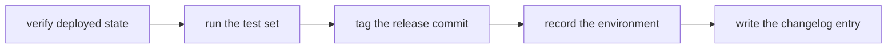

# Release Process

PatrolBot is a single-robot platform, not a distributed package. A release therefore means
**capturing a known-good, reproducible state of the whole robot** — both machines, the image,
the map, and the configuration — under one version.

The key words **MUST**, **MUST NOT**, and **SHOULD** are to be interpreted as described in
[RFC 2119](https://www.rfc-editor.org/rfc/rfc2119).

## Versioning

Releases use [CalVer](https://calver.org/) in `YYYY.MM` form — `2026.08`. A second release in
the same month takes an incrementing suffix: `2026.08.1`, `2026.08.2`.

CalVer rather than SemVer because nothing consumes PatrolBot as a dependency. There is no
downstream to break, so a "major" bump would carry no information; what a reader of a release
actually wants to know is *when this robot state was current*.

ROS package versions in `package.xml` follow their own upstream expectations and are **NOT**
governed by this scheme. Do not try to keep them in step with the release version.

## What a release pins

A release fixes all of the following together. Most of it is not in git, which is why it must be
recorded explicitly.

| Element | Recorded as |
|---|---|
| Monorepo state | Commit SHA of the tagged release commit |
| Pi runtime image | Image tag and digest, plus `org.opencontainers.image.revision` |
| Source-tree provenance | `io.patrolbot.source-tree-sha256` image label |
| Compose stack | Service set, image tags from `docker/.env` |
| SBC server | `patrolbot_server` source snapshot and binary build date |
| Active map | Map file and its resolution, with the matching costmap resolution |
| Undock profile | Whether `undock_profile.conf` is commissioned for this dock |

The SBC binary and the undock profile are the two elements most often forgotten. Neither lives
in the monorepo, and a release that omits them is not reproducible.

## Cutting a release



### 1. Verify the deployed state

On the Pi:

```bash
cd ~/patrolbot-repo && ./docker/status.sh
```

All containers **MUST** report `running` and `healthy`, and the reported revision and
source-tree digest **MUST** match the commit being released. A mismatch means the robot is not
running the code you are about to tag.

### 2. Run the test set

```bash
colcon test
```

Lint **MUST** be clean. Beyond that, run the checks from [Testing](../development/testing.md):
a real navigate-to-goal and the freeze/resume resilience matrix. The resilience matrix matters
more than usual here, because the failures it covers — reconnect TF gaps, empty-container
bringup — are exactly the ones that survive a green lint.

### 3. Confirm the load-bearing configuration

The settings in [Configuration](../reference/configuration.md) marked **MUST NOT change**
**MUST** be verified as still set correctly. A release is a natural point for someone to have
"tidied" one of them.

At minimum: `base_shift_correction: False`, `use_collision_detection: false`,
`source_timeout: 0.5`, `transform_tolerance: 1.0`, and `bond_timeout: 0.0`.

### 4. Tag

Tag the monorepo release commit with the CalVer version:

```bash
git tag 2026.08
git push origin 2026.08
```

### 5. Record the environment

Capture the elements that are not in git. This block belongs in the tag annotation or the
release note:

```text
Release 2026.08
- Monorepo @ <commit>
- Pi image @ <tag> / <digest>, org.opencontainers.image.revision=<commit>
- Source-tree digest: io.patrolbot.source-tree-sha256=<digest>
- Compose services: bringup, bridge, navigation, web-bridge
- SBC patrolbot_server built <date> from <snapshot>
- Active map: <file> @ <resolution> m/px; global costmap resolution <value>
- Undock profile: commissioned | uncommissioned
```

### 6. Write the changelog entry

Add a `## YYYY.MM` section to [Changelog](../changelog.md) describing what changed **in the
system**. Entries state behavior, configuration, or documented facts that are now different.

A changelog entry **MUST NOT** describe work in progress, and **MUST NOT** frame release
readiness in terms of outstanding items. If something is not in the release, it simply is not
mentioned.

## Package metadata

Some packages carry scaffold-default metadata — `patrolbot_bridge` has a placeholder maintainer
and description, `patrolbot-launch` has placeholder maintainer, description, and license values
with a manifest declaring only `ros2launch`, and `rosaria2` carries legacy placeholder values.

None of this affects runtime behavior. Correcting it is ordinary housekeeping and **SHOULD NOT**
block a release.

## Documentation

The docs site deploys continuously from `main` (see
[Pull Request Process](pull-request-process.md#merge-and-deploy)); there is no separate
documentation release step. Documentation is kept correct continuously rather than batched into
a release — see [Documentation Standards](documentation-standards.md).

The changelog is the one documentation artefact tied to the release, because it is the record of
what a given version *is*.

<!-- SPDX-License-Identifier: Apache-2.0 -->
