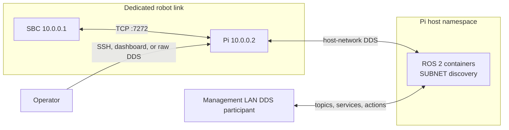

# Network Setup

PatrolBot has two distinct networking layers, and conflating them is the source of most "I can't
see the robot" confusion:

1. **SBC ↔ Pi:** a dedicated Ethernet link (`10.0.0.1/24` SBC,
   `10.0.0.2/24` Pi) carrying a single TCP socket on port 7272.
2. **ROS 2 DDS:** Fast DDS discovery is controlled by one Compose YAML setting. The current
   `SUBNET` policy exposes the complete ROS graph to the management LAN.



## The SBC ↔ Pi link

| Property | Value |
|---|---|
| Transport | TCP |
| SBC endpoint | `10.0.0.1:7272` (server) |
| Pi role | client (the bridge) |
| Requirement | Pi can reach the SBC's IP:port on the LAN |

This link is documented in full on
[Communication Architecture](../architecture/communication-architecture.md). It is plaintext and
unauthenticated, so it assumes a **trusted robot network**.

!!! success "Dedicated link configured and verified on 2026-07-15"
    Pi 5 `/etc/netplan/60-sbc-link.yaml` sets `eth0` to static
    `10.0.0.2/24` with DHCP disabled. After `netplan apply`, the link was 100
    Mbps/full duplex, the route to `10.0.0.1` used `eth0`, ping had no loss,
    and the bridge remained connected. The SBC pins `10.0.0.1/24` in
    `/etc/network/interfaces`; `patrolbot-wired-ip.service` re-applies it after
    carrier loss or reboot.

The installed Pi 5 override is:

```yaml
network:
  version: 2
  ethernets:
    eth0:
      dhcp4: false
      addresses: [10.0.0.2/24]
      optional: true
```

For a replacement installation, apply this only during a supervised maintenance
window, then validate with `ip -4 addr show eth0`, `ip route get 10.0.0.1`,
`ping 10.0.0.1`, bridge connection logs, and `docker/status.sh` before any motion
test. Do not open a separate probe connection to the single-client hardware
server while the bridge is active.

## ROS 2 discovery policy

| Setting | Value | Where |
|---|---|---|
| `ROS_DOMAIN_ID` | `0` | set by Compose/launch on Pi 5 |
| Middleware | FastDDS | default |
| Discovery | `SUBNET` (`ROS_AUTOMATIC_DISCOVERY_RANGE=SUBNET`) | one YAML anchor used by every Compose service |

Change only the scalar at the top of `docker/docker-compose.yml`:

```yaml
x-patrolbot-config:
  ros_discovery_range: &ros_discovery_range SUBNET  # or LOCALHOST
```

`SUBNET` lets LAN RViz and ROS CLI discover the robot, but it also lets every
DDS participant discover and publish to command topics and call actions and
services. There is no authentication, authorization, or read-only boundary in
raw DDS. Use `LOCALHOST` whenever that exposure is not explicitly required.

```bash
# Read-only status over the management channel:
ssh robot-pi2 'cd /home/ubuntu/patrolbot-repo && ./docker/status.sh'
```

## Remote visualization

With the current `SUBNET` policy, RViz and ROS CLI work on the same multicast-capable LAN using
`ROS_DOMAIN_ID=0`. Routed VPNs generally do not carry multicast and may still require a reviewed
bridge or discovery-server design.

The previous FastDDS Discovery Server experiment for VPN RViz was reverted on 2026-06-29. The unit
file and old XML profiles may still exist as backups, but they are **not the current runtime state**:

| Component | Status |
|---|---|
| `patrolbot-discovery.service` | on disk but disabled |
| `FASTRTPS_DEFAULT_PROFILES_FILE` in ROS 2 services | not set |
| Current discovery mode | LAN multicast (`SUBNET`) |

The old discovery-server experiment is still not part of the current design.

## Firewall / ports summary

| Port | Machine | Purpose |
|---|---|---|
| 7000 | SBC | socat → base serial (localhost use by ARIA) |
| 7272 | SBC | telemetry server (Pi connects) |
| DDS/RTPS | Pi and management LAN | unauthenticated ROS graph discovery and transport |

## Checklist

- [ ] Pi `eth0` has `10.0.0.2/24` and can reach `10.0.0.1:7272`.
- [ ] Core containers use `ROS_DOMAIN_ID=0` and one consistent discovery policy.
- [ ] When set to `SUBNET`, the operator accepts that `/cmd_vel`, action servers, and
      `/initialpose` are directly discoverable from the LAN.
- [ ] Set the YAML scalar back to `LOCALHOST` when raw LAN DDS is no longer required.
