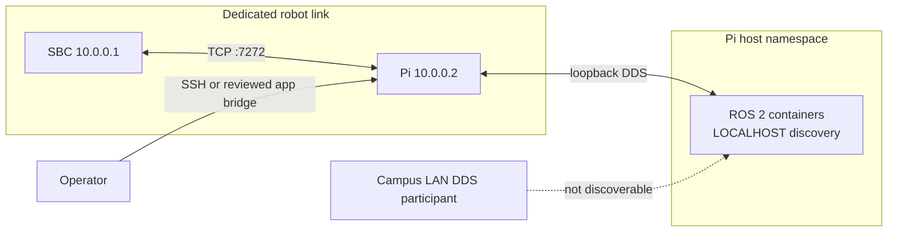

# Network Setup

PatrolBot has two distinct networking layers, and conflating them is the source of most "I can't
see the robot" confusion:

1. **SBC ↔ Pi:** a dedicated Ethernet link (`10.0.0.1/24` SBC,
   `10.0.0.2/24` Pi) carrying a single TCP socket on port 7272.
2. **Pi-internal ROS 2:** Fast DDS discovery is confined to loopback. External operator access is
   through SSH or a separately reviewed application bridge, not raw LAN DDS.



## The SBC ↔ Pi link

| Property | Value |
|---|---|
| Transport | TCP |
| SBC endpoint | `10.0.0.1:7272` (server) |
| Pi role | client (the bridge) |
| Requirement | Pi can reach the SBC's IP:port on the LAN |

This link is documented in full on
[Communication Architecture](../architecture/communication-architecture.md). It is plaintext and
unauthenticated, so it assumes a **trusted robot network**.

!!! success "Dedicated link configured and verified on 2026-07-15"
    Pi 5 `/etc/netplan/60-sbc-link.yaml` sets `eth0` to static
    `10.0.0.2/24` with DHCP disabled. After `netplan apply`, the link was 100
    Mbps/full duplex, the route to `10.0.0.1` used `eth0`, ping had no loss,
    and the bridge remained connected. The SBC pins `10.0.0.1/24` in
    `/etc/network/interfaces`; `patrolbot-wired-ip.service` re-applies it after
    carrier loss or reboot.

The installed Pi 5 override is:

```yaml
network:
  version: 2
  ethernets:
    eth0:
      dhcp4: false
      addresses: [10.0.0.2/24]
      optional: true
```

For a replacement installation, apply this only during a supervised maintenance
window, then validate with `ip -4 addr show eth0`, `ip route get 10.0.0.1`,
`ping 10.0.0.1`, bridge connection logs, and `docker/status.sh` before any motion
test. Do not open a separate probe connection to the single-client hardware
server while the bridge is active.

## ROS 2 discovery (Pi-internal only)

| Setting | Value | Where |
|---|---|---|
| `ROS_DOMAIN_ID` | `0` | set by Compose/launch on Pi 5 |
| Middleware | FastDDS | default |
| Discovery | `LOCALHOST` (`ROS_AUTOMATIC_DISCOVERY_RANGE=LOCALHOST`) | every Compose service |

The host-network containers still discover each other through loopback, but a laptop on the LAN
cannot discover or publish to the robot's ROS graph. This is the PB-AUDIT-017 containment boundary.
Do not restore `SUBNET` merely to make RViz convenient; use SSH/container-local read-only commands
or a separately reviewed authenticated bridge.

```bash
# Read-only status over the management channel:
ssh robot-pi2 'cd /home/ubuntu/patrolbot-repo && ./docker/status.sh'
```

## Remote visualization

Raw RViz discovery is unavailable on both the LAN and VPN by deliberate policy. This is not a
robot-health symptom. Any future remote visualization design must preserve authenticated command
boundaries and must not silently reopen DDS command topics to the campus network.

The previous FastDDS Discovery Server experiment for VPN RViz was reverted on 2026-06-29. The unit
file and old XML profiles may still exist as backups, but they are **not the current runtime state**:

| Component | Status |
|---|---|
| `patrolbot-discovery.service` | on disk but disabled |
| `FASTRTPS_DEFAULT_PROFILES_FILE` in ROS 2 services | not set |
| Current discovery mode | loopback-only (`LOCALHOST`) |

Treat VPN RViz as a future re-enable project, not as a configured feature.

## Firewall / ports summary

| Port | Machine | Purpose |
|---|---|---|
| 7000 | SBC | socat → base serial (localhost use by ARIA) |
| 7272 | SBC | telemetry server (Pi connects) |
| DDS/RTPS | Pi loopback only | communication among host-network robot containers |

## Checklist

- [ ] Pi `eth0` has `10.0.0.2/24` and can reach `10.0.0.1:7272`.
- [ ] Core containers use `ROS_DOMAIN_ID=0` and `ROS_AUTOMATIC_DISCOVERY_RANGE=LOCALHOST`.
- [ ] No LAN participant can discover `/cmd_vel`, action servers, or `/initialpose` directly.
- [ ] Any future visualization bridge is separately authenticated and reviewed before commands are enabled.
