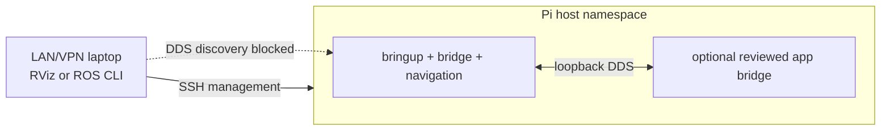

# Remote Operation

PatrolBot's ROS 2 graph is deliberately **not exposed to the LAN or VPN**. Every
runtime container uses `ROS_AUTOMATIC_DISCOVERY_RANGE=LOCALHOST`, so raw RViz or
ROS CLI processes on an operator laptop cannot discover topics, services, or
actions. This closes the unauthenticated DDS command path identified by
PB-AUDIT-017.

## Supported observation path

Use SSH for read-only status and logs:

```bash
ssh robot-pi2 'cd /home/ubuntu/patrolbot-repo && ./docker/status.sh'
ssh robot-pi2 'docker logs --tail 100 patrolbot-navigation'
ssh robot-pi2 'docker logs --tail 100 patrolbot-bridge'
```

The optional web dashboard uses a separate application bridge on the Pi. It
does not open another SBC connection. Its command capability is a distinct,
explicit mode and must be reviewed independently; telemetry availability does
not imply permission to send a goal or initial pose.

## Why LAN RViz no longer discovers the robot



This is expected policy, not a transport fault. The old Fast DDS Discovery
Server experiment remains disabled, and `SUBNET` discovery must not be restored
as a convenience workaround.

## Command boundary

- Read-only SSH checks are safe when they do not create a second TCP 7272 client.
- A navigation goal, initial pose, hardware-control service, or velocity is an
  explicit robot command even when sent through a dashboard.
- Velocity publication requires the operator to be told the exact topic,
  magnitude, direction, duration/distance, safety bounds, and stop conditions,
  followed by explicit approval.
- Current physical audit gates still prohibit normal autonomous operation.

If richer remote visualization is needed later, use an authenticated,
allowlisted bridge and separately review its command permissions. Do not expose
the raw ROS graph to the campus LAN.

See [Network Setup](network-setup.md) for the underlying topology and
[Known Gaps](../known-gaps.md) for the physical commissioning state.
