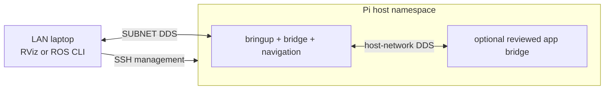

# Remote Operation

PatrolBot currently uses `ROS_AUTOMATIC_DISCOVERY_RANGE=SUBNET`, selected by the
single `x-patrolbot-config.ros_discovery_range` scalar in
`docker/docker-compose.yml`. Raw RViz and ROS CLI processes on the same
multicast-capable LAN can discover the full graph.

This is not read-only exposure. Raw DDS has no authentication or authorization,
so LAN participants can also discover publishers, command topics, services, and
actions. Set the YAML scalar to `LOCALHOST` to restore Pi-only discovery.

## Supported observation path

Use SSH for read-only status and logs:

```bash
ssh robot-pi2 'cd /home/ubuntu/patrolbot-repo && ./docker/status.sh'
ssh robot-pi2 'docker logs --tail 100 patrolbot-navigation'
ssh robot-pi2 'docker logs --tail 100 patrolbot-bridge'
```

The optional web dashboard uses a separate application bridge on the Pi. It
does not open another SBC connection. Its command capability is a distinct,
explicit mode and must be reviewed independently; telemetry availability does
not imply permission to send a goal or initial pose.

## LAN RViz discovery



The VM/laptop must use `ROS_DOMAIN_ID=0`, compatible ROS 2 types, and a network
that passes multicast. The old Fast DDS Discovery Server experiment remains
disabled, so routed VPN discovery is not implied by `SUBNET`.

## Command boundary

- Read-only SSH checks are safe when they do not create a second TCP 7272 client.
- A navigation goal, initial pose, hardware-control service, or velocity is an
  explicit robot command even when sent through a dashboard.
- Velocity publication requires the operator to be told the exact topic,
  magnitude, direction, duration/distance, safety bounds, and stop conditions,
  followed by explicit approval.

Prefer the authenticated dashboard when raw DDS is unnecessary. If `SUBNET` is
enabled, treat the management LAN as part of the robot command trust boundary.

See [Network Setup](network-setup.md) for the underlying topology and
[Limitations](../reference/limitations.md) for what the containment boundary
means in practice.
