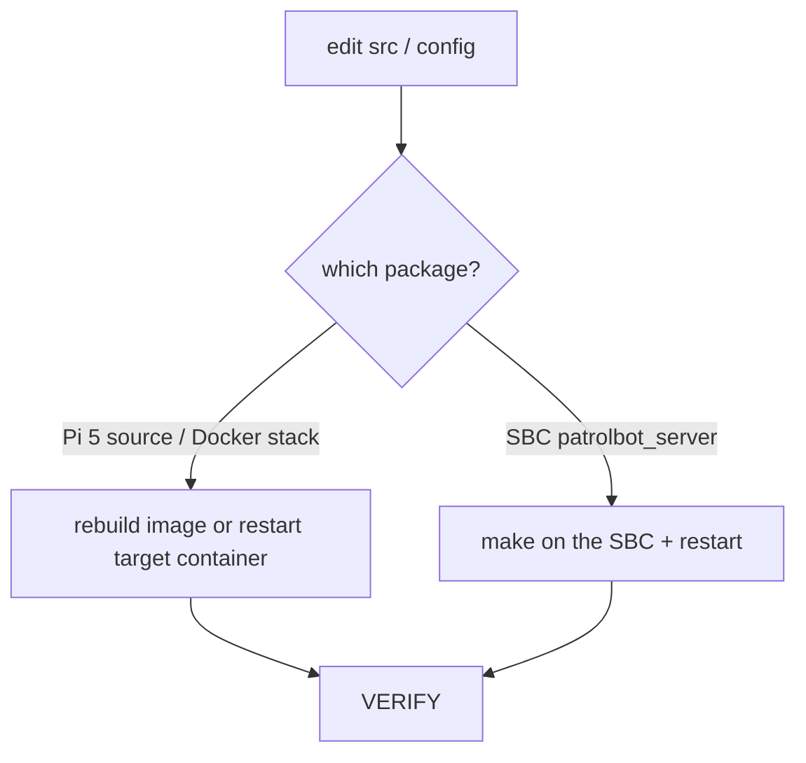

# Updates

Update the canonical monorepo first, validate it, then deploy that exact revision.
The Pi 5 path uses Docker Compose and is covered in [Docker Deployment](docker.md).

## Update map



## Updating a Pi 5 package

### patrolbot_bridge / patrolbot_navigation / patrolbot-launch

The deployed source is bind-mounted read-only into the three containers. Existing
files can be changed by deploying the exact monorepo revision and restarting the
owning container; adding files or changing package metadata requires a new image.

```bash
cd ~/patrolbot-repo/docker
docker compose build navigation
docker compose up -d
./patrolbot-status
```

For an existing bind-mounted file, restart only `bringup`, `bridge`, or
`navigation`. Never edit the deployed Pi tree as the canonical source.

## Updating the SBC server

!!! danger "Treat the executable, not the source tree, as the rollback artifact"
    The SBC source tree and its running binary are related only by whoever last ran `make`.
    A build in place can silently produce different behaviour with no error and no version
    change. Always overwrite the SBC source from the repository into an isolated staging
    directory, build there, and keep the **binary** as the thing you can roll back to.

!!! note "Source-tree divergence status — re-verified 2026-08-07"
    The 2026-07-29 divergence (SBC `.cpp` files older than repo HEAD) is **no longer present**.
    Comparing the captured SBC tree in `backups/20260806T135835Z-sbc-running-binary/sbc/source/`
    against `hardware/patrolbot_hw_server/` at HEAD: `Makefile`, `patrolbot_server.cpp`,
    `protocol.{cpp,hpp}`, `undock.{cpp,hpp}`, `undock_profile.conf` and
    `patrolbot_commission_probe.cpp` are byte-identical. `hardware/` has not changed since that
    capture, so the SBC sources still match HEAD.

    Two corrections to the older record. The marker string `Dock-turn authorization armed`
    is absent from the running binary's dumped strings *and* from repo HEAD, so it no longer
    discriminates between revisions — do not use it as a divergence test. And the current
    baseline binary is `sha256 d59a9981…` (built 2026-07-29 15:34, `MainPID 1344`), which
    matches neither the `97655f94…` nor the `fba73511…` cited in earlier notes. The current,
    authoritative baseline is `backups/20260806T135835Z-sbc-running-binary/`, which carries the
    executable, its sources, `ldd`, symbols, strings and a `SHA256SUMS` manifest.

    Still unverified: that `make -B` in staging reproduces a binary equivalent to the running
    one. That check needs the SBC reachable and is the reason the staged-build discipline below
    is mandatory rather than advisory. `test_motors.cpp` exists on the SBC but not in the repo.

### 1. Capture the rollback artifact (the binary, not the source)

```bash
STAMP=$(date -u +%Y%m%dT%H%M%SZ)
mkdir -p backups/$STAMP-sbc/sbc
ssh robot-sbc 'cat /home/ros/patrolbot_hw_server/patrolbot_server' \
  > backups/$STAMP-sbc/sbc/patrolbot_server
ssh robot-sbc 'sha256sum /home/ros/patrolbot_hw_server/patrolbot_server;
               stat -c "%n %s %U:%G %a" /home/ros/patrolbot_hw_server/patrolbot_server;
               ldd /home/ros/patrolbot_hw_server/patrolbot_server;
               systemctl --user show patrolbot-server.service -p ExecStart -p MainPID' \
  > backups/$STAMP-sbc/sbc/baseline.txt
```

### 2. Stage the exact repository revision on the SBC

```bash
cd hardware/patrolbot_hw_server
ssh robot-sbc "mkdir -p /home/ros/patrolbot-builds/$STAMP/tests"
tar cf - Makefile *.cpp *.hpp *.conf tests/*.cpp \
  | ssh robot-sbc "cd /home/ros/patrolbot-builds/$STAMP && tar xf -"
```

### 3. Build and test in the staging directory — nothing installed yet

```bash
# -B because the SBC RTC makes mtimes unreliable.
ssh robot-sbc "cd /home/ros/patrolbot-builds/$STAMP && make -B test && make -B patrolbot_server"
ssh robot-sbc "cd /home/ros/patrolbot-builds/$STAMP && file patrolbot_server && \
               ldd patrolbot_server && sha256sum patrolbot_server"
```

Expect both suites green (`protocol_test`, `undock_test`), a 32-bit i386 ELF, and every shared
library resolved. Static contract check before installing:

```bash
ssh robot-sbc "cd /home/ros/patrolbot-builds/$STAMP && \
  ! grep -q 'setRotVel' undock.cpp && \
  ! grep -qE 'DepartureAuthorization|DRIVE_ALLOWED_DOCK_(DEPARTURE|TURN)' *.cpp *.hpp && \
  echo CONTRACT_OK"
```

### 4. Install atomically, with the robot stationary and motors disabled

```bash
ssh robot-sbc "cp /home/ros/patrolbot-builds/$STAMP/undock_profile.conf \
                  /home/ros/patrolbot_hw_server/undock_profile.conf"
ssh robot-sbc "cd /home/ros/patrolbot-builds/$STAMP && \
  cp Makefile *.cpp *.hpp /home/ros/patrolbot_hw_server/ && \
  cp tests/*.cpp /home/ros/patrolbot_hw_server/tests/"
ssh robot-sbc "systemctl --user stop patrolbot-server.service && \
  install -o ros -g ros -m 755 /home/ros/patrolbot-builds/$STAMP/patrolbot_server \
    /home/ros/patrolbot_hw_server/patrolbot_server.new && \
  mv -f /home/ros/patrolbot_hw_server/patrolbot_server.new \
        /home/ros/patrolbot_hw_server/patrolbot_server && \
  systemctl --user start patrolbot-server.service"
```

Copying the sources back in step 4 is what stops the drift above from recurring.

Stop **only** `patrolbot-server.service`. Do not restart `socat-boot.service`, do not change
serial state, and never run a second process on port 7272 — the base connection is single-owner.

### 5. Verify, stationary

```bash
ssh robot-sbc 'systemctl --user status patrolbot-server.service --no-pager -l | tail -20'
ssh robot-sbc 'journalctl --no-pager -t patrolbot_server --since "-2 min" | tail -20'
```

Expect `PatrolBot text server listening on port 7272`, an `Undock profile loaded … commissioned=`
line, and `Pi connected` within ~3 s as the bridge reconnects on its own. Then confirm the Pi sees
the new fields:

```bash
ssh robot-pi2 "docker exec patrolbot-bridge bash -lc \
  'source /opt/ros/\$ROS_DISTRO/setup.bash; ros2 topic echo --once /patrolbot/base_state'"
```

`dock_state` should be populated and `undock_profile_commissioned` should reflect the profile.

The Pi bridge drops and reconnects automatically during the restart. **Note:** losing the link
now disables the motors unconditionally, so the first motion after a reconnect needs an explicit
`MOTOR_ENABLE`.

## Updating the map

The active map scale is operator-confirmed and should not be changed casually:
`second_map.{yaml,pgm}` is `3192×2205 @ 0.075 m`, origin `[-1,-1,0]`. The global costmap remains
coarser at `0.2 m` for planning speed; the local costmap remains `0.1 m`.

```bash
# In the canonical monorepo, replace the active map and commit it.
cp new_map.pgm  ros2_ws/src/patrolbot_navigation/maps/second_map.pgm
cp new_map.yaml ros2_ws/src/patrolbot_navigation/maps/second_map.yaml
# Do not change map resolution/scale unless the new map is operator-verified
# Deploy that exact revision to Pi 5, then:
cd ~/patrolbot-repo/docker
docker compose restart navigation
```

After replacing a map, keep navigation unavailable until an operator deliberately supplies and
validates a fresh pose through an authorized local interface. If the source map is a CAD drawing,
remove title blocks, border frames, and furniture/hatching artifacts that the laser cannot see.

## Rolling back the SBC server

```bash
scp backups/<STAMP>-sbc/sbc/patrolbot_server \
    robot-sbc:/home/ros/patrolbot-builds/rollback-patrolbot_server
ssh robot-sbc 'sha256sum /home/ros/patrolbot-builds/rollback-patrolbot_server'  # match baseline.txt
ssh robot-sbc 'systemctl --user stop patrolbot-server.service && \
  install -o ros -g ros -m 755 /home/ros/patrolbot-builds/rollback-patrolbot_server \
    /home/ros/patrolbot_hw_server/patrolbot_server.new && \
  mv -f /home/ros/patrolbot_hw_server/patrolbot_server.new \
        /home/ros/patrolbot_hw_server/patrolbot_server && \
  systemctl --user start patrolbot-server.service'
```

Restarts only with the robot stationary and motors disabled. **No rollback step may send
`CHARGE 1`, move the robot, clear an E-stop, or auto-enable motors.**

## Rolling back

| Change | Roll back by |
|---|---|
| Pi package | revert the monorepo commit, rebuild, and restart |
| Mobile base | `git` revert in `patrolbot-launch`, rebuild if needed, restart `patrolbot-bringup` |
| Map change | restore the previous `second_map.{pgm,yaml}` and restart `patrolbot-navigation` |
| Docker stack | deploy the previous immutable Pi 5 image/revision |
| SBC server | restore the **saved binary** (not the source tree) by atomic rename + restart the one unit |

## Post-update verification

```bash
ssh robot-pi2 'cd /home/ubuntu/patrolbot-repo && ./docker/status.sh'
ssh robot-pi2 "docker exec patrolbot-navigation bash -lc \
  'source /opt/ros/\$ROS_DISTRO/setup.bash; for topic in /odom /scan /cmd_vel; do \
     timeout --signal=INT --kill-after=2 6 ros2 topic hz \"\$topic\" || true; \
   done'"
# Stop at stationary validation unless the separate physical-motion campaign is approved.
```

Re-run the [resilience tests](../development/testing.md#resilience-tests-the-important-ones) after
any change near the seam (bridge, SBC server, lifecycle/launch).

## Keep the docs in sync

After a structural change (new package, launch, service, Docker behavior, map fact, or laser TF),
update the package `README.md`, the source workspace `SKILLS/` file, and this site.
