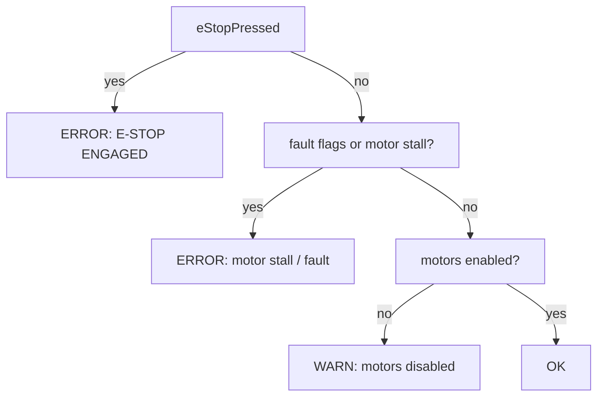

# Controllers & Base Status

This page covers the **base microcontroller's status channel** — the flags, faults, and stall
data the Pioneer base reports — and how PatrolBot surfaces them as ROS diagnostics. The drive
side of the same controller is on [Actuators](actuators.md).

## Base status source

| Field | Value |
|---|---|
| **Hardware** | Pioneer base microcontroller |
| **Host machine** | **SBC** (read by ARIA under `robot.lock()`) |
| **Connection** | base bus → ARIA → `AUX:FLAGS=flags,faultFlags,stallValue,motorsEnabled,eStopPressed` |
| **ROS topic** | `/diagnostics` (`diagnostic_msgs/DiagnosticArray`) |
| **Update rate** | ~4–5 Hz |
| **Diagnostic name / hardware_id** | `patrolbot/base` / `pioneer_patrolbot` |

## What the bridge reports

The bridge decodes the five `FLAGS` integers and publishes a single `DiagnosticStatus`:

| KeyValue | Source | Meaning |
|---|---|---|
| `estop_pressed` | `isEStopPressed()` | whether the hardware e-stop is latched |
| `motors_enabled` | `areMotorsEnabled()` | are the drive motors on |
| `flags` | `getFlags()` | raw base flags |
| `fault_flags` | `getFaultFlags()` | raw fault flags |
| `stall_value` | `getStallValue()` | raw 16-bit stall word |
| `left_motor_stall` | `stall & 0x0100` | **reliable** left motor stall |
| `right_motor_stall` | `stall & 0x0001` | **reliable** right motor stall |
| `left_bumper_bits_raw` | `(stall >> 9) & 0x7F` | legacy diagnostic name; includes the mapped front inputs (see note) |
| `right_bumper_bits_raw` | `(stall >> 1) & 0x7F` | legacy diagnostic name; includes the mapped rear inputs (see note) |

### Diagnostic level logic



The alarm level is driven by e-stop state, fault flags, motor stalls, and
motor-enable state. The bumper bit-fields are reported raw but do **not** affect the level.

!!! note "Measured bumper mapping"
    The earlier reserved/unwired-bit explanation was superseded by the July 23 physical
    mapping of all six front and six rear panels: front bits 9–14 (`0x7e00`), rear
    bits 1–6 (`0x007e`). The dock can hold the centre-front inputs `0x1800` active;
    that reading is not by itself evidence of an unwired input. `BaseState` reports
    front/rear group state only when `bumpers_valid` is true. The raw diagnostic names
    retain their legacy left/right labels and do not imply the bumper wiring.
    Direction-aware software holds consume the mapped groups separately from the
    diagnostic alarm level. Firmware BumpStall and enabled-motion cutoff still need
    acceptance under [robot issue #9](https://github.com/cmu-impactlab/patrolbot/issues/9).

## Stall word layout

```
stall_value (16-bit):
  bit 8 = LEFT motor stall     bit 0 = RIGHT motor stall
  bits 9..14 = mapped FRONT bumper panels
  bits 1..6  = mapped REAR bumper panels
  other bits = raw only; not part of the commissioned bumper masks
```

## Failure conditions

| Condition | Symptom | Handling |
|---|---|---|
| Hardware e-stop latched | `/diagnostics` level ERROR, `estop_pressed = True` | release the physical red e-stop; software cannot override it |
| Motor stall | `/diagnostics` level ERROR, `left/right_motor_stall = True` | base also halts; clear the obstruction, re-enable if needed |
| Base fault | `/diagnostics` level ERROR, `fault_flags != 0` | inspect on `rqt_robot_monitor` |
| Malformed `FLAGS` section | no `/diagnostics` update that cycle | dropped in isolation; nav data unaffected |
| Motors disabled | level WARN, `motors_enabled = False` | use the separate `/patrolbot/motor_enable` request; dock/localization/LiDAR state does not gate power, E-stop remains effective and `DRIVE` cannot enable motors |

## Where the controller setpoints come from

The *commands* this controller executes are produced entirely on the Pi by the
[`cmd_vel` chain](../architecture/software-architecture.md#the-cmd_vel-arbitration-chain) and
forwarded as `DRIVE` lines (see [Actuators](actuators.md)). The base controller is otherwise a
black box configured by the ARIA parameter file `patrolbot-sh.p`.

