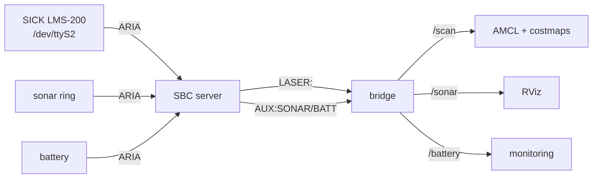

# Sensors

All sensing hardware is wired to the **SBC** and reaches ROS 2 only through the bridge's TCP
stream (see [Communication Architecture](../architecture/communication-architecture.md)). Each
sensor below lists its host, connection, ROS interface, rate, calibration, and failure modes.

## SICK LMS-200 laser

The primary perception sensor: localization and obstacle avoidance both depend on it.

| Field | Value |
|---|---|
| **Hardware** | SICK LMS-200 planar laser scanner |
| **Host machine** | **SBC** |
| **Connection** | `/dev/ttyS2` @ 38400 baud, read by ARIA `ArLaserConnector` |
| **Protocol (to ROS)** | SBC parses ARIA ranges → `LASER:r1,...,rN` text line → bridge → `/scan` |
| **ROS topic** | `/scan` (`sensor_msgs/LaserScan`), frame `laser_frame` |
| **Field of view** | 180° forward: `angle_min = -π/2`, `angle_max = +π/2` |
| **Beam count** | **181 beams at exactly 1.0°** — ARIA's `lms2xx` defaults |
| **Range** | `range_min = 0.25 m`, `range_max = 8.0 m` |
| **Update rate** | ~20 Hz |

!!! danger "`LaserStartDegrees -55` / `LaserEndDegrees 55` do **not** describe this laser"
    `patrolbot-sh.p` contains two laser sections, and the constrained ±55° / 1.0° angles belong
    to **`Section Laser 2 parameters`** — `LaserType urg` on `COM5` with
    `LaserAutoConnect false`, the low URG-04LX that has never connected on this robot
    (PB-AUDIT-005). The SICK is **`Section Laser parameters`** (Laser_1): `LaserType lms2xx`,
    `COM3`, `LaserAutoConnect true`, and its `LaserStartDegrees`, `LaserEndDegrees` and
    `LaserIncrement` are all **blank**, so ARIA's `lms2xx` defaults apply — `"180"` degrees and
    `"one"` degree increment, i.e. 181 beams spanning −90°…+90°.

    Reading the wrong section produces a very convincing false diagnosis: that the bridge
    stretches 111 beams across 180° and hands AMCL walls at wrong bearings. It does not. This
    misreading has already been made once, on 2026-08-21, from a repo copy of `patrolbot-sh.p`
    that had been head-truncated so only the Laser_2 block was visible. The full file has since
    been restored.

    Live confirmation, `diagnostics/session1/oneshot/_scan.yaml`: `angle_increment` reads
    `0.01745329238474369` rad = 0.99999999°. The bridge computes `angle_increment` as
    `π/(N−1)`, so that header is only reachable at `N = 181`.

### Calibration / mounting

- **Position:** `base_link → laser_frame` static TF at `x = 0.037 m` (ARIA `LaserX`), `z = 0.2 m`.
- **Orientation:** the SICK is mounted **flipped** (`LaserFlipped=true` in `patrolbot-sh.p`) and
  ARIA returns readings in flipped order, so the scan arrives mirrored left↔right. The live launch
  corrects this with **`roll = π`** about the forward axis (front stays front; left/right swap is
  undone).
- **Footprint-clearance cutoff:** the bridge forces any return `< 0.25 m` to `+inf`. Do not raise
  this much higher; nearby real obstacles can appear in the 0.25-0.40 m range.
- **`LaserIgnore` does nothing.** Laser_1 carries `LaserIgnore -76--72 72-76`, which reads like
  the self-occlusion at the robot's own frame is already suppressed at the ARIA level. It is
  not. `ArLaser::laserProcessReadings` only calls `setIgnoreThisReading(true)` — the reading
  stays in the list with its real range — and `patrolbot_server.cpp` iterates
  `laser->getRawReadings()` emitting **every** range without ever consulting
  `getIgnoreThisReading()`. Those beams reach `/scan` intact. The bridge's `SCAN_RANGE_MIN`
  cutoff above is what actually suppresses them, which is why its comment names the same
  ~−75° grazing angle. Changing `LaserIgnore` in `patrolbot-sh.p` will not change `/scan`.

!!! success "Orientation confirmed"
    `roll = π` is the correct static TF for the flipped SICK mount. It is consistent with
    `LaserFlipped=true` in `patrolbot-sh.p`; older `yaw = π` notes are stale.

!!! danger "The scan geometry is two errors that cancel — never fix one half alone"
    The chain is load-bearing and easy to break by "cleaning up" either end:

    1. `LaserFlipped=true` makes ARIA negate both its offset and its increment
       (`ArLMS2xx::laserCheckParams`), so the loop in `ArLMS2xx` walks
       `atDeg = +90, +89, … −90`. **`getRawReadings()` therefore returns the sweep
       left-to-right, index 0 = +90°.**
    2. The SBC sends **ranges only** — ARIA's per-reading angles are discarded on the wire.
    3. The bridge assigns index 0 to `angle_min = −90°`, which **mirrors the scan**.
    4. The `roll = π` static TF **mirrors it back**.

    Net result is correct, and the robot's walls line up. But there is no single place that is
    "right": step 3 is wrong, step 4 compensates. Anyone who makes the bridge honour ARIA's
    angle order, or sets `LaserFlipped false`, or drops the roll to match a physical
    measurement, will silently mirror every scan the robot takes — which localizes plausibly in
    a symmetric corridor and catastrophically everywhere else.

    This also applies to the un-deployed rosaria2 work in issue #34, which records a conflicting
    mount pose of `x = -0.422, yaw = -20.22°`. That is **not** what runs today; the live static
    TF reads back `x = 0.037, y = 0, z = 0.2, roll = π`. Reconcile the two before deploying it.

### Failure conditions

| Condition | Symptom | Handling |
|---|---|---|
| Laser unplugged / SBC can't open `/dev/ttyS2` | `LASER:` field empty or absent | bridge publishes no/short `/scan`; costmaps clear, AMCL can't update → `map→odom` stops |
| SBC link unavailable | no `/scan` at all | bridge reconnects every 3 s; resumes on return |
| Scan appears mirrored in RViz | walls on wrong side | re-check `LaserFlipped` and the `roll=π` static TF |
| Phantom obstacle hugging the robot | nav refuses to move | check `SCAN_RANGE_MIN`; inspect `/scan` inside `patrolbot-bridge` |

## Sonar

| Field | Value |
|---|---|
| **Hardware** | 4 rear-facing sonar sensors on the Pioneer base |
| **Host machine** | **SBC** (read by ARIA; enabled at startup via `robot.enableSonar()`) |
| **Connection** | base bus → ARIA → `AUX:SONAR=x,y;...` text line |
| **ROS topic** | `/sonar` (`sensor_msgs/PointCloud2`), frame `base_link` |
| **Update rate** | ~4–5 Hz (every 5th nav frame) |
| **Calibration** | geometry from ARIA `patrolbot-sh.p`; the SBC computes each valid echo as a point in `base_link` |

The sonar does **not** feed the costmaps — path planning is laser-only. It is, however, the
observation source for the collision monitor's `rear_velocity_stop` polygon, so a single sonar
return (`min_points: 1`) halts reverse motion. Sonar can stop the robot; it cannot shape a path.
The ARIA param file defines a generic 16-position ring, but the robot physically has 4 rear sensors
and the 12 unpopulated entries sit at max range. The SBC publishes only valid echoes
(`getRange() < 4335 mm`), so `/sonar` width is the live detection count, often 0-2.

**Failure conditions:** a malformed `SONAR` section is dropped in isolation (the `AUX` line is
parsed section-by-section), so a sonar glitch never disturbs `/scan` or `/odom`. If the base does
not report sonar, `/sonar` simply stops; nothing else is affected.

## Battery

| Field | Value |
|---|---|
| **Hardware** | Pioneer base battery (no true state-of-charge sensor) |
| **Host machine** | **SBC** (ARIA battery readings) |
| **Connection** | base bus → ARIA → `AUX:BATT=volt,soc,chargeState,temp` |
| **ROS topic** | `/battery` (`sensor_msgs/BatteryState`) |
| **Update rate** | ~4–5 Hz |

Field mapping in the bridge:

- `voltage` — `getRealBatteryVoltageNow()`; **the meaningful field.**
- `percentage` — `NaN` if the base reports no state-of-charge (`soc = -1`), which is the case here.
- `power_supply_status` — raw ARIA charge state is interpreted only through the fresh SBC dock
  observer: `CHARGING` for positive raw charge in `DOCKED_CONFIRMED`, `NOT_CHARGING` for raw
  zero while docked, `DISCHARGING` in `DEPARTING` or `CLEAR_CONFIRMED`, and `UNKNOWN` when the
  observer is stale or faulted. Raw state `2`/`3` can re-latch after physical departure.
- `temperature` — `NaN` if unavailable.

**Failure conditions:** treat `percentage` as unavailable on this base — monitor `voltage`. A
malformed `BATT` section drops only `/battery`.

## Sensor data path (summary)

See [Controllers](controllers.md) for the base status/diagnostics path and
[Actuators](actuators.md) for the drive side.
