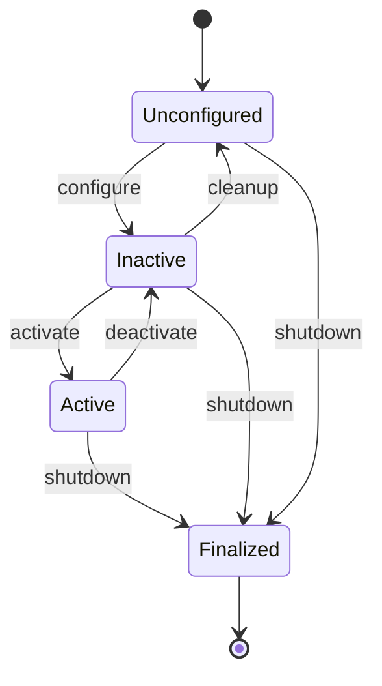
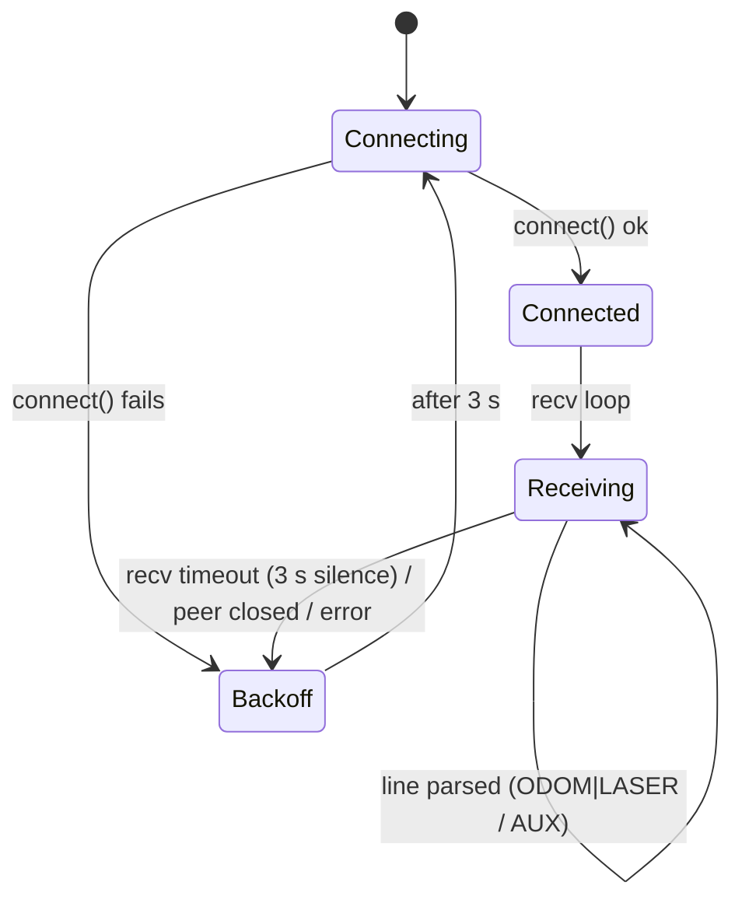
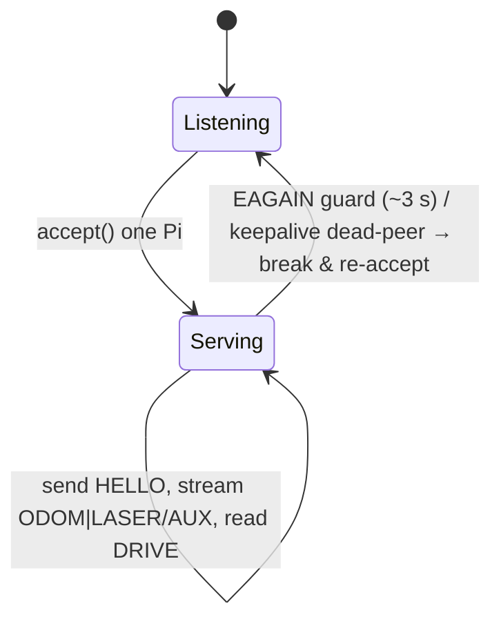
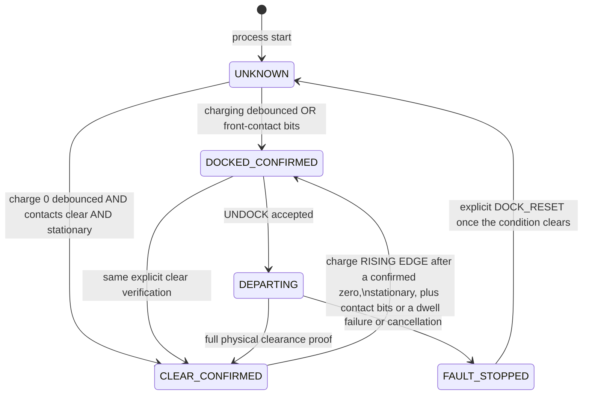
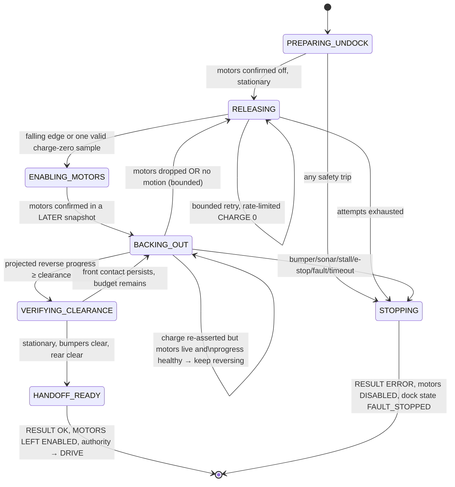
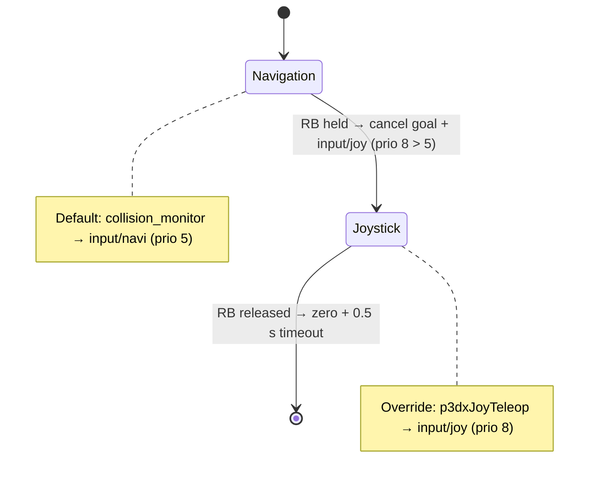
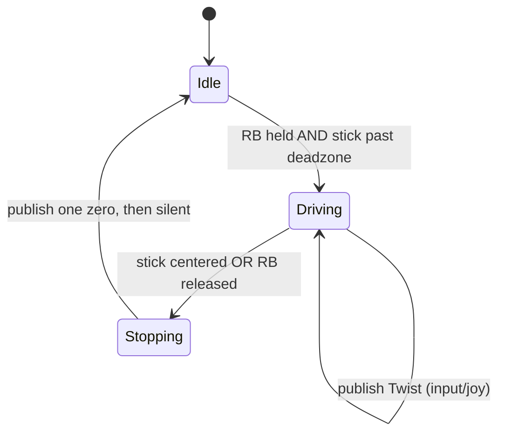

# State Machines

Several parts of PatrolBot are best understood as state machines. This page collects them: the
Nav2 lifecycle, the bridge's connection logic, the twist_mux arbitration, and the joystick
interlock.

## Nav2 lifecycle node

Every node in `nav2_container` is a **managed lifecycle node**. The lifecycle managers (patched
with `bond_timeout: 0.0`) drive them with `autostart: True`, and `lifecycle_mgr.py` drives the
mobile-base `teleop_velocity_smoother` the same way.

- **autostart** walks every managed node `Unconfigured → Inactive → Active` at launch.
- **`bond_timeout: 0.0`** disables the bond watchdog that would otherwise abort a node whose
  configure/activate takes too long — necessary because inflating the large map is slow. See
  [Software Architecture](../architecture/software-architecture.md#the-large-map-problem).
- Drive a transition by hand with `ros2 lifecycle set /<node> activate` or the `change_state`
  service ([Services](../ros2/services.md)).

## Bridge connection state machine

- **Connecting:** open socket, set `SO_KEEPALIVE` + `RECV_TIMEOUT = 3 s`.
- **Receiving:** accumulate bytes, split on `\n`, dispatch each line.
- **Backoff → Connecting:** 3 s of silence (timeout), a closed peer, or any error closes the socket
  and retries after 3 s.

This is what makes the SBC link self-healing without operator action — detailed on
[Communication Architecture](../architecture/communication-architecture.md#self-healing-hardened-on-both-ends).

## SBC server accept state machine

The server is single-client: an outer `while(robot.isRunning())` loop wraps `accept()`, so a gone
Pi is detected (sustained `EAGAIN` + TCP keepalive/`TCP_USER_TIMEOUT`) and the server returns to
`Listening` for the next connection. Losing the client stops the base, **disables the motors
unconditionally**, and invalidates any operation in flight; nothing resumes on reconnect.

## SBC dock observer (persistent)

Decides whether the robot may be driven at all. It survives client reconnects and starts at
`UNKNOWN` — nothing is assumed at process start.

Ordinary `DRIVE` is permitted **only** in `CLEAR_CONFIRMED`. `charge_state` is an input to this
observer, never an interlock in its own right, so a stale re-asserted charge level after a proven
departure does not block navigation — and the only latch that survives such a level is
`DEPARTING → CLEAR_CONFIRMED`, which requires measured displacement plus clear bumpers and rear
sonar. A stale level alone can never move the observer back to `DOCKED_CONFIRMED`.

## SBC undock operation (bounded)

Runs only between `DEPARTING` entry and exit, at 20 Hz in the main loop, supervised from outside
by an independent `ArASyncTask` command-lease watchdog.

Two terminal outcomes, deliberately different:

| | Velocity | Motors | Authority | Dock state |
|---|---|---|---|---|
| Success (`HANDOFF_READY`) | 0, confirmed | **enabled** | transferred to `DRIVE` | `CLEAR_CONFIRMED` |
| Failure / cancel (`STOPPING`) | 0, confirmed | **disabled** | `NONE` | `FAULT_STOPPED` |

Success leaves the motors live because the generic drive gate refuses motion without them:
handing off any other way would strand the robot. Charge re-assertion while the reverse is
healthy does **not** stop the robot — stopping on every re-latch would let the contacts settle
back in — it only triggers a rate-limited `CHARGE 0`. Completion uses signed reverse progress
projected onto the departure heading, with lateral-drift and heading-error limits, so forward or
sideways motion never counts as progress.

## `cmd_vel` arbitration (twist_mux)

Not a classic FSM, but a priority selection that behaves like one over time:

The joystick (priority 8) preempts navigation (priority 5) when RB is held and
cancels the active Nav2 goal. On release the teleop ramps to zero and stays at
priority 8 until cancellation is confirmed, then goes silent and times out
after 0.5 s. A new autonomous goal must be sent explicitly. Configured-but-unused
inputs (safety 10, teleop 8, switch 6) would slot into this ordering if a
publisher appeared.

## Joystick interlock (deadman)

The teleop publishes **only** while commanded or while waiting for takeover
cancellation, so an idle-but-connected controller never blocks autonomy. The
explicit zero on release prevents coasting; silence begins only after the prior
Nav2 goal cannot resume. See
[Nodes → patrolbot_joy_teleop](../ros2/nodes.md#patrolbot_joy_teleop).
