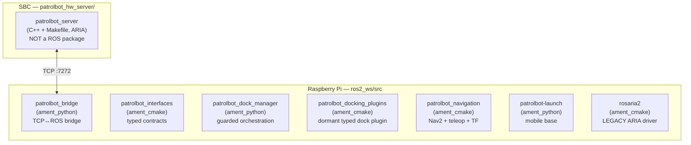

# Package Overview

PatrolBot's code is organized into **six packages built into the Pi image**, one source-only legacy
ROS driver, and one standalone C++ program on the SBC.

## The packages

| Package | Build type | Machine | Status | Page |
|---|---|---|---|---|
| `patrolbot_bridge` | ament_python | Pi | **Active** — the SBC's only ROS-side presence | [→](patrolbot_bridge.md) |
| `patrolbot_interfaces` | ament_cmake | Pi | **Active** — typed base/dock/control contracts | [ROS interfaces](../ros2/services.md) |
| `patrolbot_dock_manager` | ament_python | Pi | **Active, fail-closed** — dock pose and guarded undock | [Actions](../ros2/actions.md#patrolbot-undock) |
| `patrolbot_docking_plugins` | ament_cmake | Pi | **Built, dormant** — typed charging plugin for future generic docking review | [Parameters](../ros2/parameters.md#docking-and-hardware-readiness-gates) |
| `patrolbot_navigation` | ament_cmake | Pi | **Active** — Nav2 bringup, maps, params, joystick teleop, laser TF | [→](patrolbot_navigation.md) |
| `patrolbot-launch` | ament_python | Pi | **Active** — mobile base: twist_mux + velocity smoother | [→](patrolbot-launch.md) |
| `rosaria2` | ament_cmake | Pi | **Legacy** — direct ARIA driver, not launched | [→](rosaria2.md) |
| `patrolbot_hw_server` | Makefile (C++) | SBC | **Active** — the ARIA TCP server; *not* a ROS package | [→](patrolbot_hw_server.md) |

## How they fit together

- **`patrolbot_hw_server`** (SBC) is the data source. It speaks ARIA to the hardware and a text
  protocol to the Pi.
- **`patrolbot_bridge`** (Pi) is the translator — the only package that knows the SBC exists.
- **`patrolbot_interfaces`** (Pi) defines the typed hardware and dock contracts.
- **`patrolbot_dock_manager`** (Pi) owns fail-closed dock pose and undock orchestration without
  publishing velocity.
- **`patrolbot_docking_plugins`** (Pi) is built for a future reviewed Nav2 docking integration but
  has no active generic docking server.
- **`patrolbot_navigation`** (Pi) is the autonomy — Nav2, the maps, the joystick, the laser TF.
- **`patrolbot-launch`** (Pi) is the base controller — velocity arbitration and smoothing between
  the bridge and the autonomy.
- **`rosaria2`** (Pi) is the road not taken — the original direct-to-hardware driver, replaced by
  the SBC server + bridge split, kept only as a documented fallback.

## A note on build artifacts

Two facts about this workspace routinely surprise people:

1. **`patrolbot-launch` runs by package name.** The Pi 5 container launches
   `ros2 launch patrolbot-launch bringup.xml`; old notes about `build_backup/` are stale. The main
   Pi 5 runtime comes from the immutable Docker image, so source changes require a rebuild/redeploy.
2. **All package source belongs to this monorepo.** Deployed package trees must not
   retain historical nested `.git` directories.

## Per-package conventions

Each package page documents: **purpose**, **deployment machine**, **dependencies**, **public
interfaces** (topics/services/actions), **internal architecture**, and **example usage**. The
ROS-interface tables there cross-reference the [ROS 2 reference](../ros2/nodes.md).

## Metadata caveat

Some source-only metadata remains unfinished. `patrolbot_bridge` still carries a placeholder
maintainer and package description, while `rosaria2` retains legacy placeholder metadata. See
[Release Process](../contributing/release-process.md) and
[Known Gaps](../known-gaps.md#code-hygiene).
