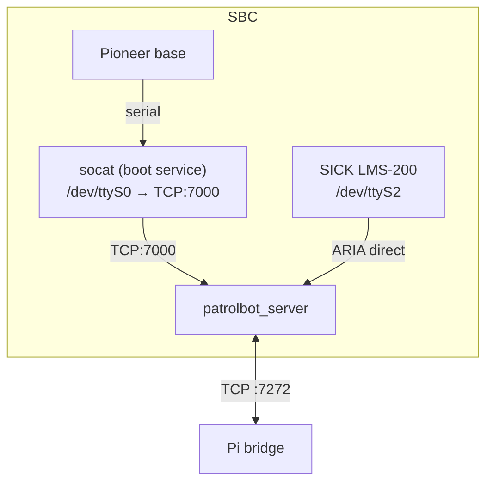

# patrolbot_hw_server (SBC)

The SBC's entire robot software: one C++ program, `patrolbot_server`, that speaks ARIA to the
hardware and a plain-text protocol to the Pi. It is **not a ROS package** — just a `Makefile`
project linked against ARIA.

!!! info "SBC source and live verification"
    On 2026-07-22 the system units, user server unit, single TCP client,
    deployed source/binary checksums, and live stationary telemetry were
    revalidated. The commissioned server keeps motors disabled at startup and
    exposes separate, idempotent charge-release and motor-enable operations.

| | |
|---|---|
| **Deploys to** | **SBC** (robot main PC; Pi endpoint `10.0.0.1:7272`, lab SSH may be `172.20.87.231`) |
| **Build** | `Makefile` (`g++ -I/usr/local/Aria/include -lAria -lArNetworking -lpthread`) |
| **Binary** | `patrolbot_server` (32-bit i386 executable; deployed atomically from a tested candidate) |
| **Source** | `hardware/patrolbot_hw_server/` in this repository; deployed to `~/patrolbot_hw_server/` on the SBC |
| **Runs ROS 2?** | **No** |

## Purpose

Be the robot's hardware data source. Connect ARIA to the Pioneer base and the SICK laser, enable
sonar, keep motors disabled until a deliberate control request succeeds, stream telemetry to the
Pi, and accept drive and bounded hardware-control requests back. Nothing on the SBC participates
in navigation — that all lives on the Pi.

## Interfaces

This program's "public interface" is the [TCP wire
protocol](../architecture/communication-architecture.md), not ROS:

| Direction | Line | Rate |
|---|---|---|
| SBC → Pi | `ODOM:x,y,th,vx,vth|LASER:r1,...,rN` | ~20 Hz |
| SBC → Pi | `AUX:SONAR=..|BATT=..|FLAGS=flags,faultFlags,stallValue,motorsEnabled,eStopPressed` | ~4–5 Hz (every 5th nav frame) |
| Pi → SBC | `DRIVE:linear:angular` | on demand |
| Pi → SBC | `CHARGE_RELEASE:request_uuid` / `MOTOR_ENABLE:request_uuid` | deliberate request only |
| SBC → Pi | `ACK:...` / `RESULT:...` | correlated control response |

Units are converted from ARIA's mm/deg to m/rad **before** sending.

## Internal architecture



- **ARIA connections:** `ArRobotConnector` to the base (routed through the socat TCP bridge with
  `-rh 127.0.0.1 -rrtp 7000`), `ArLaserConnector` to the SICK on `/dev/ttyS2`. Sonar is enabled and
  motors are explicitly disabled at startup.
- **Telemetry build:** each section is assembled defensively under `robot.lock()`. The `AUX` line
  is emitted as a **separate, independent** line every 5th nav frame so an AUX build/parse problem
  can never disturb the navigation-critical `ODOM|LASER` line.
- **Server loop:** single-client. An outer `while (robot.isRunning())` loop wraps `accept()`, so
  the server re-accepts automatically after each Pi disconnect.
- **Self-healing:** a consecutive-`EAGAIN` guard (~3 s) plus `SO_KEEPALIVE` + `TCP_USER_TIMEOUT
  = 5000 ms` detect a silently-gone Pi and break to re-`accept()` promptly (instead of spinning on
  a full send buffer for minutes).
- **Command watchdog:** if no `DRIVE` arrives for 750 ms, the server commands zero velocity. It also
  stops the base on Pi disconnect before accepting the next client.
- **Motor policy:** `DRIVE` never enables motors. Only a canonical-UUID `MOTOR_ENABLE` request can
  call ARIA `enableMotors()`, and it is rejected unless the robot is stationary, charge state is
  zero, the E-stop is clear, telemetry is valid, and fault flags are zero.
- **Charge release:** `CHARGE_RELEASE` disables motors if necessary, confirms them stably off,
  sends µARCS command 68/argument 0 exactly once, and confirms stable charge state zero. It never
  sends velocity or enables motors. Reusing the same UUID replays the cached result instead of
  repeating the hardware action.
- **Stale laser handling:** stale cached SICK readings are not streamed as live data. When the laser
  is disconnected or stale, the server emits an empty `LASER:` field so the Pi safety path detects
  sensor loss.
- **Diagnostics:** the `FLAGS` section includes motors-enabled and e-stop state; a latched hardware
  e-stop cannot be overridden in software.

## Why the serial bridge (`socat`)?

The base and the ARIA server both wanted `/dev/ttyS0`, which is a single-holder device. A boot-time
`socat-boot.service` opens `/dev/ttyS0` once and exposes it as `TCP:7000`; the ARIA server then
reaches the base over that socket (`-rrtp 7000`) rather than contending for the serial device. This
resolves the serial conflict cleanly.

## Deployment

| Service | Type | Role |
|---|---|---|
| `patrolbot-wired-ip.service` | systemd **system** | keep `10.0.0.1/24` applied to `enp2s5` with `Restart=always` |
| `socat-boot.service` | systemd **system** | bridge `/dev/ttyS0` → TCP:7000 at boot |
| `patrolbot-server.service` | systemd **user** | run `patrolbot_server -rh 127.0.0.1 -rrtp 7000` at boot |

The user service needs `loginctl enable-linger ros` once to start without a login. The architecture
notes record this as done.

## Building (on the SBC)

```bash
cd ~/patrolbot_hw_server
make -B test               # mandatory: the SBC RTC can make mtimes unreliable
make -B patrolbot_server   # g++ ... -lAria -lArNetworking -lpthread
```

Do not execute a candidate beside the live server: port 7272 and the ARIA/socat path are
single-owner resources. Deployment uses a checksum-backed backup, atomic binary replacement, and
a restart of only `patrolbot-server.service`.

## Where to read more

- The protocol in full: [Communication Architecture](../architecture/communication-architecture.md).
- The Pi end: [`patrolbot_bridge`](patrolbot_bridge.md).
- Current open verification items: [Known Gaps](../known-gaps.md).
