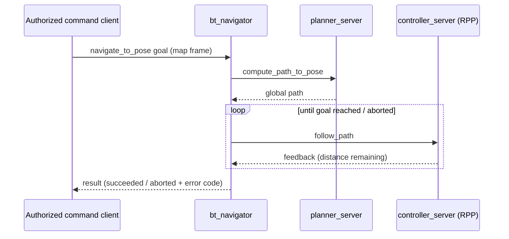

# ROS 2 Actions

PatrolBot exposes the standard [Nav2](https://docs.nav2.org/) actions plus one custom guarded
undock action. They are operator-facing autonomy entry points and can cause motion; listing an
action here is not authorization to call it.

## Primary navigation actions

| Action | Type | Server | Triggered by |
|---|---|---|---|
| `navigate_to_pose` | `nav2_msgs/action/NavigateToPose` | `bt_navigator` | reviewed local/dashboard client |
| `navigate_through_poses` | `nav2_msgs/action/NavigateThroughPoses` | `bt_navigator` | multi-pose runs |
| `follow_waypoints` | `nav2_msgs/action/FollowWaypoints` | `waypoint_follower` | patrol-style waypoint lists |



## Sub-actions used by the behavior tree

These are invoked by the behavior tree inside `bt_navigator`, not usually by an operator directly:

| Action | Type | Server | Role |
|---|---|---|---|
| `compute_path_to_pose` | `nav2_msgs/action/ComputePathToPose` | `planner_server` | global plan (NavFn) |
| `follow_path` | `nav2_msgs/action/FollowPath` | `controller_server` | local control (RPP) |
| `smooth_path` | `nav2_msgs/action/SmoothPath` | `smoother_server` | path smoothing |
| `spin` | `nav2_msgs/action/Spin` | `behavior_server` | recovery |
| `backup` | `nav2_msgs/action/BackUp` | `behavior_server` | recovery |
| `drive_on_heading` | `nav2_msgs/action/DriveOnHeading` | `behavior_server` | recovery |
| `wait` | `nav2_msgs/action/Wait` | `behavior_server` | recovery |

The generic Nav2 `docking_server`, `dock_robot`, and generic `undock_robot` actions are **not
launched**. They were removed from the active lifecycle graph because their velocity output bypassed
the safety chain.

## PatrolBot guarded undock

| Action | Type | Server | Current availability |
|---|---|---|---|
| `/patrolbot/undock` | `patrolbot_interfaces/action/Undock` | `patrolbot_dock_manager` | advertised but fail-closed while physical commissioning values remain unset |

The manager publishes no `Twist`. After checking the sole command path, fresh base/odom/sonar,
mapped bumpers, dock pose, localization, idle actions, charging state, and operator authorization,
it requests charge release and then invokes Nav2 `BackUp`. It never enables motors itself; a
separate operator action must satisfy the motor/E-stop window. The active configuration keeps
`dock_pose_configured=false` and bumper enforcement uncommissioned, so a production undock goal is
rejected before motion.

## Sending a goal

```bash
# Equivalent to RViz "Nav2 Goal"
ros2 action send_goal /navigate_to_pose nav2_msgs/action/NavigateToPose \
  "{pose: {header: {frame_id: map}, pose: {position: {x: 2.0, y: 1.0}, orientation: {w: 1.0}}}}"
```

!!! warning "Goals require the navigation half to be active"
    Localization activates within seconds, but the navigation half (costmaps, planner, controller)
    is delayed ~20 s and becomes available after staged activation. A `navigate_to_pose` goal
    sent before then is rejected. Supplying an initial pose through an authorized local interface
    does **not** require the navigation half. See
    [Execution Flow](../architecture/execution-flow.md#nav2-staged-activation).

## Failure modes

- **"No valid trajectories" / goal aborts.** Historically caused by `local_costmap` updating at
  1 Hz while the controller ran at 5 Hz → "Costmap timed out waiting for update". Fixed by raising
  `local_costmap update_frequency` to 5.0. See [Debugging](../development/debugging.md).
- **Goal rejected immediately.** Navigation half not yet active (see warning above).
- **Robot "boxed in".** Laser shows obstacles within the footprint; the `collision_monitor`
  stop-box halts motion. Inspect `/scan` from the Pi 5 `patrolbot-bridge` container.
