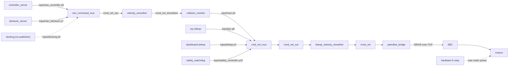

# Safety Chain

This page describes what stops PatrolBot and in what order. It is reference material: it states
what each layer does and what it cannot do.

The key words **MUST**, **MUST NOT**, and **SHOULD** are to be interpreted as described in
[RFC 2119](https://www.rfc-editor.org/rfc/rfc2119).

## The command path

Every velocity command reaches the motors through the same chain. Nothing bypasses it.

In words: Nav2's internal sources are arbitrated by a first mux, smoothed, and checked by the
collision monitor, which republishes the survivor as the *lowest-priority* input to the second
mux. That second mux picks one source overall. The winner is smoothed again, published on
`/cmd_vel`, forwarded by the bridge as a `DRIVE` line over TCP, and executed by the SBC. The
hardware E-stop cuts motor power downstream of all of it.

## Two muxes, not one

This is the part that most often causes confusion. `nav_command_mux` arbitrates *within* Nav2;
`cmd_vel_mux` arbitrates *between* Nav2, manual control, and safety.

!!! note "Package name versus node name"
    Both are instances of the `twist_mux` **package**. Older text on this site refers to "the
    twist_mux" — that means the node now named `cmd_vel_mux`. When reading parameters or node
    output, use the node names on this page.

### `nav_command_mux` — inside Nav2

Runs in the navigation container and publishes `/cmd_vel_nav`. All inputs have a 0.25 s timeout.

| Input topic | Priority | Source |
|---|---|---|
| `input/docking` | 9 | Docking — **no publisher** |
| `input/nav_behavior` | 7 | `behavior_server` (spin, back up, wait) |
| `input/nav_controller` | 5 | `controller_server` (path following) |

Everything leaving this mux still passes through the collision monitor before reaching the
second mux. A docking publisher would therefore outrank normal path following but would **not**
escape collision monitoring — unlike Nav2's own `docking_server`, which writes straight to the
base and is deliberately absent from the graph.

`/input/docking` has **zero publishers** and **MUST** remain publisher-free unless a publisher
has been reviewed against this chain.

### `cmd_vel_mux` — the main arbiter

Runs in the bringup container and publishes `/cmd_vel_out`. Higher priority wins; a source that
stops publishing releases its claim after its timeout.

| Input topic | Priority | Timeout (s) | Source |
|---|---|---|---|
| `input/safety_controller` | 10 | 0.2 | Safety watchdog |
| `input/joy` | 8 | 0.5 | Joystick |
| `input/teleop` | 7 | 1.0 | Dashboard deadman teleop (`patrolbot_web_bridge`) |
| `input/switch` | 6 | 1.0 | Mode switching |
| `input/navi` | 5 | 1.0 | All of Nav2, via the collision monitor |

Two consequences matter operationally:

- **The joystick outranks all of Nav2 — and the dashboard teleop.** Picking up the controller
  takes ownership mid-goal, regardless of which Nav2 source was driving; with both manual
  channels held, `input/joy` (8) wins over `input/teleop` (7).
- **The watchdog outranks everything.** When it publishes a stop, nothing else can drive.

The joystick's 0.5 s timeout sits just above the teleop receiver's 0.4 s watchdog, so once its
final zero lands, manual ownership releases promptly without reviving a prior Nav2 goal.

The dashboard channel is the same deadman shape at a lower priority: the Pi-side
`patrolbot_web_bridge` publishes `input/teleop` only while the browser deadman is held and zeroes
it within 0.3 s of the last frame. Like the joystick it can move the robot while localization is
held, because `patrolbot_bridge` admits manual `DRIVE` on fresh deadman evidence; unlike the
joystick it never outranks it.

## Collision monitor

The collision monitor sits between Nav2 and the mux, reading `/cmd_vel_smoothed` and publishing
to `input/navi`. It only governs Nav2 motion; it does not filter joystick or teleop commands.

It selects a polygon based on the **commanded velocity**, so protection follows the direction of
travel:

| Polygon | Source | `min_points` | Governs |
|---|---|---|---|
| `front_velocity_stop` | `/scan` | 8 | Forward and rotating motion |
| `rear_velocity_stop` | `/sonar` | 1 | Reverse motion |

Each polygon defines three velocity bands — `rotation_or_stopped` (±0.01 m/s), `forward`
(0.01 to 0.26 m/s), and `reverse` (−0.26 to −0.01 m/s). The bands share their boundaries so
selection is deterministic at the edges.

The design lets a front-docked robot reverse away from the dock wall without disabling front
safety: during reverse, the wall ahead falls outside the selected front zone, while rotation or
forward motion immediately restores the full front envelope.

### Settings that MUST NOT change

`base_shift_correction` **MUST** remain `False`. With `True`, the collision monitor looks up
`laser_frame` → `odom` at each scan's exact timestamp. After a bridge or SBC reconnect there is
a brief TF gap, so a scan can arrive stamped earlier than the rebuilt TF cache, raising
`tf2::BackwardExtrapolationException`. The collision monitor does not wrap this in a message
filter, so the uncaught throw SIGABRTs the entire composed `nav2_container` — every Nav2 node
dies at once. `False` uses the latest transform instead, which at this robot's 0.26 m/s top
speed costs about 1 cm of motion per scan.

`source_timeout` **MUST NOT** be zero for either source. Both automatic-motion sources are
fail-closed: at ~20–25 Hz for `/scan` and ~5 Hz for `/sonar`, 0.5 s tolerates one missed sonar
period but stops after roughly two to three missed samples.

## Safety watchdog

`patrolbot_safety_watchdog` runs at 10 Hz and claims the highest mux priority when any of its
conditions trip. It is the layer that reacts to *missing* data rather than to obstacles.

| Parameter | Value | Trips when |
|---|---|---|
| `scan_timeout` | 0.5 s | `/scan` goes stale |
| `odom_timeout` | 0.5 s | `/odom` goes stale |
| `base_state_timeout` | 0.75 s | SBC base state goes stale |
| `battery_timeout` | 1.0 s | `/battery` goes stale |
| `battery_stop_voltage` | 23.0 V | Battery falls to or below this |
| `stop_on_estop` | `True` | E-stop is asserted |
| `stop_on_faults` | `True` | The base reports a fault |

Because the SBC is the source of `/scan`, `/odom`, `/battery`, and base state, losing the SBC
link trips several of these at once. That is intended: the robot holds still through the
highest-priority mux input until fresh data returns.

!!! warning "Bumper enforcement is disabled"
    `bumper_enforcement_enabled` is `False` in the deployed configuration. Bumper contact does
    **not** stop the robot through this watchdog. Do not rely on bumpers as a protective layer.

The costmap layer applies the same 0.5 s staleness rule independently
(`expected_update_rate: 0.5` on the scan observation source), so a stale laser both stops the
robot and prevents planning on an old obstacle snapshot. This duplication is deliberate defence
in depth and **SHOULD NOT** be removed.

## Velocity limits

There are **two** velocity smoothers with different limits, and they bound different paths.
Confusing them leads to wrong conclusions about how fast the robot can move.

`velocity_smoother` sits inside the Nav2 path only, between the controller and the collision
monitor:

| Limit | Linear x | Angular z |
|---|---|---|
| Maximum velocity | 0.26 m/s | 1.0 rad/s |
| Minimum velocity | −0.26 m/s | −1.0 rad/s |
| Maximum acceleration | 2.5 m/s² | 3.2 rad/s² |
| Maximum deceleration | −2.5 m/s² | −3.2 rad/s² |

`teleop_velocity_smoother` is the final stage, downstream of the mux, so it bounds **every**
source including the joystick:

| Limit | Linear x | Angular z |
|---|---|---|
| Maximum velocity | 0.3 m/s | 0.7 rad/s |
| Minimum velocity | −0.3 m/s | −0.7 rad/s |
| Maximum acceleration | 1.0 m/s² | 1.5 rad/s² |
| Maximum deceleration | −1.4 m/s² | −2.0 rad/s² |

The effective limits are therefore the tighter of the two at each stage:

- **Nav2 motion:** 0.26 m/s linear (capped upstream), 0.7 rad/s angular (capped downstream —
  Nav2's own 1.0 rad/s is never reached).
- **Manual motion:** 0.3 m/s linear and 0.7 rad/s angular, with the gentler teleop
  acceleration profile.

The robot is non-holonomic; the y axis is unused and its limits are zero.

## Hardware E-stop

The single hardware E-stop cuts motor power directly. It sits below every software layer on
this page:

- Software **cannot** override it.
- Software **cannot** clear it.
- Recovery requires a physical `PWR ON` action at the robot.
- Motors additionally require an explicit enable afterwards. A `DRIVE` line cannot enable
  motors — the robot does not silently return to a drivable state.

The E-stop is the only layer that removes power rather than commanding zero velocity. Every
other stop on this page leaves the motors energized and holding.

## What this chain does not protect against

- Obstacles outside the laser plane, for any Nav2 motion (see
  [Limitations](../reference/limitations.md)).
- Anything at all during direct manual driving, beyond the velocity limits — joystick commands
  do not pass through the collision monitor.
- Bumper contact, while `bumper_enforcement_enabled` is `False`.

<!-- SPDX-License-Identifier: Apache-2.0 -->
