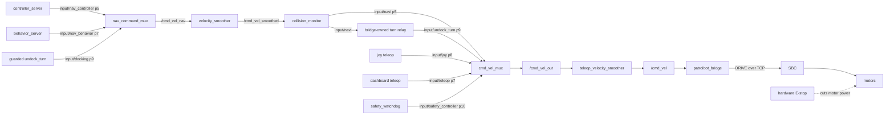

# Safety Chain

This page describes what stops PatrolBot and in what order. It is reference material: it states
what each layer does and what it cannot do. Values below describe checked-in defaults, not
readback or physical acceptance of a particular robot.

The key words **MUST**, **MUST NOT**, and **SHOULD** are to be interpreted as described in
[RFC 2119](https://www.rfc-editor.org/rfc/rfc2119).

## The command path

Ordinary `DRIVE` and the Pi-owned undock turn share the final mux, smoother and bridge.
Exclusive SBC undock moves the wheels directly with its own guards; it does not use ROS velocity topics.

In words: Nav2's internal sources are arbitrated by a first mux, smoothed, and checked by the
collision monitor, which republishes the survivor as the *lowest-priority* input to the second
mux. That second mux picks one source overall. The winner is smoothed again, published on
`/cmd_vel`, forwarded by the bridge as a `DRIVE` line over TCP, and executed by the SBC. The
hardware E-stop cuts motor power downstream of all of it.

## Two muxes, not one

This is the part that most often causes confusion. `nav_command_mux` arbitrates *within* Nav2;
`cmd_vel_mux` arbitrates *between* Nav2, manual control, and safety.

!!! note "Package name versus node name"
    Both are instances of the `twist_mux` **package**. Older text on this site refers to "the
    twist_mux" — that means the node now named `cmd_vel_mux`. When reading parameters or node
    output, use the node names on this page.

### `nav_command_mux` — inside Nav2

Runs in the navigation container and publishes `/cmd_vel_nav`. All inputs have a 0.25 s timeout.

| Input topic | Priority | Source |
|---|---|---|
| `input/docking` | 9 | Guarded `undock_turn` owned turn |
| `input/nav_behavior` | 7 | `behavior_server` (spin, back up, wait) |
| `input/nav_controller` | 5 | `controller_server` (path following) |

Everything leaving this mux still passes through the collision monitor before reaching the
second mux. The guarded undock publisher therefore outranks normal path following but does **not**
escape collision monitoring — unlike Nav2's own `docking_server`, which writes straight to the
base and is deliberately absent from the graph.

Guarded `undock_turn` publishes to `/input/docking`. Automatic dock-in remains parked and
unlaunched. Any additional publisher **MUST** be reviewed against this chain.

### `cmd_vel_mux` — the main arbiter

Runs in the bringup container and publishes `/cmd_vel_out`. Higher priority wins; a source that
stops publishing releases its claim after its timeout.

| Input topic | Priority | Timeout (s) | Source |
|---|---|---|---|
| `input/safety_controller` | 10 | 0.2 | Safety watchdog |
| `input/undock_turn` | 9 | 0.25 | Bridge relay of collision-filtered owned Spin only |
| `input/joy` | 8 | 0.5 | Joystick |
| `input/teleop` | 7 | 1.0 | Dashboard deadman teleop (`patrolbot_web_bridge`) |
| `input/switch` | 6 | 1.0 | Mode switching |
| `input/navi` | 5 | 1.0 | All of Nav2, via the collision monitor |

Two consequences matter operationally:

- **The joystick outranks ordinary Nav2 and dashboard teleop.** `input/joy` (8) wins over
  `input/teleop` (7); the bridge supervises and revokes the exclusive Pi-owned turn on foreign
  nonzero motion input rather than letting it compete.
- **The watchdog outranks every final-mux source.** Its zero is still an input to the final
  smoother, not a direct cut of motor power.

The joystick's 0.5 s timeout sits just above the teleop receiver's 0.4 s watchdog, so once its
final zero lands, manual ownership releases promptly without reviving a prior Nav2 goal.
The controller receiver requires a newly timestamped neutral report before another RB press
can start input after startup, a receiver outage, an invalid report, an SBC connection change, or a reported
hardware E-stop or fault. A reconnect discards temporary controller trims and restores the
configured defaults, still bounded by the configured caps. An ordinary trim change while RB
is held affects the proportional ramp target, not the deadman or the hardware ceilings.

The dashboard channel is the same deadman shape at a lower priority: the Pi-side
`patrolbot_web_bridge` publishes `input/teleop` only while the browser deadman is held and zeroes
it within 0.3 s of the last frame. Like the joystick it can move the robot while localization
is held, because `patrolbot_bridge` admits manual `DRIVE` on fresh deadman evidence
(0.5 s); this bypass still needs usable LiDAR, known origin, fresh raw odometry and no
incompatible motion, tuning or unresolved mutation owner. The optional dashboard service
ships with commands disabled by default.

## Collision monitor

The collision monitor sits between Nav2 and the mux, reading `/cmd_vel_smoothed` and publishing
to `input/navi`. It only governs Nav2 motion; it does not filter joystick or teleop commands.

Each polygon selects its shape from the **incoming** `/cmd_vel_smoothed` command,
not measured `/odom`, Collision Monitor output, or the command sent to hardware. These are
`base_link` coordinates in metres; every shape spans −0.30 to +0.30 m laterally.

| Commanded linear x (m/s) | Scan stop x range (8 points) | Sonar stop x range (1 point) |
|---|---|---|
| `rotation_or_stopped`: −0.01 to +0.01 | −0.30 to +0.30 | −0.30 to +0.30 |
| `forward`: +0.01 to +0.26 | −0.30 to +0.30 | +0.20 to +0.55 (rear sonar cannot see this area) |
| `reverse`: −0.26 to −0.01 | −0.55 to −0.20 | −0.55 to −0.20 |

All bands cover ±1.0 rad/s before the final clamp; the first match wins at ±0.01 m/s
(`rotation_or_stopped`). In [Nav2 1.3.12's selector](https://github.com/ros-navigation/navigation2/blob/1.3.12/nav2_collision_monitor/src/velocity_polygon.cpp),
an unmatched command warns and leaves the previous shape in place (or unset at startup);
it is **not** an out-of-envelope stop. Keep the full upstream command range covered.

Both smoothers run at 20 Hz in `OPEN_LOOP` (last smoothed command, not odometry).
Their input timeouts are 1.0 s for Nav2 and 0.5 s for the final stage. A lower or zero
command, reversal, or handoff can select a different zone while the final smoother
and the base are still slowing in the previous direction. For example, the reverse
field contracts at −0.01 m/s commanded, regardless of measured speed. The baseline
has no longer forward field for higher speeds. A monitor zero is not proof of physical
stop, and switching a smoother to odometry feedback alone would not change the monitor's
selection input. The +0.30 m edge is only 0.045 m beyond the configured unpadded +0.255 m
footprint; that difference is not a reliable detection or stopping distance.

### Settings that MUST NOT change

`base_shift_correction` **MUST** remain `False`. With `True`, the collision monitor looks up
`laser_frame` → `odom` at each scan's exact timestamp. After a bridge or SBC reconnect there is
a brief TF gap, so a scan can arrive stamped earlier than the rebuilt TF cache, raising
`tf2::BackwardExtrapolationException`. The collision monitor does not wrap this in a message
filter, so the uncaught throw SIGABRTs the entire composed `nav2_container` — every Nav2 node
dies at once. `False` uses the latest transform instead, which at this robot's 0.26 m/s top
speed costs about 1 cm of motion per scan.

`source_timeout` **MUST NOT** be zero for either source. Missing, stale or untransformable
data from either enabled source forces a zero when the monitor processes a Nav2 command,
regardless of direction. Global and per-source limits are 0.5 s. A fresh empty sonar cloud or scan
without usable returns does **not** certify clear space. The scan is filtered below
0.10 m and has blind regions; sonar is sparse and has a known rear-right gap.

## Safety watchdog

`patrolbot_safety_watchdog` runs at 10 Hz and claims the highest mux priority when any of its
conditions trip. It is the layer that reacts to *missing* data rather than to obstacles.

| Parameter | Value | Trips when |
|---|---|---|
| `scan_timeout` | 0.5 s | `/scan` goes stale |
| `odom_timeout` | 0.5 s | `/odom` goes stale |
| `base_state_timeout` | 0.75 s | SBC base state goes stale |
| `battery_timeout` | 1.0 s | `/battery` goes stale |
| `battery_stop_voltage` | 23.0 V | Battery falls below this or is non-finite |
| `stop_on_estop` | `True` | E-stop is asserted |
| `stop_on_faults` | `True` | The base reports a fault |

Because the SBC is the source of `/scan`, `/odom`, `/battery`, and base state, losing the SBC
link trips several of these at once. That is intended: the robot holds still through the
highest-priority mux input until fresh data returns.

!!! warning "Bumper enforcement is disabled"
    `bumper_enforcement_enabled` is `False` in the shipped configuration. Bumper contact does
    **not** stop the robot through this watchdog. Do not rely on bumpers as a protective layer.

Both costmaps use `/scan` with `expected_update_rate: 0.5` seconds (not Hz); stale observations
mark the obstacle layer not current. The log-throttling patch does not change that decision.
This is separate from *map-cell* policy: NavFn has `allow_unknown: true` and neither costmap
overrides Jazzy's `track_unknown_space: false` default. A plan through an unknown cell, or a
cleared costmap during recovery, is not evidence of fresh sensors or physical clearance.

The bridge additionally holds autonomous `DRIVE` for unready navigation/LiDAR, stale odometry,
unknown origin and unresolved map, tuning or undock ownership. A lost undock terminal result
is not permission to hand motion back. The SBC rejects ordinary nonzero `DRIVE` unless its own
hardware and dock gates agree; it stops on disconnect or after 0.75 s without commands.
Exclusive undock has its own independent lease watchdog. These timers are not additive,
nor are they physical stopping-time guarantees.

## Velocity limits

There are **two** velocity smoothers with different limits, and they bound different paths.
Confusing them leads to wrong conclusions about how fast the robot can move.

`velocity_smoother` sits inside the Nav2 path only, between the controller and the collision
monitor:

| Limit | Linear x | Angular z |
|---|---|---|
| Maximum velocity | 0.26 m/s | 1.0 rad/s |
| Minimum velocity | −0.26 m/s | −1.0 rad/s |
| Maximum acceleration | 2.5 m/s² | 3.2 rad/s² |
| Maximum deceleration | −2.5 m/s² | −3.2 rad/s² |

`teleop_velocity_smoother` is the final stage, downstream of the mux, so it bounds **every**
mux source including the joystick:

| Limit | Linear x | Angular z |
|---|---|---|
| Maximum velocity | 0.3 m/s | 0.7 rad/s |
| Minimum velocity | −0.3 m/s | −0.7 rad/s |
| Maximum acceleration | 1.0 m/s² | 1.5 rad/s² |
| Maximum deceleration | −1.4 m/s² | −2.0 rad/s² |

The source-specific limits are not interchangeable:

| Producer | Checked-in command limits and scope |
|---|---|
| Ordinary RPP `FollowPath` | 0.22 m/s cruise target (not a hard cap; route `SpeedLimit` can change the request), reversing disabled, 0.90 rad/s rotate-to-heading target. RPP's own collision check is disabled; the separate native RPP output cap ships **off**. Nav smoothing caps at 0.26 m/s and 1.0 rad/s before Collision Monitor. |
| Nav2 behaviors | Both shipped trees request a 0.10 m `BackUp` at 0.05 m/s; this is a recovery request, not a general reverse-velocity cap. `Spin` caps at 0.70 rad/s; `DriveOnHeading` is also loaded, separate from RPP. All behavior commands pass through Nav smoothing and Collision Monitor. |
| Physical controller | ±0.30 m/s and ±0.70 rad/s stick ceilings (trim may lower them); RB deadman, 0.4 s receiver timeout, then final mux/smoother. No Collision Monitor obstacle filtering. |
| Dashboard deadman | ±0.30 m/s and ±0.70 rad/s per the web contract (`contracts/web-teleop.json`), 0.3 s producer zero watchdog, below joystick priority, no Collision Monitor obstacle filtering. Not the dashboard Undock action. |
| Guarded dashboard/manager Undock | SBC contact separation requests 0.53 m at 0.10 m/s reverse (45 s Pi backstop). After confirmed clear handoff, the bridge owns a pure-angular Nav2 `Spin` (0.70 rad/s, 20 s), relaying through `/input/docking` and then the **filtered** `/input/navi` output to `/input/undock_turn`. Generic `docking_server` stays unlaunched. |
| Physical controller Start Undock | Separate SBC operation: fixed 0.53 m at 0.10 m/s reverse, then local encoder-based turn capped at 0.70 rad/s. It does not require AMCL/Nav2 or go through either ROS smoother; see [Controller manual undocking](../operations/controller-undocking.md). |

For ordinary `DRIVE`, the final smoother and bridge cap angular output at 0.70 rad/s;
an active tuning policy can narrow the bridge's symmetric linear and angular bounds.
The shared `/cmd_vel` Twist and ordinary `DRIVE` line do not carry authenticated
producer identity. Neither a shared clamp nor fresh deadman evidence can establish
that a command came from ordinary autonomous path following.
The Pi-owned turn bypasses the tuning clamp, not the final smoother or the SBC interlock.
The SBC's ordinary `DRIVE` message rejection ceilings (±0.30 m/s, ±1.20 rad/s) are
backstops, not additional permission. Lateral speed is zero in both smoothers. During a
handoff, inspect the final smoother's retained output, not just the new producer's ceiling.

## Hardware E-stop

The single hardware E-stop cuts motor power directly. It sits below every software layer on
this page:

- Software **cannot** override it.
- Software **cannot** clear it.
- Recovery requires a physical `PWR ON` action at the robot.
- Motors additionally require an explicit enable afterwards. A `DRIVE` line cannot enable
  motors — the robot does not silently return to a drivable state.

The E-stop cuts power independently of software. A mux or monitor stop requests zero velocity;
it does not disable the motors. The SBC can also disable motors on control or fault paths.

## What this chain does not protect against

- Obstacles outside the laser plane, for any Nav2 motion (see
  [Limitations](../reference/limitations.md)).
- Automatic obstacle avoidance for direct joystick or dashboard teleop; the watchdog and
  hardware interlocks are not substitutes for Collision Monitor.
- Bumper contact, while `bumper_enforcement_enabled` is `False`.

## Coordinated review and rollback checklist

1. **Record the baseline tuple.** Save Pi revision/image digest, resolved startup and active
   parameters (including tuning revision), exact Nav2 packages, SBC binary/firmware and profile
   identity, and dashboard revision. Compare the actual publisher graph, lifecycle state and
   parameter readback with this page. Do not infer deployment from the source tree.
2. **Review each owner separately.** Compare ordinary forward/turn, recovery reverse, both
   deadmen, and both undock variants. Preserve priorities, limits, freshness and stop gates.
   Run the [portable safety contract](../development/testing.md#portable-regression-runner)
   and use the existing isolated Collision Monitor,
   recovery/closed-loop, outage and undock tests for runtime checks. Include missed/late inputs,
   lost terminal replies, reconnects, and owner handoffs; a mixed revision is not a pass.
3. **Require transition evidence.** On a common timebase, compare `/cmd_vel_smoothed`, selected
   polygon and monitor state, `/input/navi`, final `/cmd_vel`, SBC request and independently
   verified speed/stop. Check deceleration into a shorter band, zero, direction reversal, and
   manual-to-auto handoff; cover straight and curved swept footprints. Any future wider
   envelope would need an explicit safe treatment for unmatched commands and stale, invalid,
   implausible or missing measured motion; never contract a field based on unproven slowdown.
4. **Use evidence from this unit.** Verify sensor coverage, detection-to-brake delay and
   braking distance on this robot under approved conditions. The offline stop budget
   (`diagnostics/navigation/README.md`) helps review straight-line measurements.
   Study `b12f65e` records an unevaluated zone, not usable settings; a same-model
   benchmark cannot establish this unit's firmware, sensors or braking.
5. **Keep a matched rollback point.** Retain the previous Pi/SBC/dashboard tuple and matching
   startup/active policy. If readback, safety coverage or ownership is unknown, hold motion.
   A separately authorized rollback must restore and verify the whole tuple while stopped;
   it must not clear unknown ownership by timeout, enable motors or resume a prior goal.

<!-- SPDX-License-Identifier: Apache-2.0 -->
